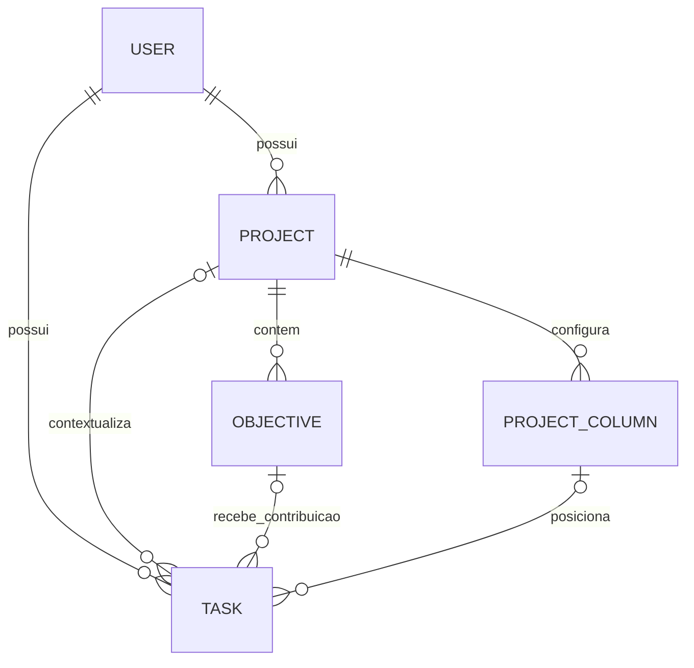

# Projetos — SPEC executável e plano de execução

Data: 2026-11-13. Status: design aprovado; implementação não iniciada.

Design e decisões aprovadas: [2026-11-13-projects-refactor-design.md](2026-11-13-projects-refactor-design.md). Esta SPEC substitui decisões anteriores apenas no escopo descrito. Os planos históricos permanecem intactos.

## 1. Problema, resultados e prova de sucesso

Projetos registra objetivos, mas não conecta suficientemente seus próximos passos à execução diária. O usuário precisa decidir o que fazer e quando, sem duplicar tarefas e sem transformar o Oriens em gestão empresarial.

Resultados observáveis:

1. Criar projeto simples sem configurar quadro, ou desenvolvimento com quadro pronto para uso.
2. Criar tarefa a partir de um objetivo ou diretamente no quadro, com vínculo de objetivo opcional.
3. Planejar uma tarefa para um dia e encontrá-la em Hoje/semana com o mesmo ID.
4. Concluir ou reabrir em qualquer superfície e obter a mesma situação após confirmação e nova consulta.
5. Reagendar execução sem alterar prazo final; distinguir pendência de planejamento de prazo ultrapassado.
6. Encontrar pendências anteriores e prazos relevantes sem duplicação nas listas de Hoje.
7. Operar quadro, editor e Hoje por teclado e toque, sem depender de arrastar.
8. Manter timeline e “agora”, inclusive quando não houver tarefas com horário.
9. Visualizar contagens coerentes, sem inferir alcance de objetivos a partir de tarefas concluídas.
10. Excluir projeto sem excluir tarefas; impedir acesso cruzado e sobrescrita silenciosa por clientes antigos.

Não há meta percentual de produtividade ou tempo economizado sem medição. A prova é comportamental: cenários da seção 15 e inspeção da seção 17.

## 2. Escopo e exclusões

### MVP

- Dois modos; criação e conversão simples → desenvolvimento.
- Cards, detalhe simples, quadro configurável, aba de objetivos e editor compartilhado.
- Tarefa avulsa ou pertencente a um projeto de desenvolvimento; vínculo opcional com um objetivo.
- Planejamento, horário e prazo independentes conforme invariantes; Hoje e semana adaptados.
- Colunas customizadas, ordenação de colunas e tarefas, destinos padrão, mover por menu e arrastar como atalho.
- Objetivos por ID e conclusão manual; contagens explícitas.
- Arquivar, excluir e desvincular com consequências visíveis.
- Persistência, API, autorização, concorrência, erros, lembretes e estatísticas afetados pelas novas datas.
- Schema novo e procedimento futuro de backup/reset do banco completo.

### Fora do escopo

Colaboração, permissões de equipe, sprints, dependências entre tarefas, subtarefas, marcos como entidade, metas numéricas automáticas, IA, geração automática de passos, automações de quadro, estimativas de duração, disponibilidade calculada, recorrência de tarefas, histórico completo de movimentações, sincronização em tempo real por socket, modo offline, conversão desenvolvimento → simples e migração de registros antigos.

As adaptações em estatísticas, notificações e Todos os dados são compatibilidade necessária, não redesign dessas features. Finanças, usuários e suporte não ganham funcionalidades, embora seus registros sejam atingidos por um reset completo.

## 3. Comportamento atual e mapa de impacto

Base: `1418930369cfc93f5d2ab67d2960dd1d20cda7a5`. Working tree estava limpo na investigação.

| Área e responsáveis atuais | Leitores/escritores e contrato | Implicação |
| --- | --- | --- |
| `entity/Project.java`, `entity/embeddable/Objective.java` | `@ElementCollection` de objetivos sem ID nem `@OrderColumn`; `completed`, `status`, `dueDate` | Índice não é identidade durável; dois campos discordam sobre conclusão |
| `ProjectServiceImpl`, `ProjectController` | PATCH/PUT/DELETE `/project/{id}/objective/{index}`; PUT de projeto pode substituir a coleção | Status alterna `completed`; editar título/data também alterna `completed`; operações não são idempotentes |
| `ProjectCard`, `ProjectDetailPage`, `CreateProjectDialog`, `ProjectsDataTable` | Índice original preservado ao filtrar; contagem por status; progresso recebido do backend | Substituir índice por ID e garantir progresso/contagem da mesma base |
| `entity/Task.java`, `TaskDTO`, `TaskResponseDTO` | ID próprio, `dueDate`, `startTime` obrigatório na entidade; sem projeto/objetivo/coluna; sem versão | Reutilizar identidade de Task; permitir datas/horário nulos e vínculos opcionais |
| `TaskServiceImpl`, `TaskController` | GET por dia/range de `dueDate`; PUT recebe entidade inteira | Separar agenda de prazo, usar DTO de escrita e evitar perda de alterações |
| `DashboardPage.tsx`, `WeekView`, `lib/tasks.ts` | Dia/range por `dueDate`, períodos e ordenação por `startTime` | Agenda passa a usar `plannedDate`; criar tratamento explícito sem horário |
| `DayLine.tsx`, `TaskRow`, `TaskChip`, diálogos | Acesso direto a strings de horário; PUT inteiro para conclusão | Guardar nulos; compartilhar mutação; preservar timeline e foco |
| `TaskRepository`, `StatisticsService`, resumo semanal | Data de agenda e consultas de atraso usam `dueDate`; conclusão diária usa `completedAt` | Dar nome e semântica corretos a cada consulta |
| `NotificationScheduler` | Lembrete usa `dueDate + startTime`; atraso usa `dueDate` e apenas PENDING; relógio do servidor | Usar planejamento para início, prazo para atraso e fuso único |
| Segurança | JWT autentica; checagem de proprietário em favorito/arquivamento, ausente em vários métodos de tarefas/projetos | Aplicar escopo do principal em toda operação afetada |
| Concorrência | Sem `@Version`; frontend com estados locais e callbacks de refresh | Introduzir versão e invalidar consultas compartilhadas após mutações |
| Persistência | PostgreSQL/JPA; SQL V1 existente, mas sem Flyway/Liquibase no `pom.xml`; dev usa `create`, produção `update` | Não presumir execução de migrations; definir baseline SQL explícita e validação |

Stack a preservar: React 18, TypeScript, Vite 5, Tailwind 3, Radix/shadcn, date-fns 3, Axios, TanStack Query 5 já instalado/provido; Java 17, Spring Boot 3.5, JPA e PostgreSQL. Não há dependência de drag-and-drop instalada.

Testes existentes úteis: `project-card-objective-index`, `project-detail-duedate`, `project-detail-a9-dialogs`, `projects-page-delete`, `task-row-status`, `task-chip`, `dashboard-period-grouping`, `dashboard-description`, `day-line-motion`, `week-view`, validação de formulários; serviços/repositórios de tarefas e E2E de projetos/tarefas/semana. Eles caracterizam contratos atuais, não provam ainda a nova feature.

## 4. Vocabulário e domínio

- **Projeto:** contexto pessoal de trabalho, de um proprietário, com modo simples ou desenvolvimento.
- **Objetivo:** resultado que o usuário quer alcançar, com prazo opcional e conclusão manual. “Meta” é sinônimo de linguagem cotidiana, não outra entidade. “Marco” não é necessário no MVP.
- **Tarefa:** ação concreta executável, avulsa ou de um projeto de desenvolvimento. Exemplo: objetivo “Receber contatos pelo site”; tarefa “Montar formulário”.
- **Coluna:** localização da tarefa no quadro, com nome e significado. A ordem das colunas não impõe sequência obrigatória.
- **Planejamento:** intenção de executar em uma data. Não é um segundo registro de tarefa e não é prazo.



### Persistência proposta

Nomes físicos finais devem seguir o mapeamento real validado no PostgreSQL; nomes abaixo fixam o contrato lógico.

| Registro | Campos relevantes |
| --- | --- |
| Project | `id`, `userId`, `title`, `description?`, `color?`, `imageUrl?`, `mode: SIMPLE\|DEVELOPMENT`, `favorite`, `archived`, `lastAccessed?`, `defaultPendingColumnId?`, `defaultCompletedColumnId?`, `version` |
| Objective | `id`, `projectId`, `title`, `dueDate?`, `status: PENDING\|CONCLUDED`, `position`, `version` |
| ProjectColumn | `id`, `projectId`, `name`, `kind: PENDING\|ON_DOING\|CONCLUDED\|CANCELLED`, `position`, `version` |
| Task | `id`, `userId`, `projectId?`, `objectiveId?`, `columnId?`, `position?`, `title`, `description?`, `plannedDate?`, `startTime?`, `dueDate?`, `priority`, `status: PENDING\|ON_DOING\|CONCLUDED\|CANCELLED`, `completedAt?`, `createdAt`, `version` e campos existentes de localização/lembretes |

Preservar nomes enum existentes `PENDING`, `ON_DOING`, `CONCLUDED`; acrescentar `CANCELLED`. Não reutilizar esse enum estendido como estado de objetivo: objetivo é resultado pendente/concluído, sem semântica de fluxo de trabalho.

`Task.status` é o estado canônico de execução, inclusive quando a tarefa fica avulsa. `columnId` especifica posição mais detalhada dentro desse estado. O backend mantém `task.status == column.kind` em toda escrita vinculada; o cliente nunca atualiza esses dados em requisições independentes. Não há cópia de status em Hoje nem tarefa específica do Kanban.

### Invariantes obrigatórias

1. IDs de tarefa e objetivo são estáveis e independentes da posição visual.
2. Proprietário de tarefa, projeto, objetivo e coluna vinculados é o mesmo usuário autenticado.
3. `projectId == null` implica `objectiveId == null`, `columnId == null`, `position == null`.
4. Tarefa com projeto exige projeto DEVELOPMENT e coluna pertencente a esse projeto.
5. Objetivo vinculado pertence ao mesmo projeto da tarefa; vínculo é opcional.
6. Projeto SIMPLE não tem quadro nem tarefas vinculadas.
7. Projeto DEVELOPMENT tem ao menos uma coluna PENDING e uma CONCLUDED; padrões apontam para colunas correspondentes do próprio projeto.
8. Nome de coluna não determina `kind`. Backlog pode ser PENDING; Em teste, ON_DOING; Bloqueadas pode ter qualquer dos dois significados ativos, escolhido pelo usuário.
9. `startTime != null` exige `plannedDate != null`. Remover planejamento remove horário na mesma transação; preserva prazo.
10. Tarefa CONCLUDED tem `completedAt`; qualquer outro status tem `completedAt == null`. Repetir conclusão já aplicada não muda a data de conclusão.
11. Objetivo tem um único estado; remover `completed` como campo independente do novo schema. Progresso simples deriva do status dos mesmos objetivos.
12. Contagens são derivadas de dados autorizados; canceladas não integram o denominador ativo, mas permanecem consultáveis.
13. Nenhuma operação de projeto ou coluna exclui tarefas implicitamente.

### Colunas, ordem e concorrência estrutural

Criação de desenvolvimento é atômica: projeto + A fazer/PENDING + Fazendo/ON_DOING + Concluídas/CONCLUDED + padrões. Conversão cria o mesmo conjunto, sem converter objetivos em tarefas; repetir a conversão não duplica colunas.

Usar posições inteiras com desempate por ID. Mover insere antes de um ID do destino ou ao final; o servidor recalcula as posições das colunas afetadas. Reordenar colunas recebe a lista completa de IDs, sem repetição. Não há ranking fracionário ou serviço próprio de ordenação.

Uma coluna vazia pode mudar de significado. Coluna ocupada precisa primeiro ter tarefas movidas para outra coluna; evitar reclassificar em lote trabalho como concluído/cancelado apenas por editar uma configuração. Ao excluir, escolher destino e mostrar quantas tarefas mudam e qual será o estado resultante. Se excluir padrão, definir substituto válido no mesmo pedido; impedir remover a última coluna PENDING/CONCLUDED.

## 5. Datas, fuso e critérios de exibição

### Semântica

| Campo | Tipo lógico/JSON | Regra |
| --- | --- | --- |
| plannedDate | LocalDate / `YYYY-MM-DD` ou null | Intenção de executar naquele dia |
| startTime | LocalTime / `HH:mm:ss` ou null | Horário local no dia planejado; não representa duração |
| dueDate | LocalDate / `YYYY-MM-DD` ou null | Prazo final inclusivo; ultrapassado quando anterior a hoje e tarefa ativa |
| completedAt | LocalDate / `YYYY-MM-DD` ou null | Data da transição efetiva para CONCLUDED no fuso do produto |
| createdAt | Instant / ISO 8601 com Z | Registro técnico de criação, não data de agenda |

Fuso único do MVP: `America/Recife`, aprovado pelo usuário. Relógio injetável no backend; frontend usa a mesma zona para determinar hoje, agora e mudança de dia, independentemente do fuso do dispositivo. Não adicionar seletor de fuso neste MVP. Alterá-lo futuramente exigirá decisão explícita sobre horários; as datas de calendário não devem mudar por conversão UTC.

Validar dias reais, inclusive bissextos: não confiar em `new Date(ano, mês, dia)` normalizando datas inválidas. Usar a biblioteca instalada e parsing estrito. Não enviar datas por `toISOString()`. Horário válido entre 00:00:00 e 23:59:59; interface edita minutos e envia segundos zero.

Prazo ultrapassado não é estado: tarefa pode estar Fazendo e com prazo ultrapassado. Planejamento passado não é prazo ultrapassado. Datas podem estar no passado, inclusive para recuperação; não bloquear. Planejamento posterior ao prazo exige aviso visível, não confirmação adicional. Objetivo tem seu próprio prazo; não impor prazo da tarefa menor que o do objetivo, nem propagar alterações entre eles.

### Partição de Hoje

Considere `D = hoje em America/Recife`, tarefa ativa = PENDING ou ON_DOING. Prioridade de classificação, por ID:

1. **Planejado para hoje:** ativa e `plannedDate == D`.
2. **Pendentes de dias anteriores:** ativa e `plannedDate < D`, excluindo IDs já classificados.
3. **Prazos que precisam de atenção:** ativa e `dueDate <= D`, excluindo IDs anteriores. Inclui tarefa planejada para uma data futura, sem antecipar seu planejamento.
4. **Concluídas:** CONCLUDED e `plannedDate == D`, recolhidas. Não entram nas três listas ativas.

CANCELLED fica fora dessas listas. CONCLUDED sem planejamento hoje não ganha planejamento por ter sido concluída no quadro. Nenhuma tarefa sem data e sem prazo aparece automaticamente em Hoje. Objetivos não são inseridos nessas listas.

Uma tarefa pode ter marca na timeline e linha na lista com o mesmo ID. A deduplicação se refere às listas de tarefas, não à representação na timeline.

Ordem: planejadas sem horário em seu bloco, por prioridade HIGH/MEDIUM/LOW e ID; com horário por hora, prioridade e ID. Pendências por dia planejado mais antigo, prioridade e ID. Atenção por prazo mais antigo, prioridade e ID. Mostrar o motivo e as datas, evitando chamar todas as pendências de “atrasadas”.

### Ações de planejamento

- **Fazer hoje:** define `plannedDate = D`, preserva prazo; retira horário antigo para não reutilizar inadvertidamente uma hora passada. O usuário pode definir outro horário.
- **Reagendar:** abre o mesmo editor de planejamento com a data anterior visível; usuário decide nova data/horário. Não modifica prazo automaticamente.
- **Retirar do planejamento:** limpa dia e horário; preserva tarefa, coluna, objetivo e prazo. Se prazo exigir atenção, a tarefa passa para essa seção.
- A quantidade já planejada exclui a tarefa em edição e canceladas; mostrar separadamente concluídas quando necessário. É contexto, não limite de capacidade.

### Outros dias e semana

Ao navegar para outra data, mostrar apenas planejamento daquele dia e suas concluídas; seções de recuperação/atenção são exclusivas de Hoje, para não inventar uma fotografia histórica. A semana usa `plannedDate`, preservando a convenção pt-BR atual de domingo a sábado; não mudar silenciosamente para a semana de segunda usada atualmente em outro resumo. Resumo retornado deve nomear seu intervalo explicitamente.

Semana inclui tarefas sem horário em cada dia, não repete tarefas de atenção em todos os dias e oferece link para Hoje revisar pendências. Navegar de volta mantém data/visão e posição quando possível.

## 6. Mudanças de estado e fonte única de verdade

| Operação | Regra |
| --- | --- |
| Concluir vinculada em Hoje | Definir CONCLUDED, mover à coluna padrão CONCLUDED e preencher completedAt |
| Reabrir vinculada em Hoje | Definir PENDING, mover à coluna padrão PENDING e limpar completedAt; preservar datas |
| Mover para coluna | Definir columnId/posição e status correspondente, com regra única de completedAt |
| Mover entre duas colunas CONCLUDED | Manter completedAt |
| Cancelar | Definir CANCELLED; limpar completedAt; preservar título, descrição, vínculos e datas |
| Reativar cancelada | Ação explícita de reabrir/PENDING; em projeto usa padrão A fazer |
| Concluir/reabrir avulsa | Mesmos estados e datas, sem coluna |
| Editar título, descrição ou prazo | Não alternar status nem completedAt |
| Concluir/reabrir objetivo | Apenas o objetivo muda; não altera tarefas |

Ao mudar projeto no editor: mostrar a nova coluna de destino e permitir salvamento apenas com destino válido. Limpar vínculo de objetivo incompatível com aviso no formulário antes de salvar. A nova coluna determina o estado da tarefa; não mudar esse estado silenciosamente ao trocar o seletor de projeto. Ao tornar avulsa, preservar o estado e remover coluna/objetivo. Não vincular tarefa a projeto simples nem converter implicitamente esse projeto.

No frontend, reutilizar TanStack Query já instalado. Serviços são donos dos contratos HTTP; hooks de consulta/mutação são donos das invalidações. Remover cópias concorrentes de handlers de status de `TaskRow`/`TaskChip`/quadro; um único caminho de mutação chama o backend.

Chaves por usuário e parâmetros: `tasks/day`, `tasks/week`, `tasks/all`, `tasks/detail`, `projects/list`, `projects/detail`, `projects/board`, `projects/objectives`, `projects/sidebar`, `planning/count`, `statistics`. Invalidar somente famílias afetadas, usando task/project IDs e datas antigas/novas do resultado. Arquivar/favoritar também atualiza sidebar. Limpar cache ao trocar usuário/sair.

MVP usa confirmação do servidor para ações persistentes; não depender de atualização otimista para parecer consistente. Durante arraste pode existir uma prévia visual, revertida se falhar. Após sucesso, atualizar tarefa retornada e reconsultar agregados afetados. Erro de atualização da consulta depois de escrita bem-sucedida é “Alteração salva; não foi possível atualizar a lista”, não falha da gravação. Revalidar ao voltar à tela/janela; consultas ativas com freshness máxima de 30 segundos detectam mudanças de outra aba sem socket. Ações visíveis só estão confirmadas após resposta.

## 7. Progresso, contagens e cards

- Simples: `completedObjectives / totalObjectives`, percentual inteiro truncado e barra do mesmo cálculo; sem objetivos, “Nenhum objetivo definido”, sem percentual fictício.
- Desenvolvimento: `completedObjectives / totalObjectives` e `completedTasks / nonCancelledTasks`, sem percentual global. Exibir canceladas separadas. Nenhuma duração ou peso implícito.
- Objetivo: contagem de vinculadas não canceladas; todas concluídas permite sugerir conclusão manual, nunca executar. Zero tarefas não significa “todas concluídas”.
- Se o denominador não cancelado for zero: “Nenhuma tarefa ativa · N canceladas”; não mostrar progresso completo por divisão por zero. Se houver concluídas, elas continuam na contagem não cancelada, mesmo que nenhuma tarefa esteja aberta.
- Contagens gerais do projeto são claramente rotuladas como gerais. Contagens de colunas e filtros usam o mesmo conjunto visível; com filtro, “2 de 8 nesta coluna” quando necessário.
- Agregados globais vêm do backend, não apenas dos seis projetos carregados por paginação.

Cada card mostra nome, modo, capa opcional curta, sinal de atenção e contexto do próximo passo. Em desenvolvimento, selecionar a próxima tarefa aberta planejada para hoje/futuro por data, horário (sem hora depois das tarefas com hora no mesmo dia), prioridade e ID; tarefas planejadas para dias passados compõem a contagem de pendências, não uma recomendação inventada. Sem próxima planejada: “Nenhuma tarefa planejada” / “Planejar próxima tarefa”. Essa ação abre o quadro filtrado por abertas, sem planejamento, onde a pessoa escolhe uma tarefa.

Simples mostra próximo objetivo pendente com prazo, ordenado por prazo e ID; sem prazo, mostrar “Objetivos sem prazo” e acesso ao detalhe. Prazos de objetivos continuam visíveis no projeto, sem se transformar em tarefas de Hoje.

Listagem mantém Ativos/Favoritos e link Ver arquivados. Não acrescentar novos filtros globais sem necessidade. A página não promete ordenação global por atenção usando somente cards carregados; o resumo e os sinais devem declarar seu escopo real. Ordem principal mantém contrato explícito do servidor, sem reordenar páginas já carregadas no cliente.

## 8. API proposta

Preservar as rotas de navegação `/projects`, `/tasks/project/:id`, `/tasks`, `/all-data`. Contratos abaixo são a superfície necessária; implementar nos controladores/serviços atuais, sem serviço paralelo de tarefas de projeto.

Todos os endpoints autenticados usam o principal para escopo. Rotas que mantêm `userId` validam igualdade com o principal, sem confiar no parâmetro. GETs retornam DTOs, nunca entidade JPA com usuário/associações expostos.

### DTOs de leitura

`TaskResponse`: campos da tabela de domínio + `version`, `project: {id,title,archived,version}?`, `objective: {id,title}?`, `column: {id,name,kind}?`. Metadados são projeções de vínculos, não texto copiado na tarefa.

`ProjectResponse`: metadados + mode/version, padrões, objetivos por ID quando no detalhe e `summary: {totalObjectives,completedObjectives,totalTasks,nonCancelledTasks,completedTasks,cancelledTasks,plannedTodayCount,previousPlansCount,overdueTaskCount,dueTodayTaskCount,overdueObjectiveCount,nextPlannedTask?,nextObjective?}`. Campo não aplicável deve ser null/omitido conforme contrato tipado, não zero enganoso.

`BoardResponse`: `projectId`, `projectVersion`, colunas ordenadas e tarefas consultadas, com contagens totais e visíveis. Consulta deve evitar N+1; só há quadro de um projeto por resposta. MVP carrega o quadro de forma integral; índices e paginação de listas gerais são obrigatórios, virtualização não.

### Rotas e escritas

| Método/rota | Contrato |
| --- | --- |
| POST `/project/user/{userId}` | `{title,mode,description?,color?,objectives?:[{title,dueDate?}]}`; criação atômica; response DTO 201 |
| GET `/project/user/{userId}` e `/all` | Preservar paginação/filtros úteis; DTOs com mode e summary; totais fora da página calculados no servidor |
| GET `/project/user/{userId}/sidebar` | Metadados autorizados, sem coleção completa desnecessária |
| GET/PATCH `/project/{id}` | Ler/editar apenas metadados, version obrigatória na escrita; não aceitar substituição de objectives nem mode por edição comum |
| PATCH `/project/{id}/mode` | `{mode:"DEVELOPMENT",version}`; conversão idempotente por estado desejado; inversa 422 |
| PATCH `/project/{id}/favorite` | `{favorite:boolean,version}`; estado explícito, sem toggle |
| PATCH `/project/{id}/archive` | `{archived:boolean,version}`; substitui archive/unarchive como ação canônica |
| POST `/project/{id}/objectives` | `{title,dueDate?}`; objetivo PENDING, novo ID |
| PATCH `/project/{id}/objectives/{objectiveId}` | `{version,title?,dueDate?,status?}`; campos omitidos preservados, null limpa prazo |
| DELETE `/project/{id}/objectives/{objectiveId}` | If-Match de versão; desvincular tarefas + excluir objetivo atomicamente |
| GET `/project/{id}/board` | Filtros `objectiveId?`, `planning=today\|unscheduled?`, `overdue?`, retornando BoardResponse |
| POST `/project/{id}/columns` | `{name,kind,projectVersion}` |
| PATCH `/project/{id}/columns/{columnId}` | `{name?,kind?,projectVersion,version}`; significado muda apenas se vazia |
| PUT `/project/{id}/columns/order` | `{columnIds:[...],projectVersion}` |
| PATCH `/project/{id}/board-defaults` | `{pendingColumnId,completedColumnId,projectVersion}` |
| POST `/project/{id}/columns/{columnId}/remove` | `{targetColumnId?,replacementPendingColumnId?,replacementCompletedColumnId?,projectVersion}`; exige destino se ocupada; response com quantidades e nova versão |
| GET `/task/{id}` | TaskResponse autorizado |
| POST `/task/user/{userId}` | `{title,description?,projectId?,projectVersion?,objectiveId?,columnId?,plannedDate?,startTime?,dueDate?,priority?,location?}`; PENDING se avulsa, coluna determina estado se vinculada |
| PATCH `/task/{id}` | `{version,projectVersion?,targetProjectVersion?,title?,description?,projectId?,objectiveId?,columnId?,status?,plannedDate?,startTime?,dueDate?,priority?,location?,beforeTaskId?}`; mesma escrita para editor, status e mover |
| DELETE `/task/{id}` | If-Match de versão; exclui única tarefa, atualiza contagens |
| GET `/task/user/{userId}?date=...` | `DayResponse`: data, timezone e listas planned/previousPlans/deadlineAttention/completed; se data não for hoje, recovery listas vazias |
| GET `/task/user/{userId}/range?startDate=...&endDate=...` | Tarefas planejadas no intervalo inclusivo, sem canceladas; metadados de intervalo/fuso |
| GET `/task/user/{userId}/all` | Paginação; status incluindo CANCELLED, projeto opcional, busca e filtros de data explicitamente `dateField=plannedDate\|dueDate` |
| GET `/task/user/{userId}/planning-count?date=...&excludeTaskId=...` | `{date,activeCount,completedCount}`; autorizado e calculado no servidor |
| GET `/project/{id}/deletion-preview` | `{projectVersion,objectiveCount,columnCount,taskCount}` para confirmação concreta |
| DELETE `/project/{id}` | If-Match da versão apresentada; desassociar tarefas e remover quadro/objetivos/projeto atomicamente |

GET de objetivos pode usar a coleção por ID do detalhe; não criar endpoint redundante se o DTO já supre a tela.

PATCH de tarefa aceita `status` isolado em vinculada apenas para PENDING/CONCLUDED, resolvendo padrões. Para ON_DOING/CANCELLED vinculados, enviar coluna explícita; menu de tarefa vinculada usa “Mover para…”. Se `status` e `columnId` forem enviados, precisam concordar. Ao remover projeto (`projectId:null`), preservar status e limpar os demais vínculos no servidor. Semântica de null e omitido exige DTO que distinga presença, não entidade JPA parcial.

`projectVersion` é obrigatória na criação vinculada e nas alterações de tarefas atualmente vinculadas, a partir da projeção carregada. Ao transferir para outro projeto, `projectVersion` valida a origem e `targetProjectVersion` valida o destino; ao vincular uma avulsa, enviar somente a versão do destino. IDs de destino precisam pertencer ao projeto. `beforeTaskId` deve estar na coluna de destino; filtros não alteram ordem global oculta — desativar arraste de reordenação dentro da coluna quando filtrada, mantendo mover para coluna pelo menu/arraste entre colunas com inserção ao final e aviso dessa regra.

GETs de recurso individual e respostas de escrita retornam `ETag: "<version>"`; DELETE usa esse valor em `If-Match`. PATCH usa a versão inteira no corpo, conforme tabela. Não aceitar requisição com versões de header/corpo divergentes.

Criações recebem `Idempotency-Key` UUID gerado pelo cliente e reutilizado numa tentativa após timeout. Persistir recibo mínimo por usuário/operação/chave e hash do payload na mesma transação; mesma chave/payload retorna o resultado original, chave com payload diferente retorna 409. Não adicionar serviço externo ou fila. Validar tempo de retenção e limpeza na implementação (mínimo 24 h); recibos expirados não autorizam retry automático de criação incerta. Se o recurso original já tiver sido excluído, responder 410, sem recriá-lo a partir do recibo.

Respostas de mutação de tarefa retornam a tarefa final, `affectedProjectIds` e datas planejadas anterior/nova para refresh, sem exigir escrita em cada tela. A resposta de remoção de coluna retorna nova versão e IDs afetados ou instrução de invalidar o quadro inteiro.

### Erros e validação

- 400: JSON/tipo/data inválidos; 401: sessão ausente/expirada.
- 404: objeto inexistente ou fora do escopo do proprietário, sem revelar títulos/IDs alheios.
- 422: regra de domínio inválida, com campo e mensagem úteis.
- 409: versão desatualizada, alteração estrutural concorrente ou incompatibilidade de idempotência; não sobrescrever.
- 428: versão de escrita ou Idempotency-Key de criação ausente; 410 nas antigas rotas por índice e PUTs de substituição integral retirados.
- 5xx: falha interna; retorno sem stack trace/dados sensíveis, com requestId.

Formato estável: `{code,message,fieldErrors:[{field,message}],requestId}`; conflito pode incluir versão atual autorizada. Limites de implementação propostos: títulos 1–200 caracteres após trim, coluna 1–60, descrição até 10.000; nomes de coluna únicos sem distinguir caixa dentro do projeto. São limites técnicos, não decisões adicionais de produto; usar os mesmos no banco, backend e formulário. Prioridade omitida usa MEDIUM. Renderizar texto como texto, sem HTML arbitrário. Preservar validações e fluxo de upload existentes, acrescentando autorização por proprietário.

## 9. Autorização, transações e concorrência

Resolver usuário do principal, buscar recursos já escopados e validar todos os vínculos. Não confiar no `userId` do corpo, em IDs enviados pelo frontend nem na ocultação de controles. Papel ADMIN não concede acesso automático aos projetos pessoais. Cobrir leitura, busca, board, agregados, preview, upload, criação, mudanças de coluna, conclusão e exclusão.

Adicionar `@Version` a Project, Objective, ProjectColumn e Task. Escritas exigem versão lida; atualizar com compare-and-set/optimistic locking. Objetivo e tarefa não usam toggles. Agregado estrutural usa a versão de Project, incrementada em alterações de metadados, colunas, padrões e ciclo de vida, inclusão/exclusão de objetivos e inclusão/exclusão/transferência de tarefas ou mudança de sua coluna. Forçar incremento quando só os filhos mudarem. Isso invalida previews de exclusão e configuração de colunas quando sua quantidade de objetos muda. Edições comuns de conteúdo/datas de tarefa usam a própria versão, sem incrementar Project quando não alteram pertencimento/coluna.

Após uma mutação que incremente Project, atualizar também a versão projetada nos dados da tela ou reconsultá-los antes da próxima ação. A serialização estrutural pode produzir conflito entre movimentos em tarefas diferentes do mesmo quadro; para uso pessoal, é uma troca intencional por integridade simples. Não mostrar isso como perda de dados nem repetir silenciosamente com uma versão fabricada.

Para a pequena carga pessoal, usar transação e lock do projeto nas operações que vinculam/movem tarefas, excluem objetivo/coluna/projeto ou alteram o quadro. Ao trocar projetos, adquirir locks de projeto em ID crescente antes de reler/bloquear a tarefa; evitar deadlocks. Revalidar versões e propriedade após adquirir locks. Exclusão de projeto e inserção de tarefa não podem correr deixando tarefa órfã. Locks serializam operações estruturais; versões protegem contra formulários obsoletos.

Desvincular tarefas precisa incrementar sua versão e preservar campos de execução; evitar bulk SQL que ignore versões, listeners e invariantes. FK de tarefa para projeto/objetivo/coluna com RESTRICT, sem cascade de exclusão para Task. Serviço faz o detach explícito antes do delete, numa única transação. Na falha, nenhuma tarefa deve ficar parcialmente desvinculada. Estrutura de padrões deve usar FK/checagem de pertencimento, com inserção inicial e update dos ponteiros na mesma transação. Na exclusão do projeto, limpar os ponteiros de padrões antes de excluir colunas e projeto. As FKs são anuláveis durante essa construção/desmontagem transacional; a aplicação valida os padrões antes de confirmar um projeto DEVELOPMENT persistente, sem CHECK imediato que impeça essa sequência.

Na remoção de coluna, um efeito de alteração de estado deve ser mostrado no formulário antes da confirmação. Como significado da coluna ocupada é imutável, a pessoa não conclui/cancela tarefas por simples renomeação.

Conflito no editor mantém rascunho e mostra “Esta tarefa mudou em outra tela. Recarregue os dados antes de salvar”; oferecer recarregar após aviso de descarte. Não reaplicar automaticamente um corpo inteiro. Em mover/concluir, reconsultar e mostrar situação vigente; repetir apenas uma intenção explícita com versão atual.

Mutação com resposta perdida: ler recurso e comparar estado/versão antes de nova tentativa. Em criação, consultar/reusar recibo da chave. Não prometer exatamente uma entrega de notificação externa; não reenviar indiscriminadamente em falha ambígua.

## 10. Arquivamento, exclusão e conversão

- Arquivamento altera somente organização: remove do conjunto ativo e sidebar conforme padrão atual, mantém acesso/edição e tarefas em Hoje com “Projeto arquivado”. Desarquivar não recria nada.
- Conversão SIMPLE → DEVELOPMENT preserva IDs, objetivos, prazos, conclusão, favoritos e capa. Cria somente colunas/padrões. Projeto arquivado pode ser convertido por ação explícita; não é desarquivado implicitamente.
- Exclusão de projeto apresenta preview e exige versão. Se tarefas/objetivos/colunas mudarem de forma que altere a consequência exibida, atualizar preview e pedir nova confirmação na UI, sem excluir com contagens antigas.
- Tarefas sobrevivem à exclusão com status/datas/conteúdo/localização/ID preservados e vínculos limpos. Não manter nomes de coluna apagada como “status” de texto livre.
- Excluir objetivo limpa objectiveId e incrementa versões das tarefas afetadas; não muda projeto/coluna/estado.
- Excluir tarefa é exclusão real com confirmação pelo nome. Lixeira/desfazer persistente não faz parte do MVP; não oferecer “Desfazer” enganoso.

## 11. Consumidores de datas e estados

### Lembretes existentes

Lembrete de início usa `plannedDate + startTime`, só para tarefas ativas com ambos os campos. Agenda e relógio em America/Recife; janelas que cruzam meia-noite precisam de comparação de data/hora correta, não apenas `LocalTime BETWEEN`.

Aviso de prazo ultrapassado usa `dueDate < hoje`, incluindo PENDING e ON_DOING, nunca CANCELLED/CONCLUDED nem apenas planejamento perdido. Reagendar ou alterar prazo reinicializa o controle de envio correspondente somente se o instante/data de referência mudar. Concluir/cancelar invalida lembretes pendentes. Job deve reler estado/versão antes de emitir e respeitar o mesmo serviço/invariante ao salvar flags.

Manter mecanismo de notificação já existente; distinguir deduplicação por tarefa/tipo/referência de agendamento de retries ilimitados. Sem nova automação de quadro, notificações adicionais ou integração externa nesta refatoração.

### Estatísticas e Todos os dados

- Volume planejado por intervalo usa plannedDate e exclui CANCELLED.
- Conclusões por data de realização usam completedAt.
- Taxa sobre o conjunto planejado usa o mesmo intervalo e denominador explicitado; não misturar com prazo final.
- Prazo ultrapassado usa dueDate e estados ativos; nunca contar novamente como atraso uma tarefa só porque mudou o plano.
- Resumo semanal aceita o intervalo explícito usado pela tela ou retorna seu próprio intervalo claramente identificado; usar relógio/fuso compartilhados.
- Todos os dados exibe Planejada para, Horário e Prazo final separados, aceita nulos e filtra canceladas/projeto. Não manter uma coluna “Data” com significado duplo.
- Busca, filtros, mapas, prioridade e localização continuam funcionando com os novos DTOs; a ausência de horário não pode derrubar TaskRow/TaskChip/WeekView/DayLine.

## 12. Telas, componentes e visual

### Direção e sistema existente

Manter Horizonte: Inter, creme/bordô, cor do projeto como identidade, superfícies planas e tokens semânticos atuais. Manter `.taste-skill/direction.json` como referência histórica `editorial-greeting`, seed 275775847, `keep palette,type`; não adotar saudação/serif/48 px numa tela de trabalho. Não trocar Tailwind/Radix nem importar exemplos de outra geração do shadcn.

Aplicar fluxo de APP SCREENS: dados e trabalho primeiro, uma pergunta por tela, hierarquia de atenção, tipografia 12/14/16/24, títulos até 32 px, sem imagens decorativas, números inventados ou animações de entrada. Reutilizar componentes de formulário, PageHeader, Empty, Skeleton, Alert, Tabs line, ResponsiveDialog, menus e controles instalados.

Densidade média: espaçamento em base 4, gap 16–24 px coerente por região, cards sem sombra em repouso, bordas discretas, texto principal legível. Cor comunica prazo/estado com rótulo textual; bordô de marca não deve fazer toda tarefa parecer em erro.

### Projetos

- Cards em grid de duas colunas quando cada card tiver ao menos 340 px úteis, três somente com largura suficiente; um card não ocupa uma caixa estreita ao lado de vazio em conta nova.
- Nome/mode, atenção, próximo passo e contagem; descrição limitada visualmente, texto completo acessível no detalhe. Capa opcional de até 96 px no card, sem placeholder quando ausente.
- Ativos/Favoritos, Ver arquivados e Novo projeto permanecem. Paginação existente pode continuar como carregar mais; erro de página seguinte preserva cards e oferece tentar novamente.
- Cliques em ações não abrem o detalhe; nenhum botão dentro de link. “Abrir quadro”/“Abrir projeto” explícito e acessível.

### Escolha e criação

- Um formulário com radio group rotulado “Modo do projeto”, opções Simples e Desenvolvimento e descrições curtas.
- Simples selecionado inicialmente como opção de pouca configuração; escolha permanece visível e alterável antes de salvar.
- Nome obrigatório; descrição/cor/objetivos opcionais. Cor ausente usa marca neutra; não exigir escolher hex. Capa somente depois de criar.
- Salvar com erro preserva modo, objetivos e conteúdo. Enter em campo de título não adiciona objetivo por acidente.

### Simples e objetivos

- Reaproveitar detalhe atual: nome/breadcrumb, ações, lista principal e resumo/calendário de apoio. Sem capa dominante no topo.
- Objetivos por ID; inclusão rápida com nome e prazo opcional; edição não modifica conclusão. Filtros A fazer/Concluídos com contagens reais.
- Em desenvolvimento, aba Objetivos reutiliza a lista e acrescenta contagem/expansão de tarefas vinculadas e “Adicionar tarefa”. Conclusão manual fica explícita.
- Ao criar tarefa pelo objetivo, editor pré-preenche vínculo e coluna padrão PENDING. Não exigir cadastrar objetivo antes da tarefa.

### Kanban

```text
Projetos › Criar meu site                              ⋯
[Quadro] [Objetivos]                      + Nova tarefa
Objetivo ▾   Planejamento ▾   Prazo ultrapassado

A fazer (3)           Fazendo (2)          Concluídas (1)
Título da tarefa      Título da tarefa    Título da tarefa
Objetivo opcional     Hoje · 14:00         Concluída em 13/11
Sem planejamento      Prazo: 20/11
[⋯ Mover para…]       [⋯ Mover para…]
+ Adicionar           + Adicionar
```

- Largura de coluna desktop 280–340 px; mais colunas rolam dentro do quadro, não na página. Cabeçalhos/ações permanecem identificáveis.
- Filtros combináveis; estado sem resultados difere de quadro vazio. Limpar filtros acessível.
- Cartão mostra nome, objetivo se houver, planejamento/horário e prazo se houver. Vínculo de objetivo é clicável para a aba correta, sem aninhar controles.
- Arraste entre colunas e reordenação sem filtro têm o mesmo comando persistente de “Mover para…”. Alternativa de teclado: menu com destino e ações Mover acima/abaixo quando aplicáveis. Mover tarefa não exige drag.
- Arraste fica restrito ao handle para não bloquear scroll/toque. Não implementar sensores complexos próprios: verificar a opção nativa acessível; se a stack não oferecer gesto confiável em dispositivos suportados, justificar uma dependência específica antes de adotá-la. Menu permanece caminho obrigatório e suficiente em mobile.
- Configurar quadro: lista de colunas com nome, significado, ordem e indicação dos dois padrões; adicionar, renomear, mover por botões e excluir com destino. Sem cores livres por coluna no MVP.

### Editor compartilhado

Título, descrição, projeto opcional, objetivo opcional condicionado ao projeto, coluna quando vinculada, dia planejado, horário, prazo, prioridade e localização existente. Mostrar relação com objetivo sem impor preenchimento. Datas têm remover explícito e rótulos distintos. Quantidade planejada para o dia carregada de forma independente; falha desse contexto não impede salvar a tarefa.

ResponsiveDialog vira Drawer abaixo de 640 px, corpo rolável, até 90dvh, ações alcançáveis com teclado virtual. Um único Salvar por formulário; não misturar autosave de campos com botão final. Fechar rascunho alterado avisa sobre descarte; cancelar não persiste.

### Hoje e timeline

```text
Hoje                                      + Nova tarefa
Sexta-feira, 13 de novembro
[Timeline existente: 06 — 12 — 18 — agora — 24]

Planejado para hoje
  Sem horário
  Manhã             00:00–11:59
  Tarde             12:00–17:59
  Noite             18:00–23:59
  Concluídas (N) ▾

Pendentes de dias anteriores
  Tarefa · Projeto · Planejada para ontem
  [Fazer hoje] [Reagendar] [Retirar do planejamento]

Prazos que precisam de atenção
  Tarefa · Projeto · Prazo ultrapassado / termina hoje
  [Planejar] [Abrir tarefa]
```

Preservar desenho/comportamento útil de DayLine: faixa 06–24, manhã/tarde/noite, posição de tarefas com horário, marcador agora e clique que foca a linha. Antes das 06h, manter a representação existente no início com horário real no rótulo; não recategorizar como tarefa sem horário. Limites de períodos permanecem 11:59:59/12:00:00 e 17:59:59/18:00:00. Sem horário não entra na faixa. Concluídas recolhidas ficam fora das marcas interativas enquanto escondidas, para não apontar para alvo invisível. A faixa continua presente mesmo vazia.

Rótulo de tarefa inclui projeto e coluna quando vinculada; “Projeto arquivado” quando necessário. Um aviso de prazo por linha, com texto e cor, sem repetir o mesmo sinal em vários badges. Marcas coincidentes na timeline devem ser navegáveis sem sobreposição de alvos: agrupar por minuto e abrir lista dos IDs correspondentes, reutilizando Popover/Menu; não esconder tarefas atrás de outra marca.

### Desktop, tablet, celular e teclado

- 1440×900: título, ação principal, filtros e primeiras tarefas/objetivos visíveis; quadro é o maior bloco de desenvolvimento. Não tentar exibir todo conteúdo de longas listas acima da dobra.
- 768 px: shell recolhido quando necessário, listas conservam identidade; resumo empilha se a área principal ficar abaixo de 340 px úteis.
- 390 px: uma coluna de cards; seletor de coluna com contagem no Kanban; não exigir deslizar por sete colunas. Margens 16–20 px, alvos mínimos 44×44 px, texto de tarefa 14 px ou mais.
- Tabs por setas; menu por teclado; Enter/Space ativa ações; Escape fecha superfícies conforme Radix, com proteção de rascunho. Foco visível e ordem de leitura alinhada à visual.
- Após mover, manter foco no cartão se visível; se filtro/coluna o retirar, voltar ao controle estável mais próximo e anunciar destino via aria-live. Após exclusão, foco na próxima linha ou título da seção.
- Uma h1 por tela, botões nomeados, datas completas disponíveis a leitor de tela, erros associados ao campo; cor nunca é o único indicador. Contraste mínimo 4,5:1 para texto; reduced-motion retira movimentos dispensáveis.

## 13. Estados e recuperação visual

| Situação | Exibição e ação |
| --- | --- |
| Primeira utilização | Estrutura, título e ação de criar no local dos dados; sem gráfico/progresso fictício |
| Quadro vazio/coluna vazia | Cabeçalho preservado, frase curta e Adicionar tarefa |
| Objetivo sem tarefas | “Nenhuma tarefa vinculada” e Adicionar tarefa |
| Dia sem planejamento | Timeline preservada; mensagem e Nova tarefa/Planejar, sem esconder pendências de outras seções |
| Filtro sem resultado | Informar filtro e Limpar filtros |
| Carregamento inicial | Skeleton plano na geometria final, sem shimmer e sem layout saltando |
| Atualização | Manter dados válidos e indicar atualização; ao trocar escopo/data, não apresentar dados anteriores como se fossem do novo dia |
| Erro de consulta | Dentro do bloco, Tentar novamente; manter último estado válido com aviso de desatualizado |
| Salvando/movendo | Indicador no objeto, impedir duplicação da mesma ação; outras regiões continuam utilizáveis |
| Salvo | Feedback discreto e anúncio acessível; confirmação depende do servidor |
| Falha de escrita | Preservar formulário/estado anterior, erro local e tentar novamente conforme certeza da gravação |
| Conflito | Rascunho mantido, explicação e recarregar; sem sobrescrita automática |
| 404/sem acesso | Mensagem neutra com Voltar a Projetos/Hoje; sem dados do recurso |
| Sessão expirada | Fluxo de autenticação existente; não prometer salvar rascunho sensível em storage persistente |

Não usar toast como único meio de reportar validação, falha de edição ou conflito. Erros de carregamento de uma seção não devem apagar as demais. Em partial failure de POST confirmado e refetch falho, mostrar sucesso da criação e tentativa de atualizar, sem novo POST.

## 14. Banco limpo, compatibilidade e rollback

### Decisão de dados

O usuário decidiu resetar todo o banco e retirou a migração de registros do escopo. A recomendação anterior de copiar a antiga Data para plannedDate foi superada por essa decisão. Não implementar backfill/ETL nem preservar registros existentes na instalação limpa.

Isso não elimina baseline de schema, integridade, backup, controle de versão ou procedimento de recuperação. **Esta etapa não executa reset.** A autorização para escrever a SPEC não é autorização para executar operações destrutivas durante o planejamento.

### Sequência de instalação futura

1. Identificar ambiente, host e nome exato do banco; confirmar que o reset abrange usuários/autenticação, projetos, tarefas, finanças, suporte, notificações e demais tabelas. Nenhum script deve inferir alvo de uma variável de ambiente ambígua.
2. Colocar aplicação em manutenção e parar API/schedulers/escritas antes do snapshot. Registrar versão do código e do schema.
3. Exportar backup completo PostgreSQL, armazená-lo fora do banco que será limpo e validar restauração numa instância isolada. Registrar destino, contagens e resultado; não imprimir credenciais.
4. Mostrar alvo e consequências ao usuário e obter a autorização destrutiva final da etapa de execução. O procedimento deve bloquear sem esse checkpoint; não usar comando automático de reset durante build/test/deploy.
5. Resetar somente o alvo autorizado; aplicar baseline SQL versionada que descreva **todas** as entidades da aplicação, não apenas Projetos. Preparar baseline a partir do schema real e mapeamentos, incluindo FKs, índices e enums/checks.
6. Usar `ddl-auto=validate` no ambiente de execução da nova versão; não depender de `create`/`update` do Hibernate para evolução. Não adicionar Flyway apenas porque existe um diretório migration; execução de baseline pode usar PostgreSQL/psql com transação e parada em erro, registrados no procedimento.
7. Iniciar backend/frontend compatíveis juntos; testar cadastro/login seguro e conta pessoal de teste, as operações críticas, consultas de Hoje e jobs sem dados reais.
8. Reabrir acesso somente após validação. Reset não recria automaticamente contas nem credenciais; usar cadastro/inicialização segura existente, sem senha padrão nova. Invalidar tokens de sessão anteriores ao reset (por rotação segura da chave JWT no ambiente e reinício da API), sem registrar a chave em código, documento ou logs. Se a configuração atual não permitir isso, preparar essa mudança antes da liberação.

Baseline SQL deve conter versão/hash e recusar aplicação numa base não vazia/incompatível. Reexecutar uma etapa concluída deve verificar versão e sair sem duplicar schema/colunas; falha parcial deve ter rollback transacional e log. Backup/reset usa marcador explícito de autorização e separação do comando de instalação idempotente.

Não há janela de operação mista sobre o banco resetado. Cache de frontend antigo pode sobreviver ao deploy: backend deve rejeitar PUT integral/rotas por índice com 410, ausência de versão com 428 e criação sem chave de idempotência com 428, instruindo recarregar. Isso impede que um POST antigo trate sua data de agenda como o novo prazo final. Não manter handlers antigos que interpretem plannedDate como dueDate ou descartem novos vínculos. Novas formas de resposta exigem atualizar todos os leitores listados na seção 3 no mesmo release. Testar cliente antigo recebendo erro seguro.

### Rollback

- Antes do reset: abortar manutenção e retomar versão anterior se nenhuma alteração destrutiva ocorreu.
- Falha após reset e antes de novas escritas: manter manutenção, restaurar backup validado em banco de recuperação, apontar versão anterior para ele e validar login/contagens antes de abrir.
- Após novas escritas: restaurar snapshot antigo perderia essas novas escritas. Não fazer rollback de dados automaticamente; manter manutenção, exportar estado novo e decidir correção para frente ou restauração com aceitação explícita dessa perda.
- Downgrade de código sozinho não é seguro com schema novo. Não remover backups ou fazer contração destrutiva como parte automática desta feature.
- Imagens de projeto/perfil podem estar fora do banco. O reset não autoriza apagar arquivos; manter armazenamento e registrar a política de limpeza como pendência operacional separada.

Índices mínimos: tasks `(user_id,planned_date,status,start_time)`, `(user_id,due_date,status)`, `(project_id,column_id,position,id)`, objective_id; objectives `(project_id,position,id)`; columns `(project_id,position,id)` e unicidade normalizada de nome por projeto. FKs de proprietários e referências precisam suportar verificações; medir consultas com fixtures proporcionais antes de adicionar índices extras.

## 15. Critérios de aceite Given/When/Then

| ID | Given / Quando / Então |
| --- | --- |
| AC01 | Dado usuário autenticado, quando cria simples sem objetivos, então recebe projeto SIMPLE sem quadro e pode adicionar objetivo depois |
| AC02 | Dado novo desenvolvimento, quando cria, então existem exatamente A fazer/PENDING, Fazendo/ON_DOING e Concluídas/CONCLUDED e padrões válidos, sem tarefas |
| AC03 | Dado objetivo do projeto, quando Adicionar tarefa, então editor preenche vínculo e permite removê-lo; tarefa mantém ID único |
| AC04 | Dada tarefa sem planejamento/prazo, quando criada no quadro, então não aparece em Hoje nem recebe horário artificial |
| AC05 | Dada tarefa de projeto, quando planejada para hoje, então aparece em Hoje com mesmo ID e metadados; editar descrição em Hoje é observado no quadro após confirmação/reconsulta |
| AC06 | Dada tarefa hoje com horário, quando Hoje carrega, então existe linha e marca da timeline; clicar na marca foca essa linha |
| AC07 | Dada tarefa sem horário planejada para hoje, quando carrega, então aparece em Sem horário e não na timeline; período não acessa string nula |
| AC08 | Dada tarefa planejada ontem ainda ativa, quando chega hoje, então fica em Pendentes anteriores sem alterar plannedDate |
| AC09 | Dada tarefa da AC08 com horário, quando Fazer hoje, então plannedDate muda para hoje, startTime fica null, prazo/status/vínculos permanecem |
| AC10 | Dada tarefa com prazo hoje e planejamento futuro, quando Hoje carrega, então aparece em Atenção com planejamento futuro indicado; não muda de data |
| AC11 | Dada tarefa planejada hoje e com prazo ultrapassado, quando carrega, então aparece uma vez na lista planejada com aviso de prazo |
| AC12 | Dada pendência sem prazo, quando hoje muda, então não recebe rótulo de prazo ultrapassado nem notificação de vencimento |
| AC13 | Dada tarefa com prazo, quando reagenda execução, então prazo não muda; planejamento após prazo mostra aviso e pode ser salvo |
| AC14 | Dada tarefa vinculada ativa, quando concluída em Hoje, então move ao padrão CONCLUDED, preenche completedAt e altera contagens; objetivo permanece aberto |
| AC15 | Dada tarefa concluída ontem, quando reaberta em Hoje/consulta de dia, então vai ao padrão PENDING, limpa completedAt e segue suas datas, inclusive Pendentes anteriores |
| AC16 | Dada tarefa, quando movida a Em teste/ON_DOING no quadro, então Hoje mostra a mesma situação; mover a CONCLUDED/CANCELLED aplica regra correspondente |
| AC17 | Dada tarefa concluída, quando repete conclusão já aplicada ou move entre colunas concluídas, então completedAt não é reescrito |
| AC18 | Dado objetivo com todas as tarefas concluídas, quando última tarefa conclui, então objetivo permanece aberto e mostra sugestão manual; reabri-lo não altera tarefas |
| AC19 | Dada tarefa cancelada com datas, quando Hoje/semana/resumo carregam, então não entra no trabalho ativo ou concluído; permanece no quadro/Todos os dados e pode reabrir |
| AC20 | Dadas colunas customizadas, quando renomeia/reordena, então tarefas não mudam de estado nem identidade; nome não determina kind |
| AC21 | Dada coluna ocupada, quando tenta mudar significado ou excluir sem destino, então API rejeita sem efeitos; com destino/versão válidos, move e remove atomicamente |
| AC22 | Dada coluna padrão, quando tenta remover sem substituto válido ou eliminar última PENDING/CONCLUDED, então não remove |
| AC23 | Dado projeto arquivado com tarefa hoje, quando abre Hoje, então tarefa permanece editável/concluível com contexto arquivado; projeto sai da listagem ativa |
| AC24 | Dado preview atualizado de exclusão, quando confirma projeto, então tarefas preservam IDs/status/datas e ficam avulsas; objetivos/colunas/projeto somem |
| AC25 | Dado objetivo vinculado, quando o exclui, então tarefas ficam no mesmo projeto/coluna sem objectiveId; não são excluídas |
| AC26 | Dado projeto simples existente na nova base, quando converte duas vezes por estado desejado, então preserva objetivos e não duplica quadro; conversão inversa retorna 422 |
| AC27 | Dado objetivo pendente, quando edita título ou data e repete mesma escrita após reler versão, então não o conclui nem alterna estado |
| AC28 | Dado usuário B e IDs de A, quando lê/altera/vincula/exclui qualquer recurso ou consulta agregados, então não recebe dados nem provoca mudança, inclusive via userId de URL |
| AC29 | Dadas duas edições da mesma versão, quando a segunda salva após a primeira, então recebe 409, mantém rascunho e não sobrescreve |
| AC30 | Dada exclusão de projeto concorrente à criação/movimentação de tarefa, quando transações competem, então resultado é serializável e sem tarefa órfã, perda ou FK inválida |
| AC31 | Dada criação confirmada com resposta perdida, quando repete mesma chave e payload, então recebe o mesmo ID sem duplicação; payload diferente com mesma chave retorna 409 |
| AC32 | Dada falha no meio de exclusão de projeto/coluna, quando transação aborta, então nenhum detach/movimento parcial permanece |
| AC33 | Dado dispositivo em outro fuso perto da meia-noite, quando abre Hoje, então data, agora, prazo e notificações seguem America/Recife, sem deslocar datas salvas |
| AC34 | Dada navegação para outro dia/semana, quando respostas chegam fora de ordem, então tela não mostra tarefas de escopo antigo sob título novo |
| AC35 | Dadas falhas de consulta/salvamento, quando ocorrem, então dados válidos/rascunho ficam preservados e erro/retry são locais; sucesso de escrita não vira novo POST por refetch falho |
| AC36 | Dado uso somente por teclado e mobile 390 px, quando cria/move/planeja/conclui, então tudo é operável sem drag, sem overflow de página e com foco/feedback acessíveis |
| AC37 | Dado filtro ativo no quadro, quando contagens aparecem, então correspondem ao conjunto visível com totais rotulados; reordenação oculta não é alterada por drag filtrado |
| AC38 | Dado conjunto só de canceladas ou nenhum objetivo, quando calcula avanço, então não divide por zero, não mostra alcance completo e não inventa percentual global |
| AC39 | Dadas tarefas próximas da virada do dia e sem horário, quando job executa/reagenda, então lembrete usa planejamento correto; sem horário não gera lembrete de início |
| AC40 | Dado frontend antigo, quando tenta PUT completo/índice/sem versão, então recebe erro seguro e não apaga vínculos nem altera novo estado |
| AC41 | Dada baseline/reset ainda não autorizados no alvo de execução, quando roda build/test, então nenhum reset acontece; instalação recusa base incompatível |
| AC42 | Dado backup e plano de rollback, quando restaura numa instância isolada, então contagens e acesso são verificados antes de autorizar reset real |

Também testar título em branco, datas impossíveis, IDs cruzados, horário sem dia, vínculo a simples, referências de default alheias, coluna inexistente, versão ausente e cancelamento após conclusão.

## 16. Plano incremental de implementação futura

Nenhuma etapa começa automaticamente com esta documentação. Cada incremento deve ser revisável; o release que depende do banco limpo só entra após o checkpoint operacional. Não executar contração de schema antigo como etapa implícita.

| Etapa | Entrega e arquivos responsáveis | Prova mínima / saída |
| --- | --- | --- |
| P0 — Baseline de contratos | Inventariar schema completo sem expor segredos; fixar DTOs/erros/IDs/status/datas; definir baseline SQL, backup/reset/restore isolado e estratégia de versão | Schema real conferido; baseline em PostgreSQL isolado; restore ensaiado; nenhum reset real |
| P1 — Domínio e persistência | Estender Project/Task, promover Objective a entidade, ProjectColumn, versões, FKs/índices e serviço transacional; DTOs de escrita | Testes JPA + PostgreSQL de integridade, defaults, datas nulas, estados e rollback; AC01–04, 17, 20–22, 27, 32 |
| P2 — API e segurança | Evoluir controladores/serviços/repositórios, operações explícitas por ID, estados e planejamento, recibos de criação e erros seguros | Testes de API por proprietário, versão, retry, locks; AC14–16, 24–31, 40; endpoints antigos rejeitados |
| P3 — Leituras e consumidores | DayResponse, range, summary/board, contagens, jobs, estatísticas, Todos os dados e compartilhamento de serviços/hooks Query | Testes de partição/dedup/fuso, null, intervalos e jobs; AC05, 08–13, 19, 33–35, 37–39 |
| P4 — Telas de projetos | Cards, escolha/criação, detalhe simples, aba objetivos, quadro e configuração de colunas, editor compartilhado | Testes de interação de criação/vínculo/filtros/mover/erros; teclado e 390 px; sem APIs duplicadas de Task |
| P5 — Hoje integrado | Reutilizar DayLine, períodos e semana; Sem horário, pendentes, atenção, concluídas e ações; invalidar consultas cruzadas | E2E quadro → Hoje → quadro nos dois sentidos, tarefas avulsas, timeline/foco; AC05–19, 23, 34–36 |
| P6 — Inspeção e liberação | Build de produção, QA visual/comportamental, documentação de desvios, runbook e checkpoint de reset | Seção 17 concluída; critérios críticos passando; aprovação destrutiva do alvo, backup/restore antes do reset e smoke tests após instalação |

Dependências: P1 depende P0; P2 depende P1; P3 depende P2; P4 depende contratos de P2/P3; P5 depende editor/hooks de P4 e leituras P3; P6 depende todos. Não publicar frontend novo contra API antiga, nem API que quebre frontend ainda acessível sem rejeição segura.

### Testes proporcionais aos riscos

- **Domínio/API:** JUnit/Mockito/Spring tests existentes, com usuário real de teste autenticado; fixtures com todos os estados, colunas customizadas, nulos e dois proprietários. Não limitar autorização a mocks do frontend.
- **Persistência/concorrência:** PostgreSQL isolado para FKs, versões, locks, exclusão e corridas; H2 sozinho não prova comportamento de produção. Usar instância/container local já disponível ou CI, sem introduzir plataforma externa.
- **Frontend:** Vitest/Testing Library para partição, datas, contagens, cache/invalidação, menus, editor e respostas fora de ordem. Reescrever testes de índice para ID, preservando intenção de não afetar objetivo errado.
- **E2E:** Playwright existente; conta de teste isolada. Ajustar globalSetup somente para ambiente descartável identificado. Nunca usar teste que reseta banco compartilhado. Jornadas reais de criar, planejar, concluir, reabrir, cancelar, arquivar, desvincular e conflito.
- **Regressão:** prioridade/localização, tarefas avulsas, favorito/sidebar, resumo semanal, estatísticas e telas Todos os dados. Canceladas e ausência de horário não podem causar erro de enum/string.
- **Comandos previstos:** `./mvnw test` em `oriens-api`; `npm test`, `npx tsc --noEmit`, lint dos arquivos alterados e `npm run build` em `oriens-front`; E2E focado e depois suíte relevante. Registrar limitações reais, não declarar aprovação por expectativa.

## 17. Inspeção futura no navegador

Usar fluxo APP SCREENS de design-taste-frontend, não gates de landing page, pisos de imagens ou animações de entrada.

1. Antes de alterar visual, rodar a versão base com fixtures isoladas e registrar screenshots em `docs/screenshots/projects-refactor/before/`. Não usar login de conta real para ensaio de exclusões. Guardar versão, fuso, tema e dados utilizados.
2. Inspecionar build de produção (`npm run build`, preview) e páginas reais, não apenas componentes soltos. Executar `node /Users/luisgosampaio/.agents/skills/design-taste-frontend/scripts/lint.mjs --app <arquivos-alterados>` e `inspect.mjs --app <url> --out <pasta>`; consultar ajuda instalada para opções de sessão/rotas. Configurar autenticação por conta/fixtures de QA sem logs de tokens. Não medir a tela de login como se fosse o quadro.
3. Larguras obrigatórias 1440, 768 e 390 px, claro/escuro; checar ainda 360 px para overflow e 1024 px para transição quando necessário. Inspecionar Projetos, criação/modo, simples, quadro, objetivos, editor e Hoje/semana.
4. Dataset de QA: um simples com objetivos com/sem prazo; um desenvolvimento com sete colunas exemplares; tarefas avulsas; vinculadas e sem objetivo; hoje com/sem horário, ontem, prazo hoje/ultrapassado, futura com prazo ultrapassado, cancelada e concluída. Incluir nomes longos, zero tarefas e só canceladas. Totais calculados das fixtures; nomes/quantidades ilustrativos, não dados inventados da conta.
5. Preservar screenshot de referência fornecida pelo usuário como critério: timeline com manhã/tarde/noite, faixa horária e agora deve continuar reconhecível. Capturar sem horário, nenhuma tarefa e horários coincidentes; testar clique/foco e reduced-motion.
6. Executar manualmente teclado completo, mover sem drag, navegação móvel, filtros, salvar, falhar, repetir e conflito. Conferir conteúdo/foco após cartão sair de coluna e após conclusão ser recolhida.
7. Abrir **todas** as capturas finais e fazer crítica APP SCREENS: pergunta principal, uso do espaço, cor com significado, contagens que fecham, zero/ausência honestos, legendas/rótulos e mobile. Até três rodadas de correção dos problemas principais.
8. Exigir zero FAIL nas regiões alteradas; cada WARN/exceção deve ter motivo específico, sem herdar dispensa automática de planos antigos. Marca creme/bordô pode justificar exceção pontual de paleta, sem dispensar contraste, foco ou legibilidade. Falha do inspetor exige registrar limitação e captura por navegador disponível; não alegar inspeção automatizada executada.
9. Registrar antes/depois, relatórios, fixtures, versão do build, resultados de interação e pendências em `docs/screenshots/projects-refactor/README.md`. Não enviar screenshots com dados pessoais para serviço externo.

## 18. Decisões, suposições e pendências

### Aprovado pelo usuário

Decisões D01–D33 do design, incluindo quadro principal, coluna padrão Fazendo, personalização, objetivos manuais, datas independentes, pendentes anteriores, atenção aos prazos, timeline, cards, editor, ciclo de vida, reset futuro e America/Recife. A última aprovação autorizou consolidar esta documentação; não iniciou execução.

### Escolhas técnicas derivadas / suposições explícitas

- `Task.status` canônico + coluna consistente, transações/versões e IDs substituem índices; não se cria um segundo tipo de tarefa.
- Sem ETL nem operação mista; instalação limpa controlada e clientes antigos com falha segura.
- Sem serviço separado de agenda, árvore de metas ou dependência de drag adicionada por padrão.
- Campos de prioridade/localização existentes permanecem; MEDIUM é o default técnico.
- Ordenações, limites de texto, regras de presença em PATCH, fuso fixo, clearing de hora em Fazer hoje e semântica de filtros detalham invariantes do design. Alteração material desses comportamentos deve ser registrada como revisão, não implementada silenciosamente.
- Recibos mínimos de criação dão retry idempotente; não equivalem a histórico de tarefas ou infraestrutura de eventos.
- Uso pessoal e quadros inicialmente pequenos justificam carga integral de um quadro e lock por projeto; medir antes de acrescentar paginação interna/virtualização.

### Questões abertas para execução, sem mudar o produto aprovado

1. Qual ambiente/host/banco será resetado e onde ficará o backup? Bloqueia apenas a operação destrutiva, não a preparação dos arquivos.
2. Confirmar schema completo e procedimento de criação segura da primeira conta na instalação limpa, sem credenciais padrão.
3. Confirmar ferramenta local de inspeção e forma segura de autenticar fixtures; extensão do navegador esteve indisponível na investigação, com Brave nativo como fallback.
4. Confirmar resultado da experiência de arraste nativo e, apenas se necessário, justificar dependência especializada e seu custo. Alternativa acessível por menu é mandatória em qualquer caso.
5. Arquivos de imagens fora do banco: manter; eventual limpeza exige escopo/autorização separada.

Não há questão de produto pendente que impeça implementar a SPEC após autorização futura. Se implementação revelar incompatibilidade material, registrar evidência e revisar somente a decisão afetada.

## 19. Registro desta entrega

Entregues somente design e SPEC com plano. Não foram alterados arquivos de produto, instaladas dependências, executados testes de implementação, resetado banco ou realizado deploy. Verificação documental deve conferir decisões, links, cobertura dos critérios e ausência de mudanças fora destes dois arquivos antes do commit.
