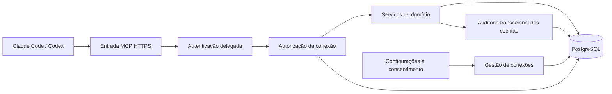

# MCP da conta — SPEC de implementação

Data: 2026-11-16. Status: desenho aprovado; implementação não iniciada.
Base inspecionada: `784c6d6`. O working tree estava limpo na investigação.

Este documento é a referência funcional, técnica e de aceite para expor projetos,
tarefas e finanças do Oriens a clientes MCP, inicialmente Claude Code e Codex.
Não autoriza implantação, alterações de banco compartilhado ou implementação
além do trabalho de documentação solicitado nesta conversa.

## 1. Decisões aprovadas

| Decisão | Definição |
| --- | --- |
| Login | Preservar cadastro, `/authenticate`, JWT e experiência de login atuais. OAuth pertence à conexão MCP. |
| Arquitetura | Módulo MCP na API Spring Boot atual, reutilizando os serviços de domínio. |
| Projetos | Allowlist explícita por conexão. Projetos futuros não entram automaticamente. |
| Tarefas avulsas | Autorização separada das tarefas dos projetos selecionados. |
| Finanças | Permissões independentes, sobre os lançamentos da conta do usuário. |
| Operações | Leitura, criação, atualização e exclusão autorizadas separadamente. Tudo começa negado. |
| Exclusões | Permissão desativada inicialmente; se concedida, dispensa nova confirmação no Oriens a cada chamada. |
| Confirmações do cliente | Claude Code, Codex e outros clientes podem exigir suas próprias confirmações. |
| Segurança | Autorização aplicada pelo backend em cada chamada, inclusive em listas, totais e replays. |
| Controle do usuário | Ver conexões, revisar permissões, consultar histórico e revogar acesso. |
| Escritas | Idempotência em todas as mutações; versões esperadas em alterações e exclusões. |
| Finanças compartilhadas | Corrigir concorrência e repetição no serviço financeiro e na interface, não somente no MCP. |

Aprovações registradas na conversa: recomendação de seleção de projetos e
finanças separadas; arquitetura e fronteiras de acesso; fluxo e catálogo
funcional; contratos, proteção das escritas, auditoria, migrações e aceite.

## 2. Problema e resultados observáveis

O usuário precisa permitir que uma IA consulte e altere dados do Oriens sem
compartilhar a credencial geral da conta e sem conceder acesso a tudo.

O resultado deve permitir, por exemplo:

1. Conectar o Codex e autorizar leitura e edição de tarefas de um projeto escolhido.
2. Pedir à IA que organize a semana, preservando prazo final e dia de execução como campos distintos.
3. Conectar outro cliente com permissões menores e revogar um deles independentemente.
4. Autorizar consulta financeira sem autorizar criação, alteração ou exclusão de lançamentos.
5. Registrar uma despesa por linguagem natural, depois de autorizar a escrita financeira.
6. Repetir uma chamada após timeout sem duplicar um lançamento ou uma tarefa.
7. Receber conflito se a interface ou outra IA alterou o registro desde a última leitura.
8. Consultar quais operações uma conexão realizou e interromper seu acesso futuro.

O MCP fornece ferramentas ao cliente de IA. O Oriens não precisa contratar um
modelo, executar inferência ou receber chaves de provedores de IA para atendê-las.
O custo da inferência permanece na relação entre usuário e cliente escolhido.

## 3. Escopo e exclusões

### 3.1 Primeira versão

- Servidor remoto por HTTPS e Streamable HTTP, com contratos tipados.
- OAuth Authorization Code com PKCE para autorizar conexões.
- Configuração assistida de Claude Code, Codex e outros clientes compatíveis.
- Seleção de projetos existentes e autorização separada de tarefas avulsas.
- Projetos, objetivos, leitura do quadro e operações sobre tarefas.
- Consulta de categorias e leitura/escrita de lançamentos financeiros, inclusive suas regras existentes de recorrência.
- Consentimento, edição de permissões, expiração, renovação e revogação.
- Histórico de uso por conexão, limites de consumo e erros previsíveis.
- Evolução aditiva de schema e adaptações financeiras necessárias na API e no frontend.

### 3.2 Fora da primeira versão

- Substituir login, adicionar login social ou criar contas de IA com privilégios próprios.
- Colaboração, contas de equipe, compartilhamento entre usuários ou acesso administrativo por MCP.
- Chat de IA dentro do Oriens, agentes agendados, webhooks e notificações para clientes.
- Servidor local distribuído por npm, plugin obrigatório ou instalação automática na máquina.
- Publicação em diretórios de conectores e compatibilidade prometida com todo cliente MCP.
- Configuração estrutural de colunas, conversão de modo de projetos, gestão de etiquetas, anexos e imagens por MCP.
- CRUD de categorias financeiras por MCP, contas bancárias, pagamentos, transferências, câmbio ou Open Finance.
- SQL, chamadas HTTP arbitrárias, execução de código ou acesso genérico aos repositórios.
- Confirmação por operação dentro do Oriens, aprovação de lotes e sistema de desfazer.
- Resources, prompts, sampling e extensões MCP sem necessidade para o catálogo abaixo.

## 4. Estado atual e responsáveis

Os caminhos completos são relativos à raiz do repositório. Pacotes Java
abreviados pertencem a `oriens-api/src/main/java/com/oriens/oriens_api/`; os
componentes e o contexto do frontend pertencem a `oriens-front/src/`.

| Área atual | Evidência | Consequência para a implementação |
| --- | --- | --- |
| Stack | `oriens-api/pom.xml`: Java 17, Spring Boot 3.5.6, MVC, Security, JPA e PostgreSQL | Escolher dependências compatíveis; não migrar stack para instalar o MCP. |
| Login | `security/filters/AuthenticationFilter.java` e `JWTAuthorizationFilter.java` | Preservar autenticação atual; credenciais MCP têm validação e uso separados. |
| Identidade | `security/WorkOwner.java` resolve o usuário pelo principal atual | Gestão de conexões usa identidade autenticada; ferramentas usam principal delegado com ID estável do usuário. |
| Projetos e tarefas | `service/ProjectWorkService.java` | É a fronteira canônica de escrita; preservar locks, versões, transições e regras de associação. |
| Leituras | `service/WorkReadService.java`, consultas em `ProjectController` e `TaskController` | Consolidar consultas necessárias nessa camada com recorte autorizado, sem copiar regras para os handlers MCP. |
| Criações | `service/WorkCreationService.java` e `entity/CreationReceipt.java` | Reutilizar o padrão de recibo transacional e tombstones; sua implementação atual não cobre toda mutação. |
| Contratos atuais | `entity/dto/work/*`, `WorkRequestBodyAdvice.java` | Preservar distinção entre ausência e null, validação estrita e projeções explícitas. A validação HTTP atual não se aplica automaticamente ao MCP. |
| Código legado | `TaskServiceImpl.java` ainda existe | Não usá-lo como atalho para contornar o modelo atual de `ProjectWorkService`. |
| Finanças | `FinancialEntryServiceImpl.java`, `FinancialEntry.java` e `EntryDTO.java` | Há validação de dono, categoria, valores e recorrência; faltam versão e idempotência equivalentes às de projetos/tarefas. |
| Recorrência | `RecurringFinancialService.java` e `financial_occurrences` | Preservar identidade pai/data, regras de calendário, marcos de processamento e claims após exclusão. |
| Agregados financeiros | `FinancialStatisticsService.java` | Reutilizar somas exatas; estender filtros apenas onde necessário para manter resumo e consulta coerentes. |
| Datas | `ProductClockConfiguration.java` | `America/Recife` é o fuso do produto nesta versão. |
| Interface | `ConfigurationPage.tsx`, `IntegrationsSection.tsx`, `SettingsSection.tsx` | Estender configurações e seus componentes; o estado de WhatsApp continua funcionando. |
| Sessão do frontend | `context/AuthContext.tsx` | O token atual está no navegador. Redirecionamentos OAuth não podem depender de recebê-lo como query string. |
| Schema operacional | `oriens-api/ops/projects-refactor/*`; JPA com `ddl-auto=validate` | Seguir evolução aditiva, preflight, checksum e recuperação; não executar DDL no startup. |

Não foi encontrada infraestrutura de MCP, servidor OAuth, grants delegados ou
auditoria de conexões já implementada. Isso representa trabalho novo, não apenas
publicação dos controllers existentes.

## 5. Arquitetura e alternativas

| Alternativa | Benefício | Custo | Decisão |
| --- | --- | --- | --- |
| MCP integrado à API | Mesmos serviços, transações e banco; uma implantação | Separar autenticação e transportar o contexto de autorização corretamente | Adotada |
| Gateway MCP separado | Implantação independente | Outro serviço e propagação de credenciais e autorização pela API | Não necessária para o escopo |
| Bridge local por stdio | Atende integrações executadas localmente | Distribuição, atualização e configuração de credenciais por máquina | Fora da primeira versão |



### 5.1 Fronteiras

- O SDK implementa o protocolo e o transporte; não escrever um servidor JSON-RPC próprio.
- Spring Security e uma implementação OAuth mantida implementam os mecanismos padronizados.
- A política MCP calcula operações e recortes efetivos da conexão. Não contém regras de negócio de tarefas ou finanças.
- Os serviços de domínio continuam donos das invariantes e das transações.
- Os handlers convertem schemas, chamam as operações autorizadas e projetam a resposta.
- Os controllers REST continuam atendendo o frontend. Ferramentas não simulam requisições aos controllers dentro do mesmo processo.
- O contexto delegado é explícito e imutável. Não depender apenas de `SecurityContextHolder` em um executor assíncrono do SDK.
- Separar os matchers de segurança do protocolo, do servidor OAuth e das APIs normais. Nenhuma cadeia genérica pode aceitar o token errado por fallback.

### 5.2 Dependências e prova P0

O Spring oferece integração WebMVC para Streamable HTTP. Isso confirma o caminho
arquitetural, não a compatibilidade de uma versão ainda não testada com este
projeto. [Referência Spring AI 1.1](https://docs.spring.io/spring-ai/reference/1.1/api/mcp/mcp-server-boot-starter-docs.html).

A P0 deverá registrar versões exatas de Java, Spring Boot, SDK/transporte MCP,
biblioteca OAuth e clientes testados. A seleção segue a stack existente. Somente
capacidades explicitamente cadastradas serão publicadas; autoexposição de todos
os métodos ou ferramentas do contexto Spring é proibida.

O Spring Authorization Server é candidato, com um bloqueio conhecido: não emite
refresh token para cliente público por padrão. Não declarar renovação concluída
apenas porque Authorization Code e PKCE funcionaram.
[Limitação documentada](https://docs.spring.io/spring-authorization-server/reference/guides/how-to-pkce.html).

A solução escolhida deve cumprir a seção 8. Extensões suportadas do framework
são aceitáveis se limitadas e testadas; implementar criptografia ou um protocolo
OAuth inteiro na aplicação não é uma saída. Se a P0 não conseguir cumprir isso
na stack atual, registrar o impedimento e submeter uma alternativa concreta antes
de ampliar a arquitetura. Não substituir silenciosamente OAuth por token pessoal,
retirar renovação ou exigir novo login a cada chamada.

## 6. Modelo de autorização

### 6.1 Identidade e permissão efetiva

Uma autorização pertence a exatamente um usuário e um cliente OAuth registrado.
O ID de usuário vem do token validado e da conexão persistida, nunca dos
argumentos enviados pela IA. O rótulo do cliente e o nome atribuído pelo usuário
não constituem prova de identidade do software.

Permissão efetiva é a interseção entre:

1. Escopos concedidos no token.
2. Escopos atualmente vigentes na conexão.
3. Recursos atualmente autorizados nessa conexão.
4. Propriedade do recurso e regras do domínio.

Um token válido não supera uma revogação no banco. Um ID conhecido não concede
acesso. Perfis administrativos do usuário não ampliam o catálogo MCP.

### 6.2 Escopos

| Escopo | Autoriza |
| --- | --- |
| `mcp:context` | Contexto mínimo e permissões da própria conexão; nenhum conteúdo de domínio |
| `projects:read` | Metadados, objetivos e estrutura dos projetos selecionados |
| `projects:create` | Criar projeto na conta, sem obter acesso contínuo automático ao novo projeto |
| `projects:update` | Editar metadados, favoritar, arquivar e desarquivar projetos selecionados |
| `projects:delete` | Excluir projetos selecionados, preservando a regra atual de sobrevivência das tarefas |
| `objectives:create` | Criar objetivos nos projetos selecionados |
| `objectives:update` | Editar, concluir ou reabrir objetivos nos projetos selecionados |
| `objectives:delete` | Excluir objetivos nos projetos selecionados |
| `tasks:read` | Ler tarefas dos projetos selecionados e/ou tarefas avulsas autorizadas |
| `tasks:create` | Criar tarefas no recorte autorizado |
| `tasks:update` | Editar, planejar, reagendar, concluir, reabrir e mover tarefas autorizadas |
| `tasks:delete` | Excluir tarefas autorizadas |
| `finance:read` | Ler categorias, lançamentos e agregados financeiros da conta |
| `finance:create` | Criar lançamentos financeiros |
| `finance:update` | Editar lançamentos financeiros permitidos pelas regras atuais |
| `finance:delete` | Excluir lançamentos financeiros permitidos pelas regras atuais |

`offline_access`, quando solicitado e concedido, controla renovação e não dá
acesso a dados. Não é um atalho para conceder os escopos acima.

Na interface, usar nomes de ações, não exigir que o usuário interprete esses
identificadores. A seleção de projetos vale para o conjunto da conexão: as mesmas
operações para todos os selecionados. Permissões diferentes por projeto podem ser
representadas por conexões distintas; uma matriz individual por projeto não faz
parte desta versão.

Regras de dependência, visíveis no resumo de consentimento:

- Alterar/excluir projetos e gerenciar objetivos requer `projects:read`.
- Operar tarefas de projetos requer `projects:read`; ler tarefas não concede escrita em metadados do projeto.
- Criar/alterar/excluir tarefas requer `tasks:read`. Tarefas avulsas não exigem acesso a projetos.
- Escritas financeiras requerem `finance:read`, inclusive para escolher uma categoria válida.
- `projects:create` pode existir sem projetos selecionados. A resposta da criação é a confirmação dessa operação, não uma concessão de leitura posterior.
- Escopos não solicitados pelo cliente não podem ser acrescentados silenciosamente no consentimento. Pedir uma nova autorização quando necessário.

### 6.3 Recorte de recursos

- `allowedProjectIds`: IDs explícitos de projetos pertencentes ao usuário.
- `allowStandaloneTasks`: falso inicialmente; corresponde a tarefas cujo `projectId` é null.
- Finanças: abrangência da conta do usuário, sem restrição implícita por projeto, categoria ou período. A tela deve explicar essa abrangência.
- Projetos novos, inclusive criados pela conexão, exigem liberação pelo usuário antes de uma consulta ou mutação posterior por MCP.
- Não oferecer “todos os projetos atuais e futuros” na primeira versão.
- Permitir selecionar projetos arquivados; filtros de listagem continuam distinguindo arquivados de ativos.

### 6.4 Dados relacionados e efeitos indiretos

- Aplicar o recorte na consulta antes de contar ou paginar. Não buscar a conta inteira e filtrar o JSON depois.
- Um projeto lido sem `tasks:read` não pode revelar tarefas, títulos, contagens ou próximo passo por meio de `summary`.
- A estrutura do quadro pode ser lida com `projects:read`; linhas e contagens de tarefas só aparecem com `tasks:read`.
- Omitir seções sem permissão e informar `includedSections`, em vez de apresentar zero como se não existissem dados.
- Os labels já presentes numa tarefa autorizada podem ser lidos. Não expor o catálogo global de etiquetas nem aceitar `labelIds` nas mutações MCP desta versão.
- A leitura de uma tarefa abrange descrição e localização presentes nela; o consentimento deve indicar esses tipos de dado.
- Transferência exige acesso à tarefa, à origem e ao destino; mover para/desde tarefas avulsas exige `allowStandaloneTasks`.
- `beforeTaskId`, coluna e objetivo devem pertencer ao destino autorizado. Uma âncora de ordenação não pode referenciar um recurso externo ao recorte.
- Excluir projeto desvincula suas tarefas, conforme o domínio atual, sem excluí-las. Se tarefas avulsas não estão autorizadas, a conexão perde acesso a elas após a exclusão.
- Excluir objetivo preserva tarefas e remove o vínculo correspondente, conforme o domínio.
- Essas consequências fazem parte da descrição das permissões e das ferramentas. Não exigir escopos extras apenas por versões e ordenação internas mudarem.

### 6.5 Alterar e revogar

- Toda edição de permissões usa versão da conexão e operação atômica.
- Reduzir escopos ou recursos tem efeito na próxima chamada, inclusive num token ainda não expirado.
- Expandir escopos/recursos requer nova autorização OAuth. Não ampliar um token já emitido apenas por editar uma linha no banco.
- A interface orienta uma nova autorização no cliente para ampliações; a seleção desejada pode ser preparada, mas não entra em vigor antes do consentimento. A conclusão cria uma autorização/conexão nova. A anterior conserva o recorte antigo até ser revogada, sem ser mesclada com a nova.
- Revogar marca a conexão como revogada e invalida sua família de tokens. Não reativar a mesma autorização ao renovar.
- Uma nova autorização cria uma nova conexão; não restaurar silenciosamente permissões da revogada.
- Sair do Oriens não revoga automaticamente uma conexão autorizada. A interface distingue logout de revogação.
- Excluir a conta desabilita também suas conexões. Não deixar credenciais utilizáveis para um usuário inexistente.

Separar a versão de edição da conexão de `policyRevision`, que muda a cada
decisão do usuário sobre recursos/escopos. Renomear uma conexão não altera sua
autorização. Remoção automática de uma associação após excluir o próprio recurso
não é uma nova concessão e não incrementa essa revisão por si só. Isso permite
reconhecer com segurança a repetição da exclusão original, conforme a seção 11.2.

## 7. Fluxo do usuário e interface

### 7.1 Conectar

1. Em `/config`, a seção Integrações oferece **Conectar via MCP**.
2. O usuário escolhe Claude Code, Codex ou Outro cliente e recebe URL e instruções correspondentes ao ambiente publicado.
3. Copiar instruções não cria uma conexão ativa, não gera uma credencial geral e não instala nada na máquina.
4. No cliente, o usuário inicia a conexão/autorização.
5. O backend valida a solicitação OAuth e abre o consentimento do Oriens.
6. A sessão existente comprova a identidade; se expirou, o usuário utiliza `/auth` e pode retomar a solicitação válida.
7. A tela apresenta cliente, conta atual, ações solicitadas, projetos, tarefas avulsas e finanças em grupos distintos.
8. Tudo começa desmarcado, exceto o contexto técnico mínimo. Dependências de leitura são explicadas antes de confirmar.
9. O usuário revisa um resumo legível e escolhe **Autorizar conexão** ou **Cancelar**.
10. O backend registra a decisão, conclui o fluxo OAuth e o cliente obtém a credencial MCP.
11. A conexão ativa aparece nas configurações. Cancelamento ou tentativa incompleta não aparece como conectada.

O resumo informa que o conteúdo autorizado será entregue ao cliente de IA e
poderá ser processado pelo provedor usado nele. Revogar acesso futuro não apaga
dados que o cliente já recebeu.

Solicitação expirada, cliente inválido e retorno não autorizado apresentam erro
local, sem enviar código a um endereço fornecido livremente pelo navegador.
A retomada após login só admite destinos locais e identificadores de fluxo
validados pelo backend; não criar open redirect em `/auth`.

### 7.2 Gerenciar conexões

A seção lista nome atribuído, cliente registrado, estado, autorização e último
uso. Uma conexão ativa significa autorização vigente, não uma sessão de rede
permanentemente aberta. Último uso vem de uma requisição autenticada, não de um
heartbeat inventado.

O detalhe contém permissões, projetos, tarefas avulsas, abrangência financeira,
datas de expiração e histórico paginado. Revogar exige uma confirmação que nomeia
a conexão e explica que operações concluídas permanecem. Não exigir digitar o
nome nem inventar uma confirmação a cada chamada MCP.

### 7.3 Direção visual

Aplicar `design-taste-frontend` no modo de app, preservando o sistema existente:
`PageHeader`, `SettingsSection`, `SettingRow`, temas e componentes acessíveis.
Esta é uma extensão de configurações, sem redesign da shell ou sorteio de uma
identidade visual nova.

Pergunta principal da tela: **quais clientes podem acessar meus dados e com quais
permissões?** O elemento específico do Oriens é o resumo que une projetos
selecionados, tarefas avulsas e permissões financeiras separadas.

- Lista de conexões e resumo das permissões em texto, sem KPIs ou gráficos decorativos.
- Uma ação principal por contexto; exclusão/revogação separada da edição comum.
- Mostrar os nomes dos projetos, não apenas a quantidade selecionada.
- Mostrar estados vazio, carregando, erro, ativo, expirado e revogado com texto; cor não é o único indicador.
- Formulário de permissões com um botão de salvar, sem misturar autosave e edição pendente.
- Mobile em uma coluna, resumo completo, controles por toque com pelo menos 44 px e sem overflow horizontal da página.
- Foco visível, navegação por teclado, nomes acessíveis, grupos de checkboxes e devolução de foco ao fechar diálogos.
- Mensagens de sucesso/erro anunciadas; falhas preservam a seleção ainda não enviada.
- Antes/depois e inspeção do build de produção a 1440, 768 e 390 px na implementação. Não há evidência visual nova neste documento.

## 8. OAuth, transporte e sessão existente

### 8.1 Superfícies

Os caminhos são relativos ao endereço público da API. Não inferir domínio de
produção a partir de um `.env` local.

| Superfície | Responsabilidade |
| --- | --- |
| `/mcp` | Transporte MCP protegido, com token MCP em toda requisição |
| `/.well-known/oauth-protected-resource/mcp` | Metadados do recurso e endereço do emissor |
| `/.well-known/oauth-authorization-server` | Metadados OAuth verdadeiros para a implementação selecionada |
| `/oauth2/authorize` | Solicitação de autorização e consentimento |
| `/oauth2/token` | Troca de código e renovação autorizada |
| `/oauth2/revoke` | Revogação OAuth segundo a biblioteca selecionada |
| `/integrations/mcp/*` | Gestão da conta e ponte de consentimento; exige o JWT normal do Oriens |

Uma requisição sem credencial a `/mcp` recebe 401 e `WWW-Authenticate` com o
endereço dos metadados. Metadados públicos não contêm nomes de projetos, IDs de
conta, segredos ou grants pessoais. A especificação MCP separa o servidor de
recursos, o cliente e o servidor de autorização; o emissor pode estar no mesmo
deployment. [Autorização MCP](https://modelcontextprotocol.io/specification/latest/basic/authorization).

Publicar `resource`, `issuer`, callbacks e endereços a partir de configuração
operacional confiável. Não formar o issuer com `Host` ou forwarded headers de
origem não confiável. Anunciar somente recursos e versões realmente suportados.

### 8.2 Aproveitar o login atual

A ponte de consentimento deve seguir este contrato, usando os pontos de extensão
da biblioteca OAuth selecionada:

1. A requisição OAuth validada origina um fluxo temporário no servidor, vinculado a cliente, retorno, escopos, PKCE e prazo.
2. O navegador recebe apenas um identificador opaco desse fluxo. Ele não autentica o usuário nem permite obter um token sozinho.
3. O frontend consulta/aprova a solicitação por chamada autenticada com o JWT atual no header `Authorization`.
4. O backend valida a identidade e a vinculação do fluxo ao navegador, e entrega essa comprovação ao mecanismo de consentimento OAuth.
5. O framework emite o código para o callback previamente validado. A IA nunca recebe o JWT do aplicativo.

Se a biblioteca precisar de uma sessão curta para essa ponte, ela é restrita ao
fluxo OAuth, com cookie Secure/HttpOnly, proteção CSRF e expiração do fluxo.
Ela não substitui nem transforma o login geral em sessão por cookie. A P0 precisa
provar o comportamento com os origins reais de frontend/API; não solucionar
problemas de cookies expondo credenciais em URL ou desabilitando CSRF.

Headers, corpos com códigos/tokens e query strings de callbacks não podem ser
registrados por aplicação, proxy, analytics ou ferramenta de diagnóstico.

### 8.3 Registro de clientes e interoperabilidade

O caminho mínimo da primeira versão é cliente público pré-registrado, com
`client_id` fornecido pelas instruções do Oriens. Não distribuir client secret
em CLI, snippet, frontend ou repositório.

As instruções configuram também os escopos que o cliente solicita. O setup pode
solicitar o catálogo desta versão para permitir sua seleção no consentimento;
isso não concede esse catálogo inteiro. O servidor emite somente o subconjunto
selecionado e solicitado, com `mcp:context` mínimo. O consentimento só oferece
ações presentes na requisição validada. Se o cliente pedir um subconjunto menor,
as demais aparecem indisponíveis até uma nova autorização com esses escopos.
`offline_access` aparece como opção explícita de manter a conexão renovável pelo
prazo indicado. Não depender de um cliente pedir todos os escopos só porque eles
aparecem nos metadados: provar as instruções e seus efeitos na P0.

As instruções devem conter os argumentos efetivamente necessários. O Codex
suporta ID pré-registrado e documenta callbacks com porta de loopback variável;
essa exceção não permite variar host ou caminho arbitrariamente.
[Configuração oficial do Codex](https://learn.chatgpt.com/docs/extend/mcp?surface=cli).

O Claude Code também permite configurar um cliente público por ID.
[Autenticação de MCP no Claude Code](https://code.claude.com/docs/en/mcp).

Não depender de DCR ou CIMD para liberar o MVP. Outros clientes precisam aceitar
HTTP, o fluxo OAuth escolhido e configuração do cliente pré-registrado. A P0
registra os callbacks exatos suportados e a compatibilidade das instruções. Se
isso não bastar para um dos clientes obrigatórios, escolher e documentar a menor
extensão interoperável antes das próximas fases; não relaxar a validação de
retorno nem anunciar um mecanismo que não foi implementado.

### 8.4 Credenciais e ciclo de vida

Valores iniciais de implementação, alteráveis por uma revisão explícita desta
política, não por controles do usuário:

| Item | Política inicial |
| --- | --- |
| Solicitação de consentimento | Até 10 minutos; consumir ou encerrar ao concluir |
| Código de autorização | Até 60 segundos; uso único e vinculado ao PKCE |
| Access token | Até 15 minutos; restrito ao recurso MCP |
| Refresh token | Quando `offline_access` for concedido; rotação por uso e expiração absoluta em 30 dias |
| Família renovável | Nunca ultrapassar a expiração absoluta por renovação |

- PKCE S256 obrigatório para clientes públicos; rejeitar downgrade.
- Validar cliente, retorno, recurso, emissor e audiência conforme o fluxo negociado.
- Vincular token a usuário, cliente, conexão e escopos; não aceitar tokens emitidos para outra API.
- Usar material de assinatura distinto do JWT normal ou tokens opacos com validação própria. Chaves e segredos ficam fora do repositório.
- Rotacionar refresh tokens atomicamente; reutilização de token já consumido revoga a família e exige autorização novamente.
- Renovação conserva ou reduz escopos. Nunca amplia acesso, troca usuário ou reativa conexão revogada.
- Cada autorização cria uma conexão/família própria, mesmo para o mesmo par usuário/cliente. Não reutilizar consentimento anterior para pular a revisão de projetos ou unir grants de duas instalações.
- Acesso MCP ao REST normal é rejeitado; JWT normal em `/mcp` não cria autorização delegada implicitamente.
- `state` e mecanismos de correlação do cliente são preservados; CSRF do consentimento é tratado na aplicação, sem confundir as duas proteções.
- Não anunciar renovação pública como pronta enquanto o bloqueio de biblioteca da seção 5.2 não estiver resolvido.

### 8.5 Transporte e exposição

- Usar negociação de versão oferecida pelo SDK e provar versões comuns aos clientes da P0. Não implementar exemplos de uma versão mais nova sobre SDK antigo por adaptação manual.
- Autenticar initialize, descoberta e chamada de ferramentas; não usar sessão MCP como credencial.
- Se o transporte mantiver sessão, vinculá-la à conexão autenticada e recusar seu uso por outro principal. Não reutilizar contexto ou catálogo privado de um usuário ao atender outro na mesma instância.
- Listar somente ferramentas permitidas pelos escopos apresentados. Cada chamada valida novamente escopos e recursos.
- A lista de ferramentas é determinística e pode ser atualizada após nova autorização. Cache de catálogo nunca serve como autorização de execução.
- HTTP origins, quando presentes, devem ser validados. CORS de navegador tem allowlist explícita e não substitui autenticação para CLI.
- Desabilitar capabilities não usadas e impedir chamada direta a uma ferramenta fora do catálogo autorizado.
- Metadados de leitura/escrita e destrutividade ajudam clientes a apresentar confirmações; não são uma fronteira de segurança.
- Conteúdo de projetos/tarefas é dado não confiável: não executá-lo, não usá-lo para alterar permissões e não embuti-lo nas instruções fixas do servidor.
- Não buscar URLs arbitrárias fornecidas em argumentos, callbacks ou metadados de cliente.

## 9. Contratos comuns das ferramentas

### 9.1 Schemas e tipos

- Schemas fechados: propriedades desconhecidas, duplicadas ou com tipo incorreto são rejeitadas.
- A raiz do schema é um objeto com campos nomeados; evitar combinadores de raiz que prejudiquem a compatibilidade com clientes. Especificar nulabilidade e campos obrigatórios, não aceitar um objeto genérico de parâmetros.
- IDs de domínio são strings decimais positivas nos contratos MCP; converter com checagem de faixa para o `Long` atual. IDs de conexão são UUIDs opacos.
- Versões são inteiros não negativos obrigatórios onde indicado; não inferir a versão atual para fazer uma escrita passar.
- `idempotencyKey` é UUID fornecido pelo cliente em toda mutação. O ID JSON-RPC não o substitui.
- Em patch, campo ausente preserva o valor; null limpa somente campos anuláveis. Reutilizar a semântica de `PatchFields`.
- Datas: `YYYY-MM-DD`; horário local: `HH:mm:ss`; instantes de auditoria: UTC com offset explícito.
- “Hoje” é calculado no backend com o Clock e `America/Recife`, informado pelo contexto.
- Dinheiro: string decimal sem separador de milhar, exatamente duas casas; limites atuais de `EntryDTO` e `numeric(12,2)`. Não usar float/double para cálculo monetário.
- A apresentação atual é BRL. Não introduzir moedas por lançamento nem inferir conversão monetária.
- Limites de títulos, descrições e outros campos seguem os serviços atuais; restrições adicionais de protocolo precisam estar no schema e na mensagem de validação.
- Nunca retornar entidades JPA, usuário completo, senha, hash ou credenciais.

### 9.2 Paginação e volume

Para listagens: `page` começa em 0; `pageSize` padrão 20, intervalo 1–100;
ordenação usa allowlist e desempate por ID. Retornar `items`, `page`, `pageSize`,
`totalElements` e `hasNext`. O total é do filtro e recorte autorizados.

`direction` aceita `ASC`/`DESC`, padrão `DESC`. `sortBy` padrão: `id` em projetos,
`createdAt` em tarefas e `entryDate` em lançamentos. Allowlists:

- Projetos: `id`, `title`, `lastAccessed`, `favorite`, `archived`.
- Tarefas: `id`, `title`, `dueDate`, `plannedDate`, `startTime`, `priority`, `status`, `createdAt`.
- Lançamentos: `id`, `entryDate`, `amount`, `createdAt`.
- Categorias: nome sem distinção de caixa e ID, ordem fixa crescente.
- Quadro: colunas por posição/ID; tarefas por coluna/posição/ID, sem sort arbitrário.
- Histórico: horário/ID decrescentes. Não aceitar nome de coluna SQL como ordenação livre.

Não truncar silenciosamente campos textuais. Listagens retornam projeções breves;
detalhes oferecem o conteúdo completo dentro dos limites do domínio. Objetivos e
colunas em coleções também precisam de paginação ou projeção paginada; não usar
um `get_project` para contornar o limite de volume da listagem.

Resumos financeiros exigem início e fim, intervalo inclusivo de até 366 dias e
fim não futuro, conforme `StatisticsViews.Period`. Listagens de lançamentos e
tarefas preservam seus filtros atuais; não aplicar a elas a restrição de data
futura que pertence somente ao resumo estatístico.

### 9.3 Resultado estruturado

Usar `structuredContent` e `outputSchema` quando suportados pela versão negociada,
com conteúdo textual sucinto derivado do mesmo objeto. Não duplicar valores
independentes em texto e JSON.

Sucesso lógico:

```json
{
  "ok": true,
  "requestId": "3cb83b28-a2c9-40f0-aac1-d61c2310b979",
  "data": {},
  "meta": { "timezone": "America/Recife", "replayed": false }
}
```

Falha de domínio:

```json
{
  "ok": false,
  "requestId": "3cb83b28-a2c9-40f0-aac1-d61c2310b979",
  "error": {
    "code": "VERSION_CONFLICT",
    "message": "Os dados mudaram. Consulte novamente antes de salvar.",
    "fieldErrors": [],
    "retryable": false
  }
}
```

No envelope MCP, falhas de execução usam `isError: true`. JSON-RPC malformado,
método desconhecido e falhas de autenticação no transporte continuam utilizando
as respostas padronizadas do SDK/OAuth. Não devolver 200 de sucesso lógico para
uma credencial inválida nem inserir stack trace na mensagem.

### 9.4 Erros e repetição

| Código | Situação | Ação do cliente |
| --- | --- | --- |
| `UNAUTHENTICATED` | Credencial ausente/inválida/expirada | Renovar ou autorizar novamente |
| `CONNECTION_REVOKED` | Autorização encerrada | Parar; nova autorização explícita é necessária |
| `INSUFFICIENT_SCOPE` | Falta escopo de operação | Solicitar revisão pelo usuário; nunca ampliar sozinho |
| `NOT_FOUND` | Recurso inexistente ou fora da conta/allowlist | Não distinguir esses casos nem revelar seu conteúdo |
| `INVALID_REQUEST` | Campo, formato, filtro ou tipo inválido | Corrigir campos indicados |
| `PRECONDITION_REQUIRED` | Falta chave ou versão obrigatória | Consultar recurso e preencher contrato |
| `VERSION_CONFLICT` | Versão mudou | Reconsultar e revisar a intenção; não sobrescrever automaticamente |
| `IDEMPOTENCY_CONFLICT` | Mesma chave com outro payload | Usar a intenção original ou iniciar nova operação conscientemente |
| `RESOURCE_GONE` | Replay não pode devolver recurso ou janela expirou | Consultar o estado; não criar novamente automaticamente |
| `DOMAIN_VIOLATION` | Regra do Oriens impede operação | Explicar restrição e pedir nova intenção quando necessário |
| `RATE_LIMITED` | Limite excedido | Aguardar `retryAfterSeconds`; preservar a chave da intenção |
| `TEMPORARILY_UNAVAILABLE` | Falha transitória/lock timeout | Repetir a mesma intenção com a mesma chave após espera |
| `INTERNAL_ERROR` | Falha não classificada | Informar `requestId`; consultar/repetir com a mesma chave, sem presumir falha de commit |

Falhas de escopo no transporte devem carregar o challenge apropriado quando o
cliente precisar de nova autorização. Nunca usar um código de domínio para
ocultar uma obrigação do protocolo.

### 9.5 Projeções de saída

Os schemas específicos de `data` reutilizam estas projeções, sem aceitar campos
extras de entidade. `?` abaixo indica campo opcional; null é permitido apenas
quando o domínio o admite.

| Projeção | Campos |
| --- | --- |
| Projeto breve | `id`, `title`, `mode`, `color`, `favorite`, `archived`, `version` |
| Detalhe de projeto | Projeto breve, `description`, IDs de colunas padrão, objetivos paginados, `includedSections`; resumo de tarefas somente com `tasks:read` |
| Objetivo | `id`, `projectId`, `title`, `dueDate`, `status`, `position`, `version`; contagens de tarefas somente com `tasks:read` |
| Coluna | `id`, `projectId`, `name`, `kind`, `position`, `version`; contagens somente com `tasks:read` |
| Tarefa breve | `id`, `title`, IDs de projeto/objetivo/coluna, `plannedDate`, `startTime`, `dueDate`, `priority`, `status`, `version` |
| Detalhe de tarefa | Tarefa breve, `description`, `position`, `completedAt`, `createdAt`, `location`, etiquetas já atribuídas e links/versões de projeto/objetivo/coluna autorizados |
| Lançamento | `id`, `amount`, `entryDate`, `description`, `tagId`, `isRecurring`, `recurrencePattern`, `recurrenceEndDate`, `parentEntryId`, `createdAt`, `updatedAt`, `version` |
| Categoria | `id`, `name`, `color`, `allowNegative`, `isDefault` |
| Resumo financeiro | `startDate`, `endDate`, filtros aplicados, `income`, `expenses`, `result`, `entryCount`, composição paginada por categoria, `timezone` |
| Resultado de escrita | `operation`, `resourceId`, recurso resultante quando ainda legível, `affectedProjects` com IDs/versões autorizados, efeitos permitidos e `requiresProjectAuthorization?` |

Coleções usam o envelope da seção 9.2. Páginas de composição financeira não
alteram os totais gerais: os totais abrangem todo o filtro e a composição tem
sua própria paginação explícita. Nenhum `userId` precisa ser exposto para o
cliente formular as próximas chamadas.

Contagens de tarefas também são protegidas nas respostas de exclusão de
projeto/objetivo. Sem `tasks:read`, informar a consequência geral sem retornar
`detachedTaskCount` ou outros totais derivados dessas tarefas.

Leituras não gravam acesso recente/favorito nem alteram o recurso consultado.
Somente a atualização de último uso da conexão e a auditoria técnica ocorrem.

## 10. Catálogo fechado da primeira versão

Todos os nomes abaixo são nomes MCP. Campos de paginação só aparecem nas operações
que produzem coleção. Os parâmetros listados são a superfície permitida; o handler
não aceita livremente DTOs REST inteiros.

### 10.1 Contexto e projetos

| Ferramenta | Escopo | Entrada e resultado |
| --- | --- | --- |
| `oriens_get_context` | `mcp:context` | Sem argumentos de domínio. Retorna ID/rótulo da conexão, versão do contrato, horário/fuso, escopos efetivos e opções de tarefas avulsas. IDs de projetos autorizados podem ser informados; nomes exigem leitura de projetos. |
| `oriens_list_projects` | `projects:read` | `search`, `includeArchived`, paginação e sort permitido. Retorna somente projetos da allowlist, sem resumo de tarefas quando falta `tasks:read`. |
| `oriens_get_project` | `projects:read` | `projectId`, `objectivesPage`, `objectivesPageSize`. Retorna metadados, versão, objetivos paginados e campos de estrutura necessários. Seções opcionais explicitam sua inclusão. |
| `oriens_create_project` | `projects:create` | `idempotencyKey`, `title`, `mode`, `description?`, `color?`. Retorna confirmação com ID/versão, campos criados e `requiresProjectAuthorization: true`; não inclui objetivos embutidos nem concede acesso posterior. |
| `oriens_update_project` | `projects:update` | `idempotencyKey`, `projectId`, `expectedVersion`, patch de `title`, `description`, `color`, `favorite`. Não aceita modo nem coleções. Retorna metadados atualizados e versão. |
| `oriens_set_project_archived` | `projects:update` | `idempotencyKey`, `projectId`, `expectedVersion`, `archived` boolean. Define o estado desejado, sem toggle. |
| `oriens_delete_project` | `projects:delete` | `idempotencyKey`, `projectId`, `expectedVersion`. Exclui projeto/estrutura conforme domínio; tarefas sobrevivem desvinculadas. Retorna IDs da operação e contagem dos efeitos, sem vazar detalhes de tarefas não legíveis. |

`SIMPLE` e `DEVELOPMENT` continuam sendo os modos existentes. Tarefas de projeto
exigem modo Desenvolvimento; criar um projeto simples não deve convertê-lo
automaticamente quando a IA tenta criar uma tarefa.

### 10.2 Objetivos e quadro

| Ferramenta | Escopo | Entrada e resultado |
| --- | --- | --- |
| `oriens_create_objective` | `objectives:create` | `idempotencyKey`, `projectId`, `expectedProjectVersion`, `title`, `dueDate?`. Retorna objetivo e versões afetadas. |
| `oriens_update_objective` | `objectives:update` | `idempotencyKey`, `projectId`, `objectiveId`, `expectedVersion`, patch de `title`, `dueDate`, `status`. `PENDING`/`CONCLUDED` define reabertura/conclusão. |
| `oriens_delete_objective` | `objectives:delete` | `idempotencyKey`, `projectId`, `objectiveId`, `expectedVersion`, `expectedProjectVersion`. Retorna confirmação, nova versão do projeto e quantidade de vínculos removidos. |
| `oriens_get_board` | `projects:read`; linhas/contagens exigem `tasks:read` | `projectId`, `columnsPage`, `columnsPageSize`, `tasksPage`, `tasksPageSize`, filtros `objectiveId`, `planning`, `overdue`, `open`. Retorna estrutura e, quando autorizado, tarefas paginadas e totais do mesmo recorte. |

Consultar objetivos é uma seção de `oriens_get_project`. Conclusão não é inferida
da contagem de tarefas. A consulta paginada do quadro deve ficar na camada de
leitura responsável; não retornar a coleção completa atual para depois truncá-la
no handler MCP.

As duas coleções do quadro têm paginação independente com os mesmos defaults
e limites comuns. A página de tarefas conserva sua referência de coluna, mesmo
quando essa coluna está em outra página de estrutura. `planning` aceita `today`
ou `unscheduled`; os booleanos usam falso como padrão. Contagens de projeto e de
filtro são nomeadas separadamente, sem apresentar um total global como total da
página.

### 10.3 Tarefas

| Ferramenta | Escopo | Entrada e resultado |
| --- | --- | --- |
| `oriens_list_tasks` | `tasks:read` | `projectId?`, `standaloneOnly?`, `columnId?`, `status?`, `priority?`, `search?`, `dateField?`, `startDate?`, `endDate?`, paginação e sort. Sem projeto explícito, consulta a união dos projetos autorizados e tarefas avulsas permitidas. |
| `oriens_get_task` | `tasks:read` | `taskId`. Retorna detalhe autorizado, versão e referências/versões de projeto necessárias para uma futura mutação. |
| `oriens_create_task` | `tasks:create` | `idempotencyKey`, `title`, `description?`, `projectId?`, `expectedProjectVersion?`, `objectiveId?`, `columnId?`, `plannedDate?`, `startTime?`, `dueDate?`, `priority?`, `location?`. Retorna tarefa e versões afetadas. |
| `oriens_update_task` | `tasks:update` | `idempotencyKey`, `taskId`, `expectedVersion`, `expectedProjectVersion?`, patch de `title`, `description`, `objectiveId`, `plannedDate`, `startTime`, `dueDate`, `priority`, `location`, `status`. Preserva etiquetas. |
| `oriens_move_task` | `tasks:update` | `idempotencyKey`, `taskId`, `expectedVersion`, `expectedProjectVersion?`, `targetProjectId` anulável, `expectedTargetProjectVersion?`, `columnId?`, `beforeTaskId?`, `objectiveId?`. Valida origem e destino, move e retorna versões afetadas. |
| `oriens_delete_task` | `tasks:delete` | `idempotencyKey`, `taskId`, `expectedVersion`, `expectedProjectVersion?`. Retorna confirmação e projetos afetados. |

`expectedProjectVersion` é obrigatório se a tarefa atualmente pertence a um
projeto; na criação, se o destino é projeto. A ferramenta de movimento mapeia
versão da origem e do destino para os campos atuais do domínio, inclusive no
caso avulsa → projeto. O handler não faz duas atualizações para simular uma
transferência que precisa ser atômica.

Estados atuais: `PENDING`, `ON_DOING`, `CANCELLED`, `CONCLUDED`. Prioridades:
`LOW`, `MEDIUM`, `HIGH`. Planejamento não altera prazo final automaticamente.
Horário exige dia planejado; vínculos de objetivo/coluna devem obedecer às regras
atuais. Em projetos, a coluna governa o estado; mudanças incompatíveis exigem
um destino de coluna válido, sem inventar transições.

`location` conserva o formato atual de endereço/latitude/longitude, com validação
e projeção explícitas. Não aceitar URL de geocodificação nem consultar serviços
externos a partir desse campo.

Combinar `standaloneOnly=true` e `projectId`, ou filtrar coluna sem projeto, é
inválido. Se houver intervalo de datas, exigir início/fim válidos e `dateField`
igual a `plannedDate` ou `dueDate`, sem inferir qual data a IA pretendia consultar.

### 10.4 Finanças

| Ferramenta | Escopo | Entrada e resultado |
| --- | --- | --- |
| `oriens_list_financial_categories` | `finance:read` | Paginação. Retorna `id`, `name`, `color`, `allowNegative`, `isDefault`, suficientes para interpretar/escolher categoria. |
| `oriens_list_financial_entries` | `finance:read` | `startDate?`, `endDate?`, `tagId?`, `search?`, paginação e sort permitido. Retorna lançamentos e identificação de recorrência. |
| `oriens_get_financial_entry` | `finance:read` | `entryId`. Retorna detalhe, versão e indicação de original ou ocorrência gerada. |
| `oriens_get_financial_summary` | `finance:read` | `startDate`, `endDate`, `tagId?`, `search?`. Retorna receitas, despesas positivas, resultado assinado, quantidade e composição por categoria, calculados sobre todos os registros do filtro. |
| `oriens_create_financial_entry` | `finance:create` | `idempotencyKey`, `amount`, `entryDate`, `description?`, `tagId`, `isRecurring`, `recurrencePattern?`, `recurrenceEndDate?`. Retorna lançamento e versão. |
| `oriens_update_financial_entry` | `finance:update` | `idempotencyKey`, `entryId`, `expectedVersion`, patch dos campos editáveis de criação. Montar o estado resultante no serviço e validar regras de recorrência. |
| `oriens_delete_financial_entry` | `finance:delete` | `idempotencyKey`, `entryId`, `expectedVersion`. Retorna confirmação, sem recriar ocorrências consumidas. |

Valor negativo representa despesa; positivo representa receita; manter a
semântica atual de zero e de categorias que proíbem negativos. O serviço valida
categoria do mesmo dono. Campos como `parentEntryId`, timestamps e versão são
somente de leitura: a IA não os define.

Frequências existentes: `DAILY`, `WEEKLY`, `BIWEEKLY`, `MONTHLY`, `QUARTERLY`,
`SEMIANNUALLY`, `YEARLY`. Ocorrência automática não é editável diretamente.
Uma origem que já tem ocorrências conserva as restrições atuais de início,
frequência e encerramento; exclusão da origem não contorna a preservação do
histórico. Reutilizar as regras do serviço, sem criar variantes para IA.

Filtros adicionais de resumo devem ser implementados em
`FinancialStatisticsService`/consultas compartilhadas. Não somar apenas uma página
de lançamentos. Não retornar automaticamente períodos comparativos ou detalhes
que o contrato da ferramenta não pediu.

O resumo aceita `categoriesPage`/`categoriesPageSize` para sua composição,
independentes da paginação dos lançamentos.

## 11. Escritas, concorrência e idempotência

### 11.1 Ordem de processamento

1. Validar protocolo, credencial, formato e limites de entrada.
2. Abrir transação; para escrita, bloquear usuário e depois conexão nessa ordem.
3. Reler estado da conexão e escopos; recusar credencial revogada antes de qualquer replay.
4. Consultar recibo pela conexão, ferramenta e chave, sem devolver seu corpo; validar o recorte atual ou a prova de exclusão autorizada abaixo.
5. Se há replay autorizado, devolver seu resultado. Se não há recibo, validar o recurso e executar o serviço de domínio com versões e locks existentes.
6. Gravar resultado do recibo e evento de auditoria na mesma transação da mutação.
7. Confirmar a transação e responder. Falha antes do commit não deixa uma mutação parcial.

Locks existentes de projeto em ordem de ID e locks de tarefas permanecem.
O gerenciamento de permissões/revogação usa a mesma ordem usuário → conexão;
não pode segurar um lock de conexão e depois pedir o de usuário. Timeout/deadlock
de banco gera erro recuperável, nunca remoção da checagem de versão.

### 11.2 Recibos

O padrão atual de criação é adequado como base, mas precisa ser generalizado
para atualização e exclusão. A condição de replay atual, que exige um recurso
existente, não pode ser aplicada cegamente a uma exclusão bem-sucedida.

- Namespace lógico: usuário + conexão + ferramenta + chave. Uma conexão não recupera resultado armazenado por outra ou pelo frontend.
- Hash de payload canônico, incluindo IDs e versões esperadas; preservar diferença entre ausente e null.
- Mesmo namespace/chave e mesmo payload: devolver resultado anterior, com `meta.replayed=true` e novo `requestId` de transporte.
- Mesma chave com payload diferente: `IDEMPOTENCY_CONFLICT`, sem efeito.
- Criação/atualização seguida de exclusão: não recriar nem devolver snapshot de conteúdo já removido. Retornar `RESOURCE_GONE` quando não for seguro devolver a resposta.
- Exclusão repetida com a mesma chave: confirmar a exclusão original se a autorização ainda permite reconhecer essa operação; não exigir que o alvo continue existindo.
- Reautorização, escopo removido ou recurso fora da allowlist: não devolver corpo antigo com base no recibo. Após revogação, nem a confirmação de replay é acessível.
- Uma exclusão que removeu a própria associação de allowlist pode ser reconhecida pelo recibo da mesma conexão/intent e `policyRevision` vigente, sem recuperar conteúdo do projeto. Isso só vale para a confirmação da própria exclusão, nunca para ler ou mutar outro recurso. Uma decisão posterior do usuário sobre recursos/escopos muda essa revisão e encerra a exceção.
- Criação de projeto tem uma exceção equivalente apenas para sua confirmação: com `projects:create` ainda vigente, mesma conexão/intent, revisão de política inalterada e projeto ainda existente, repetir retorna ID/versão original e campos enviados, com `requiresProjectAuthorization: true`. A ausência na allowlist não impede reconhecer a criação, mas continua impedindo leituras/alterações posteriores. Não incluir objetivos, quadro ou resumos no recibo dessa operação.
- Guardar corpo de replay por 24 horas, protegido como dado de domínio; depois apagar o corpo e manter tombstone mínimo que impeça recriação incerta.
- Falhas não confirmadas não recebem recibo de sucesso. Repetir com a mesma chave deve permitir distinguir commit concluído de rollback.
- Cancelamento/desconexão do cliente não prova rollback. A resposta instrui consulta ou repetição com a mesma chave.

Na implementação, consolidar o mecanismo de recibos na camada responsável,
preservando os contratos e testes de criação existentes. Não criar um segundo
registro desconectado que permita executar duas vezes a mesma intenção.

### 11.3 Segurança financeira em todos os escritores

- Acrescentar versão a `FinancialEntry`, com valor inicial compatível para registros existentes.
- Retornar versão em leitura/criação e exigir precondição em alteração/exclusão.
- Aplicar idempotência na criação e nas demais mutações financeiras feitas por REST e MCP.
- Atualizar os consumidores financeiros do frontend na mesma entrega: conservar a chave durante repetição de uma intenção e reconsultar em conflito.
- Requisições antigas sem precondições são recusadas de forma explícita; não manter um caminho que sobrescreve dados silenciosamente. Coordenar a publicação da API e do frontend.
- Revisar SQL direto: `startProcessing`, scheduler e outras escritas devem preservar/incrementar a versão quando mudarem o estado versionado. `@Version` não protege um UPDATE JDBC que ignora a coluna.
- A resposta de criação/edição deve conter a versão realmente confirmada, com refresh da entidade quando SQL direto tiver alterado esse valor na mesma transação.
- O scheduler atual bloqueia o marco de cobertura e depois as origens. Preservar uma ordem compatível: não introduzir o lock de cobertura após bloquear uma origem numa chamada de edição.
- Sob lock da origem, criação de ocorrência e mudança de recorrência devem enxergar um estado coerente. Provar corrida com encerramento/exclusão sem perder claim, gerar duplicata ou usar uma definição intermediária.
- Somatórios usam `BigDecimal`/`numeric`; quantidade e totais devem corresponder ao mesmo filtro, em snapshot consistente.
- Não alterar valores históricos, âncora de calendário nem reconstruir ocorrências antigas durante a migração.

### 11.4 Semântica de revogação concorrente

O ponto de decisão de uma escrita é sua transação: se ela obtém os locks antes
da revogação, pode confirmar; a revogação espera e bloqueia as seguintes. Se a
revogação confirma primeiro, a escrita relê o estado e falha sem mutação.

Leituras admitidas antes da revogação podem terminar; não é possível retirar
bytes já enviados. Chamadas novas após o commit da revogação falham em qualquer
instância. Não usar cache de permissões com janela de tolerância para esse caso.

## 12. Persistência

As estruturas abaixo são responsabilidades lógicas. Reutilizar as tabelas e
repositórios da biblioteca OAuth quando equivalentes; não duplicar o mesmo token
ou consentimento em duas fontes de verdade.

| Estrutura | Conteúdo e invariantes |
| --- | --- |
| Clientes OAuth registrados | ID, nome, tipo público, callbacks, escopos suportados; armazenamento persistente da biblioteca |
| Solicitações/autorização OAuth | Cliente, PKCE, usuário autenticado após comprovação, consentimento, código e expiração; armazenamento do framework |
| `mcp_connections` | UUID, usuário, cliente, nome atribuído, versão de edição, `policyRevision`, estado, criação, autorização, expiração absoluta, último uso e revogação |
| `mcp_connection_scopes` | Par conexão/escopo único, com escopos conhecidos; a conexão também registra a autorização de tarefas avulsas |
| `mcp_connection_projects` | Usuário, conexão e projeto, únicos por conexão/projeto; FKs compostas impedem associação entre donos diferentes |
| Tokens/famílias OAuth | Vínculo à conexão e estado de rotação/revogação; não guardar bearer token em logs ou campos de apresentação |
| Recibos de mutação | Evolução do padrão `creation_receipts`, namespace isolado, hash, resultado, status, expiração e tombstone |
| `mcp_audit_events` | ID, usuário/conexão, horário, ferramenta/ação, IDs afetados, nomes de campos, resultado e correlação |
| `financial_entry.version` | Inteiro não negativo, obrigatório, incluindo registros preexistentes e escritores JDBC |

FK de projeto não deve impedir sua exclusão. Ao excluí-lo, remover a associação
ativa; tombstones de recibo/histórico guardam somente a identidade necessária,
sem FK que ressuscite o recurso ou bloqueie a exclusão. Revogação não apaga a
conexão e seu histórico; exclusão de conta segue sua política de remoção e torna
tokens inutilizáveis imediatamente.

Índices mínimos: conexões por usuário/estado; allowlist por conexão/projeto e
usuário/projeto; recibos por namespace/chave e prazo de limpeza; auditoria por
usuário/conexão/horário/ID; versões e índices financeiros existentes preservados.

Evitar armazenar tokens em claro em tabela da aplicação. Se um repositório do
framework persistir material recuperável de token, protegê-lo em repouso com
criptografia gerida fora do banco, acesso restrito e procedimento de rotação.
Hash de lookup e proteção do token precisam continuar permitindo validação e
detecção de reutilização, sem criptografia caseira.

## 13. API de gestão, separada do MCP

Todas as rotas abaixo usam o JWT normal e resolvem o dono pelo principal. Tokens
MCP não podem chamá-las, mesmo que conheçam o ID da conexão.

| Método/rota | Comportamento |
| --- | --- |
| `GET /integrations/mcp/setup?client=...` | Instruções públicas do ambiente, cliente/URL/ID registrados; sem tokens pessoais |
| `GET /integrations/mcp/connections` | Lista paginada das conexões do usuário |
| `GET /integrations/mcp/connections/{id}` | Detalhe, versão, permissões e recursos autorizados |
| `PATCH /integrations/mcp/connections/{id}` | Nome, redução de permissões e seleção com precondição; aumento inicia nova autorização e não amplia token existente |
| `POST /integrations/mcp/connections/{id}/revoke` | Revogação idempotente; versão obrigatória no primeiro encerramento; repetição da intenção confirma estado final |
| `GET /integrations/mcp/connections/{id}/events` | Histórico paginado com período/filtros permitidos |
| `GET /integrations/mcp/authorization-requests/{flowId}` | Resumo da solicitação validada, após comprovar identidade/vinculação do navegador |
| `POST /integrations/mcp/authorization-requests/{flowId}/decision` | Aprovar/recusar, com versão do fluxo, proteção de correlação e decisão de recursos/escopos |

O armazenamento de fluxo e endpoints auxiliares exigidos pelo framework podem
ser especializados na P0, mantendo o contrato de segurança da seção 8.2. A IA
não recebe ferramenta equivalente a editar conexão ou decidir consentimento.

Gerenciamento usa o envelope de erros REST já adotado pelo projeto, com
`requestId` e precondições, sem converter esses endpoints em ferramentas MCP.

## 14. Auditoria, privacidade e operação

### 14.1 Eventos

Registrar autorização, recusa, redução/ampliação solicitada, renovação inválida,
revogação e chamadas de ferramentas. Cada evento de ferramenta identifica a
conexão, operação, IDs, campos alterados, resultado e duração. Em leitura de
coleção, registrar tipo de consulta e quantidade devolvida, sem copiar a lista
inteira para o histórico.

- Escrita bem-sucedida e evento de sucesso confirmam na mesma transação. Se a auditoria obrigatória não puder persistir, a escrita falha sem commit.
- Negativas e falhas, após rollback, usam gravação independente; não transformar uma tentativa negada em efeito de domínio.
- Leitura mantém registro mínimo de acesso em armazenamento de auditoria separado do conteúdo; se ele estiver indisponível, falhar antes de devolver dados novos.
- Replay gera evento de replay sem duplicar o evento de mutação original.
- Não registrar valores monetários, descrições, localização, corpos completos, tokens, senhas ou códigos OAuth. Os valores continuam no registro de domínio, acessíveis pelas permissões normais.
- Mensagem de erro é sanitizada. Argumentos e metadados não podem injetar quebras de log, HTML executável ou conteúdo de outro usuário.
- Histórico inicial: retenção de 90 dias, apresentada na interface; limpeza não remove tombstones necessários à segurança de repetição.
- Histórico não é backup, trilha de estorno ou promessa de recuperação de registro excluído.

### 14.2 Limites iniciais

Impor limites antes de chamar os serviços, com contadores coerentes entre
instâncias. Reutilizar gateway compartilhado se existir; na ausência, usar
controle limitado no PostgreSQL para este volume, sem acrescentar Redis só para
essa funcionalidade.

| Limite | Valor inicial |
| --- | --- |
| Corpo de requisição | 256 KiB; rejeitar antes de desserializar |
| Página | 20 padrão; máximo 100 |
| Leitura | 120 chamadas/minuto por conexão e 300 por conta |
| Escrita | 30 chamadas/minuto por conexão e 60 por conta |
| Início de autorização | 10 tentativas/minuto por origem de rede e cliente registrado |
| Janela dos contadores | Minuto fixo; limpar contadores expirados |

Limites são política operacional inicial, não metas de desempenho medidas.
Inicialização/descoberta deve ter orçamento próprio suficiente para os clientes
da P0 e não ser uma forma de executar ferramenta sem contabilização. Para
chamadas em lote, contar cada operação e só aceitar lote se o SDK o suportar.

Definir timeouts limitados de requisição, transação e lock na integração com o
SDK. A P0 registra os valores necessários aos clientes; nenhuma chamada pode
ficar indefinidamente aguardando lock. Não prometer cancelamento de uma mutação
já confirmada quando a conexão HTTP cair.

### 14.3 Observabilidade e interrupção

Métricas por ferramenta/código de resultado, latência, conflitos, replay, falhas
OAuth e revogações. IDs de usuário/conexão ficam na auditoria restrita; não criar
labels de alta cardinalidade com IDs ou textos privados em métricas.

Dispor de controle operacional para desabilitar `/mcp` e novas autorizações sem
derrubar o login e o restante do Oriens. O recurso é habilitado somente após os
gates de segurança e compatibilidade. Reiniciar uma instância não pode perder
revogações, recibos, consentimentos ou famílias de tokens.

## 15. Migrações, publicação e rollback

Seguir o padrão de evolução operacional em
`oriens-api/ops/projects-refactor/STATISTICS.md`, sem modificar checksums ou
reinstalar a baseline histórica.

1. Criar uma revisão aditiva sobre a revisão realmente instalada, com SQL, checksum, script de preflight/aplicação e documentação próprios.
2. Preflight verifica catálogo, revisão, donos dos registros financeiros, FKs, defaults e índices necessários. Não corrigir nem apagar registros de usuário automaticamente.
3. Testar aplicação, repetição sem efeitos adicionais, detecção de drift e rollback de falha de migração em PostgreSQL isolado.
4. Para publicação real, identificar literalmente o alvo e seguir backup/restore, manutenção e parada de escritores exigidos pelo procedimento existente.
5. Acrescentar estruturas MCP e versão financeira com backfill estrutural; não reprocessar recorrências nem preencher histórico de auditoria fictício.
6. Publicar API e frontend financeiro compatíveis com as novas precondições; API normal de projetos/tarefas preserva seu contrato atual.
7. Configurar URLs públicas, clientes, callbacks, chaves e proteção de segredos; provar metadados e cabeçalhos através do proxy real.
8. Habilitar autorização/MCP somente depois de validar o smoke e os critérios de aceite.

Rollback de aplicação mantém o schema aditivo. Desabilitar MCP e impedir uso de
credenciais emitidas antes de voltar a uma versão sem suporte. Não remover
tabelas, audit events ou versões para reverter código. Não voltar a um escritor
financeiro que ignore versões enquanto outros escritores protegidos continuarem
ativos. Se necessário, manter finanças em manutenção até restaurar um conjunto
compatível. Recuperação de banco usa alvo isolado e troca coordenada, nunca
sobrescrita automática do banco atual.

## 16. Plano executável por fases

Cada fase termina com evidência reproduzível, não apenas com classes criadas.

### P0 — Prova de compatibilidade e decisões de dependências

Entregáveis: registro de versões/dependências; transporte autenticado; ponte de
sessão/consentimento demonstrada com usuário sintético; configuração real dos
dois clientes; renovação/revogação; contrato de schemas e propagação de identidade.

Gates:

- Compilar com Java 17 e Spring Boot do projeto sem migração de stack.
- Claude Code e Codex descobrem, autorizam, listam e chamam uma ferramenta de leitura inofensiva em ambiente isolado.
- Provar cliente público, PKCE, callback exato com porta de loopback, issuer/audience e expiração real/forçada.
- Provar renovação com rotação, replay negado, expiração absoluta e revogação após reinício de instância.
- Provar que o JWT existente não aparece em URL, configuração do cliente ou logs e que o fluxo normal de login continua igual.
- Registrar a menor versão de cliente efetivamente testada; instruções finais incluem quaisquer IDs/flags necessários.

Se qualquer gate falhar, não liberar escritas nem declarar a P0 encerrada. A
escolha de biblioteca só fica fechada com essa evidência.

### P1 — Persistência e autorização delegada

Entregáveis: migração aditiva, conexões/escopos/allowlist, OAuth persistente,
política de autorização, gestão/revogação, auditoria e limites básicos.

Gates: FKs de dono; negação por padrão; scopes não se ampliam via refresh;
redução/revogação funcionam entre instâncias; nenhum token atravessa a fronteira
MCP/REST; edição concorrente de permissões gera conflito.

### P2 — Projetos, objetivos e tarefas

Entregáveis: catálogo dessas áreas, consultas com recorte na origem, recibos
generalizados e testes de invariantes atuais pelos dois canais.

Gates: listas/totais/nested views não vazam; projeto criado não se autoautoriza;
transferência valida origem/destino/âncora; versões são preservadas; exclusão de
projeto não exclui tarefas; repetição de cada escrita não duplica efeito.

### P3 — Finanças protegidas e ferramentas financeiras

Entregáveis: versão/recibos no serviço, REST e frontend financeiro adaptados,
consultas exatas e ferramentas de lançamentos/categorias.

Gates: corridas REST × MCP × scheduler; categoria do dono; limites/precisão;
resumos além de uma página; recorrência e tombstones preservados; frontend não
usa mais escrita sem precondição.

### P4 — Experiência completa e liberação

Entregáveis: seção de integrações, configuração por cliente, consentimento,
gerenciamento/histórico, estados e documentação de uso/operação.

Gates: fluxo real com ambos os clientes, build de produção inspecionado nos três
viewports, teclado/toque, regressão do login e demais integrações, smoke de
publicação e rollback conferido em ambiente isolado.

## 17. Matriz de aceite

| ID | Cenário | Prova esperada |
| --- | --- | --- |
| A01 | Login normal antes/depois | Mesmo endpoint, credencial e experiência; autenticação MCP não vira login geral |
| A02 | Conectar cada cliente obrigatório | Fluxo real termina em ferramenta autorizada, com versões de cliente registradas |
| A03 | Negar/cancelar/expirar consentimento | Nenhuma credencial utilizável ou conexão apresentada como ativa |
| A04 | Conta B tenta ID da conta A | Leitura/escrita/recibo/gestão/histórico negados sem conteúdo de A |
| A05 | Projeto fora da allowlist | Detalhe, busca, contagens, quadro, objetivos e âncoras não revelam o projeto |
| A06 | `projects:read` sem `tasks:read` | Nenhuma tarefa, título ou contagem aparece em campos aninhados |
| A07 | Tarefas avulsas desautorizadas | Nem consulta sem filtro nem transferência permite acessá-las |
| A08 | Novo projeto criado por IA | Uma criação; retorno de confirmação; acesso posterior negado até nova concessão |
| A09 | Exclusão de projeto/objetivo | Efeitos existentes preservados; sem exclusão indireta de tarefas |
| A10 | Mover tarefa | Origem/destino, versões, coluna, objetivo e `beforeTaskId` validados atomicamente |
| A11 | Repetir criação/patch/delete após timeout | Um efeito, mesmo resultado reconhecido; payload alterado com mesma chave conflita |
| A12 | Replay de outra conexão ou após redução | Sem recuperação de snapshots fora da autorização atual |
| A13 | Replay expirado ou registro removido | Sem recriação incerta nem devolução de conteúdo excluído |
| A14 | UI e IA editam a mesma versão | Um resultado válido e um conflito, sem sobrescrita silenciosa |
| A15 | Revogar simultaneamente a escrita | Ordenação transacional demonstrada; chamadas posteriores falham em todas as instâncias |
| A16 | Ampliar permissões | Token antigo não ganha escopos nem novos projetos silenciosamente |
| A17 | OAuth inválido | PKCE errado, código repetido, retorno adulterado, issuer/audience/recurso incorretos e refresh reutilizado são recusados |
| A18 | Reiniciar aplicação | Revogação, allowlist, recibos e família de tokens conservam validade/invalidade correta |
| A19 | Finanças independentes | Acesso a projetos/tarefas não revela categorias, lançamentos ou resumos financeiros |
| A20 | Valor monetário e paginação | Precisão de centavos, sinais e totais corretos com mais registros que uma página |
| A21 | Editar recorrência durante scheduler | Sem duplicação, perda de claims ou uso de definição parcial |
| A22 | Ocorrência/recorrência com histórico | Restrições atuais preservadas; exclusão não faz o scheduler recriar ocorrência consumida |
| A23 | Auditoria e sigilo | Escrita/evento atômicos; falhas/replays diferenciados; nenhum segredo ou conteúdo privado bruto nos logs |
| A24 | Limites/erros | Recusa previsível, espera informada, chave preservada e nenhum commit parcial |
| A25 | Interface | Estados completos, teclado, leitor de tela, toque e 1440/768/390 px sem regressão de configurações |
| A26 | Evolução e rollback | Aplicação/repetição/drift/rollback parcial de migração e recuperação sem reset demonstrados |
| A27 | Conteúdo malicioso em dados | Texto não altera ferramentas, permissões, URLs de destino nem execução do servidor |
| A28 | Clientes antigos financeiros | Escrita sem precondição falha explicitamente; frontend publicado usa o contrato novo |
| A29 | Requisições intercaladas de duas contas/conexões | SDK, executor e cache não trocam identidade, catálogo ou resultados; um session ID não pode ser usado com token de outra conexão |

## 18. Estratégia de verificação

- Testes unitários: interseção de escopos/recortes, patch ausente/null, normalização de payload, conversão de IDs/dinheiro e schemas.
- Integração PostgreSQL real: constraints, transações, locks, claims, recibos, revogação e SQL financeiro. H2 não é prova suficiente desses comportamentos.
- Testes de protocolo: initialize/negociação, catálogo autorizado, chamada direta não anunciada, schemas de entrada/saída, erros e challenges OAuth.
- Testes OAuth/segurança: código e refresh repetidos, callback inválido, troca de usuário/cliente, CSRF/retomada e separação entre tokens normais e delegados.
- E2E de navegador: setup, consentimento, edição, revogação, histórico e finanças com frontend de produção conectado à API isolada.
- Teste manual reproduzível com clientes reais: instruções, autorização, chamada permitida, negada, expiração/renovação e revogação em Claude Code e Codex.
- Inspeção visual: registrar antes/depois e aplicar as regras de app de `design-taste-frontend`; abrir todas as capturas e corrigir falhas nos três viewports.
- Regressões: suítes atuais de projetos/tarefas, estatísticas/recorrência, autenticação e configurações, ampliadas somente nos contratos afetados.

Não usar contas, credenciais ou registros reais nos fixtures. Não transmitir
mensagens a terceiros para testar. Dados de teste devem ser sintéticos e o
banco isolado deve ser identificado e removido pelos próprios runners.

## 19. Situação desta entrega e transição

Esta entrega contém somente a SPEC. Não há endpoint MCP, migração aplicada,
dependência instalada, cliente configurado, protótipo visual ou prova de runtime
executada por sua criação.

O próximo trabalho é a P0, com esta SPEC como contrato e registro de evidências
em documento próprio. As decisões de produto acima estão aprovadas; versões
exatas de dependências, extensão necessária para refresh público e callbacks
efetivos são resultados obrigatórios da prova, não fatos presumidos.

Mudanças que exijam substituir login, reduzir garantias aprovadas, ampliar o
acesso a dados, criar um serviço externo ou migrar a stack exigem uma proposta
concreta antes de avançar. Decisões rotineiras dentro da arquitetura e dos
contratos não exigem uma nova rodada de aprovação.

## 20. Referências

- [Design existente de projetos](2026-11-13-projects-refactor-design.md) e [SPEC executável](2026-11-13-projects-refactor-spec.md): invariantes de tarefas/projetos.
- [Evolução de estatísticas e recorrência](../../oriens-api/ops/projects-refactor/STATISTICS.md): operação e segurança dos dados financeiros.
- [MCP — autorização](https://modelcontextprotocol.io/specification/latest/basic/authorization): papéis e descoberta OAuth.
- [MCP — ferramentas](https://modelcontextprotocol.io/specification/latest/server/tools): schemas, descoberta e execução.
- [MCP — segurança](https://modelcontextprotocol.io/specification/latest/basic/security_best_practices): fronteiras e ameaças do protocolo.
- [Spring AI 1.1 — servidor MCP](https://docs.spring.io/spring-ai/reference/1.1/api/mcp/mcp-server-boot-starter-docs.html): alternativa compatível a investigar na P0.
- [Spring Authorization Server — PKCE](https://docs.spring.io/spring-authorization-server/reference/guides/how-to-pkce.html): suporte a cliente público e limitação de refresh.
- [Claude Code — MCP](https://code.claude.com/docs/en/mcp): configuração e autorização no cliente.
- [Documentação oficial OpenAI — MCP no Codex](https://learn.chatgpt.com/docs/extend/mcp?surface=cli): transporte, configuração e registro/callbacks.

Documentação externa consultada em 2026-11-16. A P0 deve registrar as versões
efetivamente verificadas; links `latest` não fixam a versão de protocolo do Oriens.
