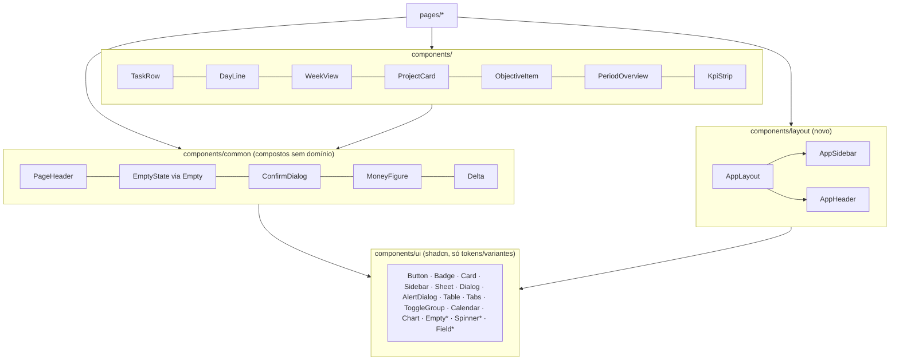
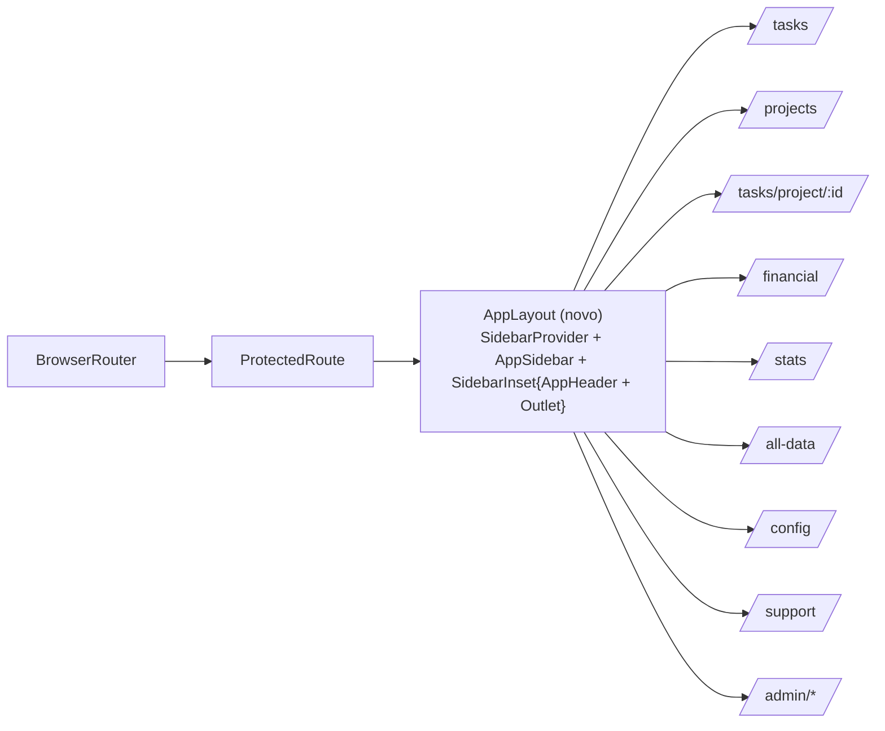
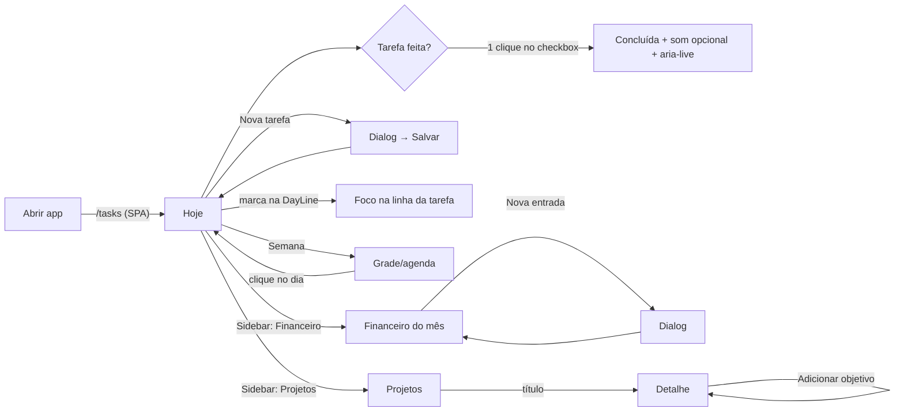
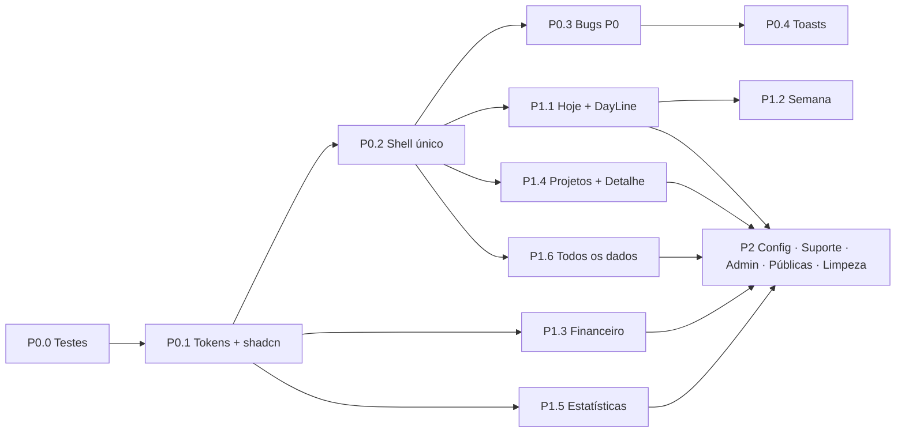
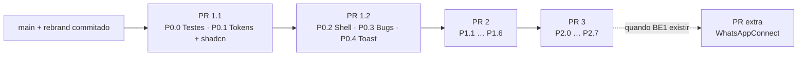

# Oriens — SPEC de Redesign e Refatoração do Frontend

| Campo | Valor |
|---|---|
| Status | **Fechada — v1.1 (2026-11-11).** Direção visual aprovada em 2026-11-10; questões Q1–Q10 respondidas em 2026-11-11; plano de PRs aprovado em 2026-11-11 (§20). Mudanças a partir daqui entram como revisão registrada no histórico abaixo. A implementação depende de uma autorização explícita. |
| Histórico | v0.1 (2026-11-10): auditoria e direções · v0.9 (2026-11-11): decisões D1–D14 e dependências BE1–BE6 · v1.0 (2026-11-11): fechada · **v1.1 (2026-11-11): plano de 4 PRs com prompts de execução (§20)** |
| Escopo | `oriens-front/`, todas as rotas. As páginas públicas entram como P2 de marca. |
| Direção | **A — "Horizonte"** |
| Base de evidência | Código em `main` (1e79639) mais as mudanças não commitadas do rebrand (cream/bordô/amarelo). Telas inspecionadas em 1440, 820 e 490 px. |

Convenção de marcação usada neste documento:
- **[Fato]**: observado no código ou na tela, com a evidência citada.
- **[Recomendação]**: proposta desta SPEC.
- **[Decisão]**: aprovada pelo dono do produto.
- **[Pendente]**: precisa de validação (ver §18).

---

## 1. Executive Summary

O Oriens é um planner pessoal: as tarefas do dia ficam divididas em Manhã, Tarde e Noite, ao lado de projetos com objetivos, finanças pessoais e estatísticas. O frontend funciona no desktop, mas tem quatro classes de problema:

1. **Navegação quebrada fora do desktop com mouse** [Fato].
   - Em 490 px não existe nenhum link de navegação visível e a página transborda 272 px na horizontal.
   - A sidebar só expande no `hover`.
   - Os links usam `<a href>`, então cada clique recarrega a aplicação inteira.
2. **Shell duplicado** [Fato]: dez páginas montam a própria `SidebarProvider`, `AppSidebar` e `AppHeader`, com quatro fundos diferentes.
3. **Bugs visíveis** [Fato]:
   - gráfico de Estatísticas sem cor (tokens `--chart-*` inexistentes);
   - visão semanal com palavras partidas e badges vazando;
   - botão "Conectar WhatsApp" sem efeito;
   - KPI de atrasos negativo pintado de verde;
   - um botão invisível no detalhe do projeto.
4. **Inconsistência de marca e linguagem** [Fato]:
   - três logos diferentes;
   - cerca de 100 classes de cor fora dos tokens;
   - prioridade em inglês num lugar e em português em outro;
   - dois sistemas de toast.

A direção **Horizonte** [Decisão] parte do nome: *oriens* é o sol que nasce, e o produto já divide o dia em períodos. Ela traz:
- uma sidebar clara, com rótulos, item ativo e Sheet no mobile;
- a "Linha do dia" como elemento próprio do produto;
- bordô reservado à ação principal e ao item ativo, e amarelo/ocre reservado a "agora/hoje";
- KPIs tipográficos e superfícies planas.

Tudo isso é feito com a infraestrutura que já existe (shadcn/ui Radix, Tailwind 3, recharts, date-fns), **sem nenhuma dependência de runtime nova**. Ficam autorizados apenas:
- três componentes shadcn copiados como código-fonte (Empty, Field, Spinner);
- as devDependencies de teste (Vitest, Testing Library, Playwright).

A entrega é incremental em 3 fases: **P0 Foundations** (testes, tokens, shell, bugs), **P1 Core Experience** (telas principais no desktop) e **P2 Polish & Consistency** (refinamento mobile, configurações, admin, páginas públicas, limpeza). Seis itens dependem do backend e estão listados em §18.

---

## 2. Contexto e objetivos

### 2.1 Produto e usuários
- **Usuário principal:** uma pessoa organizando o próprio dia. Abre `/tasks` várias vezes por dia, em sessões curtas, **principalmente no desktop**. O mobile é secundário [Decisão Q2]: precisa funcionar (navegação, sem overflow), mas o refinamento de layout mobile fica no P2.
- **Usuário admin** (`role === "ADMIN"`): atende tickets de suporte e gerencia administradores.
- **Tarefas mais frequentes:** criar uma tarefa, marcar como concluída, ver o que vem a seguir hoje, revisar a semana. Com menos frequência: registrar gasto ou receita, atualizar objetivos de projeto.

### 2.2 Objetivos do redesign
| Dimensão | Objetivo verificável |
|---|---|
| Visual | Um único conjunto de tokens. Zero classes de paleta crua (`red-500`, `emerald-600` etc.) fora de `components/ui`. Um único logo. |
| UX | Toda rota alcançável por teclado e toque em 390 px, sem overflow horizontal. A tarefa mais frequente (concluir tarefa) fica a 1 clique. |
| Arquitetura | Um layout autenticado único via rota de layout. Nenhuma página monta o shell por conta própria. |
| Consistência | Um sistema de toast. Um vocabulário pt-BR para status e prioridade. Um padrão de confirmação para ações destrutivas. |

---

## 3. Escopo, restrições e non-goals

**Escopo:** todas as rotas de `App.tsx`; os componentes em `src/components/**` (exceto `ui/`, que só recebe ajustes de token ou variante); `index.css` e `tailwind.config.ts`.

**Restrições** (herdadas do pedido):
- Nada de mudar contratos de API, regras de negócio ou rotas (todas as URLs atuais continuam válidas).
- Nada de trocar framework, migrar para Tailwind v4 ou trocar Radix por Base UI.
- Nenhuma dependência de runtime nova.
  - **Autorizados** [Decisão Q8]: os componentes shadcn `empty`, `field` e `spinner`, instalados via CLI com `--dry-run`/`--diff` antes. Se a CLI pedir alguma dependência npm, ela é declarada e aprovada antes de instalar.
  - **Autorizados** [Decisão Q7]: as devDependencies de teste da §15 (P0.0).
- Preservar os tokens do rebrand em andamento (`--brand-cream`, `--brand-burgundy`, `--brand-yellow`).

**Non-goals:**
- Kanban e drag-and-drop.
- Paleta de comandos.
- "Quick add" com parsing de linguagem natural.
- Internacionalização completa (só a padronização pt-BR das strings já existentes).
- Redesenhar o conteúdo da FAQ e dos tutoriais (exceto o ajuste da Q6).
- Implementar as mudanças de backend da §18. A SPEC só define o que o front espera de cada uma.

---

## 4. Diagnóstico do frontend atual

### 4.1 Stack [Fato]
| Camada | Tecnologia | Observação |
|---|---|---|
| Build | Vite 5.4, `@vitejs/plugin-react-swc` | `lovable-tagger` em devDeps |
| UI | React 18.3, TypeScript 5.8 | — |
| Estilo | Tailwind 3.4, `tailwindcss-animate`, `@tailwindcss/typography` | `darkMode: ["class"]` |
| Componentes | shadcn/ui com Radix (`components.json`: style `default`, baseColor `slate`, variáveis CSS HSL) | O estilo `default` foi descontinuado pelo shadcn; manter (ver §14) |
| Ícones | `lucide-react` 0.462 | — |
| Gráficos | `recharts` 2.15 via `components/ui/chart.tsx` | — |
| Rotas | `react-router-dom` 6.30 | `BrowserRouter` em `App.tsx` |
| Dados | `axios` (`services/api.ts`) com token JWT em `localStorage` | `@tanstack/react-query` instanciado, mas **sem nenhum `useQuery`** |
| Formulários | `useState` manual | `react-hook-form` e `zod` instalados, **não usados** |
| Estado | `AuthContext`, `SettingsContext` (tema e som persistidos no servidor), `ThemeContext` (deprecated, só emite `console.warn`) | — |
| Feedback | `sonner` (9 arquivos) **e** toast Radix `use-toast` (16 arquivos) | dois sistemas |
| Fonte | Inter via Google Fonts (`index.css:1`) | — |

### 4.2 Tokens atuais (working tree) [Fato]
- O rebrand não commitado define `--brand-cream` (#FDEFD6), `--brand-burgundy` (#731328) e `--brand-yellow` (#FEC40B), e mapeia `--background` para o cream, `--primary` para o bordô e a sidebar para o bordô, com o item primário em amarelo.
- `--radius: 0.75rem`.
- `--shadow-soft` e `--shadow-medium` existem como variáveis e são usadas via `shadow-[var(...)]` em 5 lugares.
- **Não existem** `--chart-1..5` (usados em `StatisticsPage.tsx:17,24`), nem tokens semânticos de positivo, negativo, aviso ou "agora".

### 4.3 Estrutura [Fato]
```
src/
  pages/            14 páginas (cada página autenticada monta o próprio shell)
  components/
    ui/             48 primitivos shadcn (15 nunca importados: carousel, context-menu, hover-card,
                    input-otp, menubar, navigation-menu, radio-group, resizable, slider, breadcrumb,
                    pagination, drawer, command, toggle, form, scroll-area, sheet*)
    common/         AppHeader, EditableAvatar, LocationInput
    dashboard/      AppSidebar, TaskCard, TaskSection, WeekView, WeekSelector, SummaryAside, dialogs…
    financial/      PeriodOverviewCard, charts, EntryHistoryTable, 4 dialogs, skeleton
    projects/       ProjectCard, CreateProjectDialog, ProjectSkeleton
    all-data/       TasksDataTable, ProjectsDataTable
    settings/       PreferencesCard, AccountCard, SettingSwitch
    statistics/     KpiCard, ReusableLineChartCard
  context/ services/ types/ hooks/ router/
```
\* `sheet` não é importado por nenhuma página, mas é usado internamente por `ui/sidebar.tsx`.

---

## 5. Inventário de telas, rotas e componentes

| Rota | Arquivo | Objetivo | Perfil | Componentes principais | Inspecionada |
|---|---|---|---|---|---|
| `/` | `LandingPage.tsx` | Marketing e conversão | Visitante | Badge, BarChart (ícone), screenshot `oriens-tasks-screen.png` | Sim (inspector 1440/768/390) |
| `/auth` | `SignLoginPage.tsx` | Login, cadastro, esqueci a senha | Visitante | Card, Tabs, Input, Dialog | Sim (claro e escuro) |
| `/reset-password` | `ResetPasswordPage.tsx` | Redefinir a senha via token | Visitante | Card, Input | Só código |
| `/terms` | `TermsOfServicePage.tsx` | Termos de uso | Visitante | Card, h2 numerados | Só código |
| `*` | `NotFoundPage.tsx` | 404 | Todos | link `text-blue-500` | Só código |
| `/tasks` | `DashboardPage.tsx` | **Agenda do dia ou da semana** | Usuário | WeekSelector, TaskSection, TaskCard, WeekView, SummaryAside, Create/EditTaskDialog | Sim (dia, semana, 820, 490) |
| `/projects` | `ProjectsPage.tsx` | Lista de projetos com scroll infinito | Usuário | ProjectCard, ProjectSkeleton, CreateProjectDialog, AlertDialog | Sim |
| `/tasks/project/:id` | `ProjectDetailPage.tsx` (1011 linhas) | Detalhe e objetivos de um projeto | Usuário | AspectRatio, Tabs, Checkbox, Calendar, Progress, AlertDialog ×2, Dialog | Sim |
| `/financial` | `FinancialPage.tsx` | Saldo, gráficos e histórico de entradas | Usuário | PeriodOverviewCard, TagExpensesChart, DistributionPieChart, EntryHistoryTable, 4 dialogs | Sim (estado vazio) |
| `/stats` | `StatisticsPage.tsx` | KPIs de produtividade | Usuário | KpiCard ×4, ReusableLineChartCard | Sim |
| `/all-data` | `AllDataPage.tsx` | Tabelas de tarefas e projetos (inclui arquivados) | Usuário | Tabs, TasksDataTable, ProjectsDataTable | Sim. Só acessível pelo menu do avatar. |
| `/config` | `ConfigurationPage.tsx` | Preferências e conta | Usuário | PreferencesCard, AccountCard | Sim |
| `/support` | `HelpSupportPage.tsx` | FAQ, tutoriais, documentação, contato | Usuário | Tabs, Accordion, Input, Textarea | Sim (aba FAQ) |
| `/admin/support` | `AdminSupportPage.tsx` | Fila de tickets | Admin | Card, Tabs, Table, Badge | **Não** (conta de teste sem `ADMIN`) |
| `/admin/management` | `AdminManagementPage.tsx` | Gerenciar admins | Admin | Card ×4, Table, Dialog, Select | **Não** (idem) |

**Comportamentos a preservar** [Fato]:
- **Tarefas:**
  - O toggle de status faz `PUT /task/:id` com o objeto inteiro e toca `concluding-sound.wav` se o som estiver ligado.
  - As tarefas são agrupadas por período via `startTime` (00:00–11:59, 12:00–17:59, 18:00–23:59).
  - A visão dia busca `/task/user/:id?date=`; a visão semana busca `/range` com início da semana no locale ptBR.
- **Projetos e objetivos:**
  - Os objetivos são endereçados **por índice** (`/project/:id/objective/:index`). Qualquer reordenação visual precisa preservar o índice original.
  - Favoritar e arquivar usam PATCH. O upload de imagem é multipart `projectImage`.
  - A lista de projetos usa scroll infinito paginado (`size=6`).
- **Financeiro:** cache de páginas por filtro, filtros de período (7/15/30 dias, este mês, personalizado), tag e busca.
- **Configurações:** o tema é aplicado por `SettingsContext` via `classList` em `<html>` e persistido no servidor.

**Componentes duplicados ou acoplados** [Fato]:
- `ProjectDTO` é declarado em `ProjectCard.tsx`, `ProjectDetailPage.tsx` e `types/task.ts`.
- `ObjectiveItem` existe em `ProjectCard` e `ProjectObjectiveItem` existe em `ProjectDetailPage`, com o mesmo papel e marcações diferentes.
- O parse de `dueDate` (`split('T')` + `new Date(y, m-1, d)`) está repetido 4 vezes em `ProjectDetailPage`.
- `TaskCard` define `DayViewLayout` e `WeekViewLayout` como componentes dentro do corpo do componente, recriados a cada render.
- `formatCurrency` está duplicado em `PeriodOverviewCard` e `DistributionPieChart`.
- `Task` é declarado em `DashboardPage` e `TaskCard`, e há também um `TaskDTO` em `types/task.ts`.

---

## 6. Auditoria de UI/UX: problemas priorizados

Escalas usadas: Impacto (I) e Frequência (F) em Alta, Média ou Baixa; Esforço (E) em P, M ou G.

### 6.1 P0
| ID | Problema | Evidência | I/F/E |
|---|---|---|---|
| A1 | Mobile sem navegação e com overflow horizontal | A 490 px, `scrollWidth` = 762. Nenhum `a[href]` visível. Não existe `[data-sidebar=trigger]`. Botões "Nova Tarefa" e "Sair" cortados. | A/A/M |
| A2 | Links internos recarregam o SPA e o menu não indica a página atual | `<a href>` em `AppSidebar.tsx:192,215`; `window.location.href` em `UserProfileNav.tsx:25,81`; nenhum `isActive` | A/A/P |
| A3 | Sidebar só expande no hover; ícones sem nome visível; `<button>` dentro de `<a>` | `AppSidebar.tsx` (`onMouseEnter/Leave`, botão de favorito dentro do link) | A/A/P |
| A4 | Shell montado por página, com 4 fundos e remontagem a cada rota | `SidebarProvider` em 10 páginas; fundos `bg-gray-50/50`, `bg-muted/40`, `bg-background` e nenhum | M/A/M |
| A5 | Gráfico sem cor | `hsl(var(--chart-1))` sem token definido | M/M/P |
| A6 | Visão semanal ilegível em 1430 px | Screenshot: títulos partidos ("Revi/sar/pull/requ/est"), badge `MEDIUM` vazando, cabeçalho de dias duplicado (`WeekSelector` e colunas), dias do seletor não clicáveis (`div`) | A/M/M |
| A7 | CTA "Conectar WhatsApp" sem efeito | `SummaryAside.tsx:24`: o estado `isWhatsAppDialogOpen` nunca é consumido | M/A/P |
| A8 | Excluir tarefa sem confirmação | `TaskCard.handleDelete` chama `DELETE` direto | A/M/P |
| A9 | Botão invisível sem rótulo no diálogo de editar objetivo; asteriscos literais no diálogo de exclusão | `ProjectDetailPage.tsx:968-976` (`absolute right-12 top-[125px]`, sem conteúdo) e `:879` (`**{project.title}**`) | M/B/P |
| A10 | Variação ruim apresentada como boa | `KpiCard`: `isPositive = change >= 0` pinta "Tarefas Atrasadas +100%" de verde | M/M/P |

### 6.2 P1
| ID | Problema | Evidência |
|---|---|---|
| B1 | Dois `h1` por tela; o Dashboard não tem título próprio | `AppHeader` tem `<h1>Oriens</h1>`; as páginas têm outro `h1`; o `/tasks` só tem `h2` com a data |
| B2 | Dois sistemas de toast | 16 arquivos com `@/hooks/use-toast`, 9 com `sonner` |
| B3 | Idioma misto | `TaskCard` mostra `HIGH/MEDIUM/LOW`; `TasksDataTable` mostra Alta/Média/Baixa; notificações em inglês na screenshot da landing; "Planeamento" (pt-PT) na landing; "Gerenciar Recorrencias" |
| B4 | Cores fora dos tokens | Cerca de 100 classes de paleta crua (`text-red-500` ×25, emerald, rose, orange, indigo, yellow) e hex `#ccc`, `#CCCCCC`, `#3b82f6`, `#14B8A6` |
| B5 | Três identidades de marca | Meio-sol laranja (`oriens-logo.png`, landing), quadrado amarelo com `CheckSquare` (auth, sidebar), header com texto "Oriens". A screenshot da landing é do tema laranja antigo. |
| B6 | No Financeiro, a navegação de mês não governa o card em que está | `PeriodOverviewCard` recebe `overviewEntries` (todo o histórico) e mostra "Saldo geral · todo o período". O mês só afeta o donut. |
| B7 | O Financeiro carrega o histórico inteiro | `loadChartData` busca todas as páginas de 500 entradas em paralelo |
| B8 | Placeholders de imagem dominam Projetos | Cards com 160 px de "Sem imagem"; no detalhe, o bloco 16:9 ocupa cerca de 2/3 da primeira tela |
| B9 | Um fato exibido duas vezes discorda | O card "Viagem para Lisboa" mostra progresso 0% e "Objetivos (2/2)". Causa no backend [Decisão Q3]: a correção já está planejada (BE2). O front continua usando `progress`. |
| B10 | Arquivar é ação de mão única no card | `ProjectCard` sempre mostra "Arquivar"; os arquivados só são recuperáveis em `/all-data` |
| B11 | O loading do Dashboard troca a tela inteira | `fetchTasks(true)` no effect de data/visão retorna um spinner `min-h-screen` sem o shell |
| B12 | Em tablet o resumo some sem substituto | `SummaryAside` usa `hidden lg:block` |
| B13 | Larguras de canvas diferentes por tela | Ajuda usa coluna centrada estreita; Financeiro e Todos os dados usam `max-w-[1800px]`; as demais são fluidas |
| B14 | Ícones de período com cores cruas e ícones em círculos tingidos | `text-yellow-500`, `text-orange-500`, `text-indigo-500` dentro de `rounded-full bg-primary/5` |

### 6.3 P2
- `console.log("Rendirizou!")` em `DashboardPage.tsx:57`, `console.log(project)` em `ProjectCard.tsx:89`, `console.log` em `AllDataPage.tsx:208`.
- `import { title } from "process"` em `AppSidebar.tsx`.
- `App.css` é boilerplate do Vite e não é importado. `ThemeContext` está deprecated.
- 110 usos de `space-y-*`.
- Pizza com rótulos nas fatias e cor fixa.
- A FAQ cita "compartilhar projeto com outros usuários" como se já existisse. A funcionalidade está planejada [Decisão Q6]: a pergunta é reescrita como "em breve".

### 6.4 Medições do inspector (páginas públicas)
- **Landing:** 8 FAIL e 5 WARN (eyebrow em pílula, ícones em cards, linhas finas, uma sombra em repouso, primeira tela sem ponto focal, uma única imagem).
- **Auth:** 0 FAIL e 4 WARN (`h1` "Oriens" com 36 px como título, bloco vazio de 29% na primeira tela, fundo cream amarelado).

---

## 7. Direções exploradas e trade-offs

| | **A — Horizonte** (aprovada) | B — Moldura Bordô | C — Agenda densa |
|---|---|---|---|
| Conceito | O dia como horizonte: o produto lê o tempo | A marca como moldura | Ferramenta de produtividade orientada a teclado |
| Shell | Sidebar clara com rótulos, item ativo em pílula neutra; Sheet no mobile | Sidebar e top bar bordô em L; folha cream recuada 8 px | Sidebar estreita, listas de largura total |
| Cor | Bordô na ação principal e no ativo; ocre/amarelo só para "agora/hoje"; dados em tons de token | Bordô em toda a moldura; amarelo no ativo | Quase acromático; cor só em dados e status |
| Elemento próprio | **Linha do dia** (06h–24h, marcas por tarefa, linha "agora") | Nenhum além da marca | Paleta de comandos (cmdk) |
| Tipografia | Inter, 5 tamanhos, figuras tabulares | Igual | Igual, mais compacto (linhas de 40 px) |
| Prós | Corrige navegação e acessibilidade com os componentes existentes; dark mode simples; identidade de produto | Menor mudança em relação ao rebrand | Mais rápido para quem usa muito |
| Contras | Tira o bordô do fundo da sidebar | Chrome saturado contra canvas claro (0 de 17 telas claras no estudo da skill); ruído em sessões longas; dark mode difícil | Maior mudança de comportamento; risco de escopo (funcionalidades novas) |
| Referências | Sidebar shadcn, sidebar-07, Empty, ToggleGroup | sidebar-07 com tema próprio | Command, Kbd, Data Table, shadcn.io Kanban |

Origem metodológica: a direção A combina os estilos `editorial-greeting` e `achromatic-ledger` sorteados pela skill *design-taste-frontend* (`draw.mjs --app --kind workspace --keep palette,type`), mantendo a paleta da marca.

---

## 8. Direção aprovada e decisões

| # | Decisão | Origem |
|---|---|---|
| D1 | Direção **A — Horizonte** | [Decisão] 2026-11-10 |
| D2 | O canvas do app usa um tom de **menor croma** da família cream (#F7F4ED). O cream pleno (#FDEFD6) fica nas páginas públicas (landing, auth, reset, termos, 404). | [Decisão] |
| D3 | O Financeiro mostra o **mês selecionado** como figura principal e o **saldo acumulado** como linha secundária, calculado no frontend com os dados atuais | [Decisão] |
| D4 | As páginas públicas entram como **P2 de marca** | [Decisão] |
| D5 | Logo único: o **meio-sol** (`/oriens-logo.png` redesenhado como SVG em tokens) substitui o `CheckSquare` | [Recomendação] derivada de D1 |
| D6 | Sonner é o único sistema de toast | [Recomendação] |
| D7 | Ações destrutivas sempre passam por `AlertDialog` com o nome do objeto | [Recomendação] |
| D8 | Mobile é secundário: navegação e ausência de overflow no P0; layouts mobile dedicados (agenda semanal, tabelas em lista, Drawer) no P2 | [Decisão Q2] |
| D9 | O status **"Em andamento"** (`ON_DOING`) passa a ser exposto como terceiro estado da tarefa | [Decisão Q9] |
| D10 | O progresso do projeto vem do backend (`progress`); a divergência é corrigida no backend (BE2) | [Decisão Q3] |
| D11 | O front adota o endpoint de resumo financeiro (BE3) quando ele existir; até lá mantém a carga atual | [Decisão Q4] |
| D12 | Os textos narrativos dos KPIs continuam vindo do backend, que passa a gerar a copy correta (BE4) | [Decisão Q5] |
| D13 | Testes: Vitest + Testing Library (unidade e componente) **e** Playwright (E2E) | [Decisão Q7] |
| D14 | Instalar os componentes shadcn Empty, Field e Spinner via CLI | [Decisão Q8] |
| D15 | Implementação em **4 PRs** sequenciais (PR 1.1, PR 1.2, PR 2, PR 3), com um commit por entrega | [Decisão] 2026-11-11, §20 |

**Princípios da direção:**
1. **Cor em dados, não em chrome.** O bordô aparece em no máximo dois lugares por tela: a ação principal e o item ativo da navegação.
2. **O maior elemento responde à pergunta da tela.** Cada tela tem uma pergunta (§11).
3. **Superfícies planas.** Separação por tom e espaço; sombra só no que flutua (popover, dialog, sheet, dropdown).
4. **Números honestos.** Zero aparece como zero, ausente aparece como "—", variações têm direção de bom ou ruim.
5. **Uma linguagem.** pt-BR, sentence case, vocabulário do domínio ("A fazer", "Concluída", "Vence em 15/11").

---

## 9. Design System e tokens

### 9.1 Cores (HSL no formato do projeto, `H S% L%`)
Os tokens novos vão em `src/index.css` em `:root` e `.dark`. **Os três `--brand-*` não mudam.**

| Token | Claro | Hex | Escuro | Hex | Uso |
|---|---|---|---|---|---|
| `--background` | `38 40% 95%` | #F7F4ED | `350 18% 12%` (atual) | #24191B | Canvas do app (D2) |
| `--background-brand` *(novo)* | `var(--brand-cream)` | #FDEFD6 | `350 18% 12%` | — | Páginas públicas |
| `--card` / `--popover` | `38 50% 98.5%` | #FDFCF9 | `350 17% 16%` (atual) | #302224 | Superfícies |
| `--muted` / `--secondary` / `--accent` | `36 32% 91%` | #EFEAE1 | `349 25% 22%` (atual) | — | Um degrau de tom, hover e ativo neutro |
| `--border` / `--input` | `33 24% 82%` | #DCD2C6 | `347 17% 30%` (atual) | #5A3F45 | Bordas de controle e tabela |
| `--foreground` | `350 28% 14%` (atual) | #2E1A1D | `var(--brand-cream)` | #FDEFD6 | Texto |
| `--muted-foreground` | `15 17% 36%` (atual) | #6B544C | `30 24% 72%` (atual) | #C9B8A6 | Texto secundário |
| `--primary` | `var(--brand-burgundy)` | #731328 | `var(--brand-cream)` (atual) | — | Ação principal, item ativo |
| `--ring` | `var(--brand-burgundy)` | — | `var(--brand-yellow)` | — | Foco |
| `--now` *(novo)* | `38 92% 36%` | #B07207 | `var(--brand-yellow)` | #FEC40B | Linha "agora", marca "hoje" (só gráfico, nunca texto sozinho) |
| `--positive` *(novo)* | `158 52% 26%` | #20654B | `152 45% 62%` | #72CAA1 | Receita, variação boa |
| `--negative` *(novo)* | `6 72% 40%` | #AF2B1D | `6 85% 70%` | #F47E71 | Gasto, atraso, variação ruim |
| `--destructive` | `= --negative` | — | `= --negative` | — | Ações destrutivas |
| `--chart-1` *(novo)* | `var(--brand-burgundy)` | — | `var(--brand-yellow)` | — | Série principal |
| `--chart-2..5` *(novo)* | `38 92% 36%`, `170 35% 32%`, `220 25% 45%`, `30 25% 55%` | — | versões de L +25% | — | Séries secundárias e categorias sem cor própria |
| `--sidebar-*` | `--sidebar-background: var(--background)`; `-foreground: var(--foreground)`; `-accent: var(--muted)`; `-primary: var(--primary)`; `-border: var(--border)` | — | os mesmos mapeamentos do escuro | — | Sidebar clara (D1) |

**Contraste calculado** (WCAG 2.2, script em §17.3):

| Par | Razão | Requisito |
|---|---|---|
| foreground / background (claro) | 14.92 | Texto, ≥4.5 ✔ |
| muted-foreground / background | 6.38 | ✔ |
| muted-foreground / muted | 5.85 | ✔ |
| primary-foreground (cream) / primary | 9.98 | ✔ |
| now / background (claro) | 3.64 | Gráfico, ≥3 ✔. **Não usar como texto.** |
| brand-yellow / background (claro) | 1.46 | ✘. **O amarelo nunca é usado como indicador sobre o fundo claro.** |
| positive / card | 6.77 | ✔ |
| negative / card | 6.42 | ✔ |
| foreground / background (escuro) | 15.04 | ✔ |
| muted-foreground / card (escuro) | 7.89 | ✔ |
| brand-yellow / background (escuro) | 10.66 | ✔ |
| border / background (claro) | 1.36 | Decorativo. Controles de formulário usam `--input` com borda de 1 px **e** label; o estado de foco usa o anel `--ring` (10.32). |

**Cores de entidade:** a cor de projeto e de tag é escolhida pelo usuário e é **identidade**, não dado. Aparece como um ponto de 8 px ao lado do nome, ou como fatia/barra no gráfico de tags. Os valores sem cor usam `--muted-foreground` (substitui `#ccc`).

### 9.2 Tipografia
- **Família:** Inter (sem mudança). Adicionar `font-feature-settings: "tnum"` via a utilidade `tabular-nums` em todo número de dado.
- **Escala** (5 tamanhos visíveis por tela, no máximo):

| Papel | Tamanho / altura de linha | Peso | Classe |
|---|---|---|---|
| Figura-resposta (saldo do mês, contagem do dia) | 32/36 | 600 | `text-[2rem] leading-9` → token `text-figure` |
| Título da página (`h1`) | 24/32 | 600 | `text-2xl` |
| Título de seção ou card (`h2`) | 16/24 | 600 | `text-base` |
| Corpo, linhas de lista | 14/20 | 400–500 | `text-sm` |
| Secundário, metadados, eixos | 12/16 | 400 | `text-xs` |

- **Proibido:** texto abaixo de 12 px (hoje existe `text-[10px]` no badge semanal), uppercase espaçado, títulos de card em `text-2xl`, como o "Resumo do dia" atual.

### 9.3 Espaçamento, raio, densidade, layout
| Token | Valor | Nota |
|---|---|---|
| Base | 4 px (escala Tailwind) | — |
| Gutter do canvas | 24 px (≥768), 16 px (<768) | Um único valor horizontal e vertical |
| Gap entre blocos | 24 px | `gap-6`. Proibido `space-y-*` em código novo. |
| Padding de card | 20 px (`p-5`); 16 px no mobile | — |
| Altura de controle | 36 px padrão (`h-9`), 32 px compacto (`h-8`); área de toque mínima 40×40 no mobile | Botões de ícone de 24 px (`h-6 w-6`) passam a ter hit area de 40 px |
| Linha de lista | 44 px (uma linha), 56 px (duas linhas) | — |
| `--radius` | `0.5rem` (8 px): cards e popovers; controles `md` = 6 px; badges e avatares `full` | Hoje é 0.75rem |
| Canvas | Fluido, `max-w-[1280px]` alinhado à esquerda do inset, para **todas** as telas | Substitui `max-w-[1800px]` e a coluna centrada da Ajuda |
| Breakpoints | Os padrões do Tailwind: `sm` 640, `md` 768 (a sidebar vira Sheet abaixo daqui; `useIsMobile` já usa 768), `lg` 1024, `xl` 1280 | — |

### 9.4 Sombras, ícones, motion, estados
- **Sombras:** remover `--shadow-soft`, `--shadow-medium` e seus 5 usos, e `--transition-smooth`. Sombra fica só nos primitivos flutuantes (os padrões do shadcn).
- **Ícones:**
  - lucide, 16 px em controles, 20 px no máximo.
  - Stroke padrão, sem círculos ou quadrados tingidos atrás.
  - Botão só com ícone exige `aria-label` e `Tooltip`.
- **Motion:**

| Token | Valor | Uso |
|---|---|---|
| `duration-fast` | 120 ms, `ease-out` | Hover e press |
| `duration-base` | 200 ms, `ease-out` | Abrir dropdown, dialog ou sheet (as animações Radix existentes) |
| Conclusão de tarefa | O check preenche com escala 0.9→1 em 120 ms, e o título ganha `line-through` | É o único "momento" com propósito |

  Nenhuma animação de entrada de página ou seção. Toda animação respeita `motion-reduce:` (Tailwind) ou `@media (prefers-reduced-motion)`.
- **Estados interativos** (todo controle): `hover` com fundo `--muted`; `focus-visible` com anel de 2 px `--ring` e offset de 2 px; `active` em escala 0.98 nos botões; `disabled` com opacidade 50% e `cursor-not-allowed`; `aria-busy` com Spinner.

---

## 10. Arquitetura de componentes e estratégia de refatoração

### 10.1 Camadas

\* Componentes shadcn a adicionar no P0.1 (autorizados, D14).

### 10.2 Shell único

- `App.tsx`: `<Route element={<ProtectedRoute/>}><Route element={<AppLayout/>}>…rotas atuais…</Route></Route>`. As URLs não mudam.
- As páginas passam a renderizar só o conteúdo: `PageHeader` mais os blocos. Os `SidebarProvider`, `AppSidebar` e `AppHeader` repetidos são removidos das 10 páginas.
- Loading e erro de página acontecem **dentro** do `Outlet`, nunca substituindo o shell.

### 10.3 Matriz de decisão de componentes
| Componente | Localização | Problema | Decisão | Proposta | Referência | Dependências | Prio |
|---|---|---|---|---|---|---|---|
| AppLayout | `components/layout/AppLayout.tsx` (novo) | Shell duplicado (A4) | **Criar** | Layout route com `SidebarProvider`, `SidebarInset` e `Outlet` | shadcn Sidebar | `App.tsx`, 10 páginas | P0 |
| AppSidebar | `components/dashboard/AppSidebar.tsx` → `components/layout/` | A2, A3, hover, sem ativo, `<a>`, botão aninhado, resumo duplicado | **Refatorar** | `collapsible="icon"` com `SidebarTrigger` e `SidebarRail`; `NavLink` + `isActive`; `tooltip` em cada item; grupos "Planejar" (Hoje, Projetos, Financeiro, Estatísticas, Todos os dados), "Favoritos" (projetos com favorito em `SidebarMenuAction`), "Administração" (ADMIN); rodapé com menu do usuário (Configurações, Ajuda, Tema, Sair). Remove "Resumo Semanal" e o `useEffect` de hover. | sidebar-07 | `/project/user/:id/sidebar` (mantido); o endpoint de resumo semanal deixa de ser chamado aqui | P0 |
| AppHeader | `components/common/AppHeader.tsx` | `h1` "Oriens" repetido, 80 px de altura, "Sair" duplicado | **Refatorar** | 48 px: `SidebarTrigger`, `Separator` vertical, breadcrumb opcional (P2), à direita `NotificationBell`. Sem `h1`. Tema e Sair passam ao menu do usuário. | dashboard-01 | `SettingsContext` | P0 |
| UserProfileNav | `components/dashboard/UserProfileNav.tsx` | `window.location` | **Consolidar** no rodapé da sidebar | `DropdownMenu` com `Link` | sidebar-07 (`NavUser`) | `/all-data`, `/config` | P0 |
| PageHeader | `components/common/PageHeader.tsx` (novo) | Cabeçalhos com tamanhos de 3xl, 2xl e misturados | **Criar** | Props: `title` (vira o `h1`), `description?` (frase do dado), `actions?` (slot), `meta?` (frescor/período). Uma única linha em ≥768; quebra em 2 no mobile. | — | Todas as páginas | P0 |
| ConfirmDialog | `components/common/ConfirmDialog.tsx` (novo) | 5 AlertDialogs copiados; tarefa sem confirmação | **Criar** | Wrapper de `AlertDialog`: `title`, `objectName`, `confirmLabel` ("Excluir tarefa"), `onConfirm` com estado de carregando | AlertDialog | TaskRow, Projects, ProjectDetail, EntryHistoryTable, AccountCard | P0 |
| Toasts | `ui/toaster.tsx`, `hooks/use-toast.ts`, 16 call sites | B2 | **Substituir** pelo sonner | `toast.success/error` com a mesma copy; remover `<Toaster/>` Radix por último | Sonner | 16 arquivos | P0 |
| KpiCard | `components/statistics/KpiCard.tsx` | A10, tile por KPI, pílula colorida | **Refatorar** para `KpiStrip` + `Delta` | Um único container dividido em 4 colunas; valor de 24 px; `Delta` recebe `goodDirection: "up" \| "down"` | — | StatisticsPage | P0 (cor) / P1 (layout) |
| TaskCard | `components/dashboard/TaskCard.tsx` | Subcomponentes recriados a cada render, inglês, `text-[10px]`, delete sem confirmação, botão de 24 px | **Refatorar** em `TaskRow` (dia) e `TaskChip` (semana) | Ver §11.1 e §11.2 | Item | WeekView, TaskSection, LocationMap | P1 (confirmação em P0) |
| TaskSection | `components/dashboard/TaskSection.tsx` | Ícone em círculo tingido com cor crua | **Refatorar** | Cabeçalho de período em texto; contagem "1 de 3" | — | DashboardPage | P1 |
| DayLine | `components/dashboard/DayLine.tsx` (novo) | — (elemento próprio) | **Criar** | §11.1 | — | DashboardPage | P1 |
| WeekSelector | `components/dashboard/WeekSelector.tsx` | Duplica o cabeçalho, não clicável | **Remover** | Os cabeçalhos das colunas da `WeekView` viram botões de dia | — | DashboardPage | P1 |
| WeekView | `components/dashboard/WeekView.tsx` | A6 | **Refatorar** | §11.2 | — | TaskChip | P1 |
| SummaryAside | `components/dashboard/SummaryAside.tsx` | Duplica o resumo; CTA morto; some no tablet | **Remover**; o resumo vai para `PageHeader.description` e a `DayLine`; o WhatsApp vai para Configurações › Integrações | Sem CTA no `/tasks` até BE1 existir | Alert | DashboardPage, ConfigurationPage | P0 (CTA) / P1 |
| WhatsAppConnect | `components/settings/WhatsAppConnect.tsx` (novo) | Formulário de conexão nunca implementado (A7) | **Criar** quando BE1 existir | Dialog com `Field` de telefone (E.164, exemplo visível), estados salvando/erro, ação "Desconectar" | Field, Dialog | ConfigurationPage, BE1 | P2 |
| TaskStatusControl | Dentro de `TaskRow`/`TaskChip` | Só alterna PENDING↔CONCLUDED | **Criar** (D9) | §11.1 ("Em andamento") | DropdownMenu | `PUT /task/:id` (já existe) | P1 |
| ProjectCard | `components/projects/ProjectCard.tsx` | B8, B10, `console.log`, `key={index}`, estrela amarela crua | **Refatorar** | §11.3 | — | ProjectsPage | P1 |
| ObjectiveItem | `ProjectCard` + `ProjectDetailPage` | Duplicado | **Consolidar** em `components/projects/ObjectiveItem.tsx` | Checkbox com label; data "Vence em 15/11" em `--negative` se vencida; ações em menu; recebe `index` original | Item, Checkbox | ProjectCard, ProjectDetailPage | P1 |
| ProjectDTO / ObjectiveDTO | 3 arquivos | Duplicados | **Consolidar** em `types/project.ts` | — | — | Projetos, AllData | P1 |
| `parseLocalDate` | 4 cópias | Duplicado | **Consolidar** em `lib/date.ts` | `parseLocalDate(iso)` e `formatDue(iso)` | — | Projetos | P1 |
| PeriodOverviewCard | `components/financial/PeriodOverviewCard.tsx` | B6, cores cruas | **Refatorar** em `PeriodOverview` | §11.5 (D3) | — | FinancialPage | P1 |
| TagExpensesChart | `components/financial/TagExpensesChart.tsx` | Período não governado pela página | **Refatorar** | Usa as entradas do mês selecionado; barras horizontais ordenadas, cor da tag | Chart | FinancialPage | P1 |
| DistributionPieChart | `components/financial/DistributionPieChart.tsx` | Rótulos nas fatias, `#14B8A6`, legenda sem valor | **Refatorar** | Anel fino (stroke de 12 px) com total no centro e legenda em tabela (ponto, tag, valor, %) | Chart | FinancialPage | P1 |
| EntryHistoryTable | `components/financial/EntryHistoryTable.tsx` | Valores e sinais em cor crua; tabela larga no mobile | **Refatorar** | Valores alinhados à direita, `tabular-nums`, sinal explícito, `--positive`/`--negative`; abaixo de 768 vira lista de 2 linhas; usa `Pagination` | Data Table, Pagination | FinancialPage | P1 |
| Dialogs financeiros (Create/Edit/Tag/Recurring) | `components/financial/*Dialog.tsx` | Cores cruas (verificado por grep); layout não auditado em detalhe; criação de tag devolve 403 para conta nova (BE6) | **Refatorar leve** | Tokens, `Field` + `FieldError` com `aria-invalid`; erro 403 mostrado inline ("Não foi possível criar a tag"), não só em toast; viram `Drawer` abaixo de 640 (P2) | Field, Drawer | FinancialPage | P1/P2 |
| Create/EditTaskDialog | `components/dashboard/*` | Validação só por toast ("preencha todos os campos") | **Refatorar** | Erros inline por campo; prioridade como `ToggleGroup` (Baixa/Média/Alta) | Field, ToggleGroup | DashboardPage | P1 |
| CreateProjectDialog | `components/projects/CreateProjectDialog.tsx` | Não auditado em detalhe | **Manter** com tokens | — | — | — | P2 |
| ReusableLineChartCard | `components/statistics/ReusableLineChartCard.tsx` | A5 | **Manter** e corrigir tokens; eixos | §11.6 | Chart | StatisticsPage | P0 (token) |
| TasksDataTable / ProjectsDataTable | `components/all-data/*` | Sem paginação padrão; badges pastel crus | **Refatorar** | Mapas de rótulo e variante compartilhados (§10.4); `Pagination`; lista no mobile | Data Table | AllDataPage | P1 |
| PreferencesCard / AccountCard / SettingSwitch | `components/settings/*` | Tema como switch (dois estados é aceitável) | **Manter**, com seção nova "Integrações" | §11.8 | Field | ConfigurationPage | P2 |
| NotificationBell | `components/dashboard/NotificationBell.tsx` | Mensagens do backend em inglês (fora do escopo de UI) | **Manter**; badge de contagem só se houver não lidas | Popover | — | P2 |
| EditableAvatar, LocationInput, LocationMap | `common/`, `dashboard/` | — | **Manter** | Só tokens | — | — | P2 |
| ProjectSkeleton, FinancialEntrySkeleton | — | Funcionam | **Manter**; ajustar à nova composição | Skeleton | — | P1 |
| ThemeContext | `context/ThemeContext.tsx` | Deprecated | **Remover** depois de confirmar zero consumidores | — | `main.tsx` | P2 |
| App.css | `src/App.css` | Não importado | **Remover** | — | — | P2 |
| Primitivos não usados | `components/ui/*` | 15 sem import | **Manter** (custo zero no bundle via tree-shaking); não remover agora | — | — | — |

### 10.4 Vocabulário e mapas compartilhados (`lib/labels.ts`, novo)
```ts
export const PRIORITY = {
  HIGH:   { label: "Alta",  badge: "negative" },  // Badge variant
  MEDIUM: { label: "Média", badge: "warning"  },
  LOW:    { label: "Baixa", badge: "outline"  },
} as const;
export const TASK_STATUS = {
  PENDING:   { label: "A fazer",      badge: "outline" },
  ON_DOING:  { label: "Em andamento", badge: "warning" },
  CONCLUDED: { label: "Concluída",    badge: "positive" },
} as const;
```
`Badge` ganha as variantes `negative`, `warning` e `positive` (tokens §9.1). Proibido `className` de cor em badge.

---

## 11. Especificação de redesign por tela

### 11.1 `/tasks`: Hoje (visão dia)

**Pergunta da tela:** *"O que falta hoje, e o que vem a seguir?"*

**Estado atual:**
- [Fato] Navegação à esquerda, data no centro (`h2`), toggle de ícones e "Nova Tarefa" à direita.
- Três seções com ícone colorido; tarefas em cards.
- Aside fixo de 320 px com "Resumo do dia" (título de 24 px) e o card do WhatsApp com CTA morto.
- Spinner em tela cheia a cada troca de data.
- Em 490 px: overflow e sem navegação (A1).

**Estado proposto:**
```
┌ PageHeader ──────────────────────────────────────────────────────────────┐
│ h1  Hoje · terça, 10 de novembro          [‹][Hoje][›] [Dia|Semana] [+ Nova tarefa] │
│ p   3 de 7 concluídas · próxima às 15:00 — Escrever spec do redesign               │
├ DayLine (64px) ──────────────────────────────────────────────────────────┤
│ 06   Manhã   12          Tarde          18      Noite        24          │
│ ▮ ▮   ▮         ▮     │agora   ▮   ▮                ▮                    │
├ Manhã · 00:00–11:59 ─────────────────────────────── 2 de 3 ─────────────┤
│ ☑ 07:00  Academia · Treino de costas                       Média   ⋯     │
│ ☐ 10:00  Reunião de planejamento · Sprint 14               Alta    ⋯     │
├ Tarde … ├ Noite …                                                        │
```
- **Título:** "Hoje" quando a data é a de hoje. Caso contrário, a data por extenso ("Quarta, 11 de novembro"). É o único `h1`.
- **Descrição:** calculada a partir das tarefas carregadas (o mesmo `tasks[]` da lista, uma única fonte):
  - "N de M concluídas · próxima às HH:MM — Título";
  - quando não há próxima: "Tudo concluído";
  - quando M = 0: "Nenhuma tarefa".
- **DayLine:**
  - Faixa horizontal de 06h a 24h (tarefas antes das 06h encostam na borda esquerda com marca "≤06").
  - Três zonas em `--muted` alternado, com rótulos de período em 12 px.
  - Cada tarefa é uma marca de 4×16 px: pendente em `--foreground` com 40% de opacidade, concluída em `--primary`.
  - Linha "agora" de 2 px em `--now`, só quando a data é a de hoje, com o rótulo "agora" em `--foreground`.
  - Cada marca é um `<button>` com `aria-label="15:00, Escrever spec do redesign, a fazer"` que rola até a linha da tarefa e a foca.
  - Container `role="list"`.
  - Em <640 px: altura de 40 px, sem rótulos de hora, só as marcas e a linha "agora".
- **Seções de período:** cabeçalho em texto (`h2` de 16 px), intervalo em 12 px e a contagem "2 de 3" à direita. **Sem ícones coloridos.**
- **TaskRow** (componente `Item` ou `li` com grid `auto 56px 1fr auto auto`):
  - `Checkbox` com `aria-label="Concluir {título}"` e hit area de 40 px.
  - Hora tabular.
  - Título e descrição em uma linha, truncada com `title`.
  - Badge de prioridade pt-BR.
  - Linha secundária com endereço e o link "Ver no mapa" quando houver `location`.
  - Menu "⋯": Editar, Ver no mapa, **Marcar como em andamento** / **Voltar para a fazer**, Excluir. Excluir abre `ConfirmDialog` ("Excluir a tarefa "X"? Esta ação não pode ser desfeita.").
  - Concluída: título em `--muted-foreground` com `line-through`, sem baixar a opacidade da linha inteira.
- **Status "Em andamento"** [Decisão Q9/D9]:
  - Checkbox: `PENDING` ou `ON_DOING` → `CONCLUDED`; `CONCLUDED` → `PENDING`. O clique mais frequente continua sendo 1.
  - "Em andamento" é definido pelo menu "⋯" (ou pela edição).
  - **Visual:** a linha ganha o badge "Em andamento" (`warning`) antes da prioridade, e o checkbox fica no estado `indeterminate` (traço), com `aria-checked="mixed"` e `aria-label="Concluir {título} (em andamento)"`.
  - **DayLine:** a marca de uma tarefa em andamento é preenchida em `--now`.
  - **Contagens:** "N de M concluídas" não muda; a descrição do `PageHeader` acrescenta "· 1 em andamento" quando houver alguma.
  - **Persistência:** `PUT /task/:id` com o objeto inteiro e o novo `status` (mesmo contrato de hoje).
  - **Som:** toca só ao concluir.
- **Período vazio:** uma linha "Nada pela manhã." com o botão ghost "Adicionar", que abre `CreateTaskDialog` com a data atual [Recomendação P2: pré-preencher a hora inicial do período].
- **Estados:**
  - Carregamento inicial: `Skeleton` de 3 linhas por período.
  - Troca de data ou visão: mantém os dados anteriores, mostra um `Spinner` de 16 px no `PageHeader` e `aria-busy` na lista. **Nunca** um spinner em tela cheia.
  - Erro: `Alert` destrutivo com "Tentar novamente".
- **WhatsApp:** sai do `/tasks`. Ver §11.8 e BE1.
- **Responsivo:**
  - ≥1024: tudo numa coluna de largura `max-w-[1280px]`.
  - 768–1023: igual.
  - <768 (requisito P0, D8): as ações do `PageHeader` quebram em uma segunda linha; "Nova tarefa" fica como botão de largura natural; o toggle Dia/Semana fica com texto.
  - Nenhum overflow em 360 px.
  - A versão compacta da DayLine (<640) fica para o P2; até lá, abaixo de 640 a DayLine fica oculta e a lista continua completa.
- **Acessibilidade:**
  - O toggle Dia/Semana com rótulos visíveis.
  - Navegação de data com `aria-label` ("Dia anterior", "Próximo dia").
  - Concluir a tarefa anuncia via `aria-live="polite"` ("Tarefa concluída").
  - O som só toca se a preferência estiver ligada (comportamento atual).

**Fluxo "concluir tarefa":** 1 clique, igual ao atual. **"Criar tarefa":** 2 cliques mais o formulário (igual). **Navegação entre telas:** passa a ser SPA, sem recarregar a página.

### 11.2 `/tasks`: visão semana
**Estado atual:** A6.

**Proposta:**
- **≥1280 px:** grade de 7 colunas iguais.
  - O cabeçalho de cada coluna é um `<button>` ("Qua 11"); clicar troca para a visão dia daquela data.
  - Hoje é marcado com uma barra de 2 px em `--now` sobre o cabeçalho e a data em 600; a data selecionada fica em pílula `--muted`.
- **`TaskChip`:**
  - Hora tabular e título com `line-clamp-2` (**nunca** `break-all`).
  - Prioridade como ponto de 6 px com texto `sr-only`.
  - Checkbox de 16 px com hit area de 32 px, mais o menu "⋯".
  - Sem badge de texto.
- **1024–1279 px (P1):** a mesma grade de 7 colunas, com `TaskChip` mostrando só a hora e o título (`line-clamp-3`) e a prioridade só como ponto.
- **<1024 px (P2, D8):** "agenda" vertical, com os dias como cabeçalhos `h2` ("Quarta, 11") e as tarefas como `TaskRow`. Dias sem tarefas aparecem numa linha só: "Sem tarefas". Até o P2, abaixo de 1024 a grade rola na horizontal **dentro do próprio container** (`overflow-x-auto`), sem overflow da página (R1 continua valendo).
- **`PageHeader.description`:** "N de M concluídas nesta semana".
- **Removido:** `WeekSelector`.

### 11.3 `/projects`
**Pergunta:** *"Como estão meus projetos e o que vence primeiro?"*

**Proposta:**
- **`PageHeader`:** "Projetos", com a descrição "N ativos · próximo prazo: Empacotar livros, 15/11" e a ação "Novo projeto".
- **Filtro** (`ToggleGroup`): Ativos, Favoritos. O link "Ver arquivados" leva a `/all-data?tab=projects&archived=1` (§11.7).
- **Grid:** 3 colunas a partir de 1280, 2 a partir de 768, 1 abaixo.
- **`ProjectCard`:**
  - **Imagem só se existir** (16:9 no topo). Sem imagem, nenhum placeholder; "Adicionar imagem" vai para o menu.
  - Ponto de cor de 8 px, título (`h2` de 16 px) e descrição com `line-clamp-2`.
  - **Progresso** (`Progress` de 8 px) a partir de `project.progress` (D10), com o texto "3 de 4 objetivos" da contagem de `objectives`. A divergência entre os dois (B9) é corrigida no backend (BE2). O front **não** recalcula o progresso.
  - **Próximos objetivos:** até 3 pendentes, ordenados por `dueDate`, como `ObjectiveItem` (o toggle continua inline e o `index` original é preservado). Depois disso, o link "Ver todos" vai ao detalhe.
  - **Ações:**
    - estrela com `aria-pressed` e `aria-label="Favoritar"`;
    - menu com Editar, Trocar imagem, **Arquivar/Desarquivar** (alterna conforme `archived`) e Excluir (via `ConfirmDialog`).
  - O título é um `Link` para `/tasks/project/:id`.
- **Paginação:** o scroll infinito continua, mais o botão "Carregar mais" como fallback para teclado.
- **Vazio:** `Empty` com o título "Nenhum projeto ainda", uma descrição de uma linha e a ação "Criar projeto".

### 11.4 `/tasks/project/:id`
**Pergunta:** *"O que falta neste projeto e quando vence?"*

**Proposta** (grid 8/4 em ≥1024, uma coluna abaixo):
- **Cabeçalho:**
  - Breadcrumb "Projetos › {título}" (componente `Breadcrumb` já instalado), substituindo o botão "Voltar".
  - `h1` com ponto de cor e badge "Arquivado" quando for o caso.
  - Descrição.
  - Ações: estrela e menu (Editar, Arquivar/Desarquivar, Excluir).
- **Coluna principal: Objetivos**, primeiro (a tarefa principal da tela).
  - Formulário de adicionar com `Input` e botão "Adicionar" com texto. O botão só com ícone `+` passa a ter rótulo.
  - Abas "A fazer (n)" e "Concluídos (n)".
  - Lista de `ObjectiveItem` com `key={id}`.
  - Vencidos em `--negative` com "Venceu em 08/11".
- **Coluna lateral:**
  - **Resumo:** progresso; "Próximo prazo: 16/11 · em 6 dias"; "Vencidos: N" (o cálculo `overdueTasks` já existe e não é exibido hoje).
  - **Calendário** de vencimentos.
  - **Imagem:** só se existir, 16:9, abaixo do calendário.
- **Correções:**
  - Remover o botão vazio (A9). "Limpar data" passa a ser um botão com texto dentro do `PopoverContent` do calendário.
  - Corrigir o texto do `ConfirmDialog` (`<strong>{title}</strong>`, sem asteriscos).
- **Estados:** o skeleton atual é adaptado ao novo grid. Projeto não encontrado vira `Empty` com o link "Voltar para Projetos", sem tela vazia.

### 11.5 `/financial`
**Pergunta:** *"Quanto sobrou neste mês, e para onde foi o dinheiro?"*

**Proposta (D3):**
- **`PageHeader`:**
  - Título "Financeiro" (substitui "Gestão Financeira").
  - `meta`: navegação de mês (`‹ Novembro 2026 ›` e "Este mês") — o período agora é da **página**, não de um card.
  - Ações: "Nova entrada" (primária) e o menu "Gerenciar" (Tags, Recorrências).
- **`PeriodOverview`** (um card, três figuras):
  - **Saldo do mês**: 32 px, `tabular-nums`, em `--negative` se for negativo.
  - Receitas do mês e Gastos do mês: 20 px, com os sinais "+" e "−" e as cores `--positive`/`--negative`.
  - Linha secundária: "Saldo acumulado: R$ X" (todo o histórico, o cálculo atual).
  - O botão de ocultar valores continua [Recomendação P2: persistir em `localStorage`].
  - Regra: os valores exibidos são somados a partir das entradas arredondadas a 2 casas, de modo que receitas − gastos = saldo **na tela**.
- **Linha de gráficos** (2 colunas em ≥1024), ambos com as entradas **do mês selecionado**:
  - "Gastos por tag": barras horizontais ordenadas, na cor da tag, com o valor à direita.
  - "Distribuição do mês": anel fino com o total no centro e legenda em tabela (tag, valor, %). "Saldo livre" usa `--chart-3`.
- **Histórico:** a tabela atual com os filtros mantidos (eles são independentes do mês, como hoje; o título "Histórico" deixa isso claro).
  - Valores alinhados à direita.
  - `Pagination`.
  - <768: lista de 2 linhas (descrição e tag; data e valor).
- **Desempenho** (D11): o overview e os gráficos passam a ler um **endpoint de resumo** (BE3), quando ele existir. Até lá, a carga completa do histórico (B7) continua, mas sem bloquear a primeira pintura: o overview do mês aparece assim que as entradas do mês chegarem, e o acumulado mostra um `Skeleton` inline até terminar.
  - Para que a troca seja localizada, toda a agregação fica em um único módulo `lib/financialSummary.ts` (`summarizeMonth(entries, period)`, `summarizeAll(entries)`, `byTag(entries)`). Trocar para BE3 altera só a origem dos dados, não os componentes.
- **Vazio** (verificado na tela): `Empty` "Nenhuma entrada em novembro", com as ações "Nova entrada" e "Ver outro mês". Os gráficos não reservam 300 px vazios: renderizam a frase dentro do card com a altura natural.

### 11.6 `/stats`
**Pergunta:** *"Estou mais ou menos produtivo que antes?"*

**Proposta:**
- **`KpiStrip`:** um container com 4 colunas divididas por `Separator` (2×2 abaixo de 768).
  - Cada coluna: rótulo de 14 px, valor de 24 px e `Delta`.
  - `goodDirection`: Concluídas, Produtividade e Projetos ativos = `"up"`; **Atrasadas = `"down"`**.
  - Variação 0 ou indefinida aparece em cinza como "—" ou "sem variação".
  - Os textos narrativos (`description`, `additionalDescription`) **continuam vindo do backend** e são exibidos como estão (D12). A copy incorreta (por exemplo "Melhora de 100.0%" para atrasos que subiram) é corrigida no backend (BE4).
  - O front corrige só a **cor e a seta** do `Delta`, que são responsabilidade dele (P0.3).
- **Gráfico:**
  - Linha de 2 px em `--chart-1`, segmentos retos, 4 gridlines horizontais, eixo Y com ticks inteiros e o eixo X com 4 a 8 rótulos.
  - `ToggleGroup` 7D/30D/1A mantido.
  - Sem dados: linha zero e a frase "Nenhuma tarefa concluída neste período".
- **Loading** dentro do canvas (Skeleton), nunca `min-h-screen`.

### 11.7 `/all-data`: "Todos os dados"
- Passa a ter um item próprio na sidebar.
- As abas leem e escrevem `?tab=tasks|projects` e `&archived=1` (estado na URL; permite o link "Ver arquivados" de §11.3).
- As tabelas usam `PRIORITY` e `TASK_STATUS` (§10.4), cabeçalhos em sentence case, números e datas alinhados e `Pagination`.
- **Mobile (P2, D8):** cada linha vira um bloco de 2 linhas; os filtros ficam dentro de um `Sheet` "Filtros". Até o P2, a tabela rola na horizontal dentro do próprio container.
- O arquivar e desarquivar existentes são preservados.
- O filtro de status inclui "Em andamento" (D9), com o rótulo de `TASK_STATUS`.

### 11.8 `/config`
- Canvas `max-w-[720px]`, alinhado à esquerda do inset.
- **Seções:**
  - **Aparência:** tema como `ToggleGroup` Claro/Escuro.
  - **Notificações e som:** os switches atuais.
  - **Integrações:**
    - WhatsApp, com o número atual ou "Não conectado".
    - **Até BE1 existir:** só o estado, sem botão.
    - **Com BE1:** a ação "Conectar" ou "Alterar" abre `WhatsAppConnect`:
      - um campo de telefone com o exemplo "+55 11 91234-5678" e um texto curto: "Você receberá lembretes 15 minutos antes de cada tarefa";
      - validação inline no formato E.164;
      - estados salvando, erro e sucesso;
      - a ação "Desconectar" via `ConfirmDialog`.
    - Depois de salvar, o estado é atualizado via `GET /user/:id` (o mesmo que o Dashboard já usa para `phoneNumber`).
  - **Conta:** a atual, incluindo exclusão via `ConfirmDialog`.
- Cada seção é um bloco com `h2` e linhas de configuração (rótulo, descrição e controle à direita), sem ícone decorativo à esquerda.

### 11.9 `/support` (P2)
- Mesma largura de canvas das outras telas (B13).
- As abas continuam.
- A busca da FAQ ganha `aria-controls`.
- Formulário de contato com `Field` e erros inline.
- FAQ: a pergunta sobre compartilhar projetos é reescrita para o futuro, com o `Badge` "Em breve" (D6/Q6): "Poderei compartilhar projetos com outras pessoas? — Ainda não. O compartilhamento está planejado e chega em uma próxima versão." As demais respostas são revisadas contra as funcionalidades reais.

### 11.10 `/admin/support`, `/admin/management` (P2)
**Não inspecionadas visualmente** (a conta de teste não é ADMIN). A estrutura foi inventariada por código.

Aplicar:
- shell e `PageHeader`;
- os 4 Cards de contagem do Management viram `KpiStrip`;
- tabelas no padrão §11.7;
- badges de status de ticket por mapa compartilhado;
- o `window.location.href = mailto:` vira `<a href="mailto:">` real, com o assunto codificado por `encodeURIComponent`.

Validar com uma conta ADMIN antes de fechar o design.

### 11.11 Páginas públicas (P2, D4)
- **Marca:**
  - Logo meio-sol em SVG, nos tokens, usado na landing, no auth, na sidebar e no favicon.
  - O fundo usa `--background-brand`.
- **Landing:**
  - Remover a pílula "eyebrow".
  - Um único estilo de CTA primário (hoje há amarelo e bordô).
  - Trocar a linha de 6 cards com ícone por uma seção composta (o skill aponta isso como FAIL).
  - **Atualizar a screenshot** para o novo `/tasks`.
  - Corrigir "Planeamento" para "Planejamento".
  - Corrigir as notificações em inglês na imagem.
- **Auth:**
  - O `h1` vira "Entrar no Oriens" (o logo continua como marca).
  - Tabs de Login e Cadastro mantidas.
  - Erros inline por campo.
- **404:** trocar `text-blue-500` por um `Link` com estilo de token.

---

## 12. Fluxos de usuário



| Fluxo | Hoje | Proposto | Ganho |
|---|---|---|---|
| Trocar de seção | Clique e reload completo; mobile impossível | Clique sem reload; mobile via Sheet (2 toques) | A1, A2 |
| Ver o que vem a seguir | Ler as 3 seções | Lido na descrição do `PageHeader` ou na `DayLine` | 0 cliques |
| Recuperar projeto arquivado | Avatar → "Todos os dados" → aba Projetos → filtro | Projetos → "Ver arquivados" (URL com estado) | −2 passos |
| Excluir tarefa | 2 cliques, sem confirmação | 3 cliques com confirmação | Segurança (A8) |
| Ver o mês financeiro | Navegar no mês e decifrar qual bloco mudou | Mês no topo da página; todos os blocos de cima obedecem | Clareza (B6) |
| Conectar WhatsApp | Botão sem efeito | Configurações › Integrações: só o estado até BE1; depois, Conectar/Alterar (2 cliques e o formulário) | Honestidade (A7) |
| Marcar tarefa em andamento | Impossível na UI | Menu "⋯" → "Marcar como em andamento" (2 cliques) | Modelo exposto (D9) |

---

## 13. Requisitos de responsividade e acessibilidade

### 13.1 Responsividade (verificável em 1440, 1024, 820, 390 e 360 px)
- R1: `document.documentElement.scrollWidth <= innerWidth` em todas as rotas e larguras.
- R2: abaixo de 768 px a sidebar vira `Sheet` aberto pelo `SidebarTrigger` no header. Todas as rotas da navegação são alcançáveis.
- R3: o `PageHeader` não corta ações. Elas quebram em uma segunda linha; nenhum botão fica oculto sem um menu equivalente.
- R4 (**P2**, D8): tabelas com mais de 4 colunas viram lista abaixo de 768 px. Até lá, elas rolam na horizontal **dentro do container**, nunca a página.
- R5: alvos de toque ≥ 24×24 px em todas as larguras (WCAG 2.5.8, P0). A meta de 40×40 px abaixo de 768 px fica para o P2.
- R6: dialogs com formulário longo (Nova entrada, Nova tarefa, Novo projeto) usam altura máxima de `90dvh` com rolagem interna (P1). A versão `Drawer` abaixo de 640 px fica para P2.

Prioridade dos requisitos de responsividade: R1, R2, R3 e R5 (24 px) são **P0**; R6 (`90dvh`) é **P1**; R4, a meta de 40 px do R5 e o Drawer do R6 são **P2**.

### 13.2 Acessibilidade (WCAG 2.2 AA)
- A1: um `h1` por rota; hierarquia `h1 → h2` sem saltos.
- A2: contraste conforme §9.1. O amarelo sobre o claro é proibido como indicador.
- A3: foco visível em todo controle (`focus-visible:ring-2 ring-ring ring-offset-2`). Nada de `outline-none` sem substituto.
- A4: todo botão só com ícone tem `aria-label` e `Tooltip`. Estrelas e toggles têm `aria-pressed`.
- A5: navegação por teclado completa. `Tab` percorre a sidebar, o header e o conteúdo. `⌘/Ctrl+B` alterna a sidebar (já existe em `ui/sidebar.tsx`). A sidebar não depende de hover.
- A6: o HTML não tem elementos interativos aninhados (corrige botão dentro de `<a>`).
- A7: dialogs e sheets têm `Title` (mesmo que `sr-only`); o foco volta ao gatilho ao fechar (padrão Radix).
- A8: erros de formulário aparecem inline com `aria-invalid` e `aria-describedby`. Toast não é o único canal de erro de validação.
- A9: `aria-live="polite"` para concluir e excluir tarefa, e para salvar entrada.
- A10: `prefers-reduced-motion` desativa a escala do check e as transições não essenciais.
- A11: gráficos têm `aria-label` com o resumo ("Gastos por tag em novembro: Moradia R$ 2.600,00…") e a legenda em tabela é acessível.

### 13.3 Qualidade técnica
- Q-T1: nenhuma rota faz um *document request* ao navegar pela sidebar (verificado na aba Network).
- Q-T2: nenhum `console.log` em `src/` (`grep -rn "console.log" src` = 0, exceto `console.error` em `catch`).
- Q-T3: nenhuma classe de paleta crua fora de `components/ui`:
  `grep -rEn "(text|bg|border|fill)-(red|green|blue|yellow|orange|amber|emerald|indigo|purple|gray|slate|rose|teal|white|black)-?[0-9]*" src/pages src/components --include=*.tsx | grep -v components/ui` = 0.
  Exceções: `bg-black/50` em overlays de imagem, documentada.
- Q-T4: todo `var(--x)` usado em `.tsx` existe em `index.css`.
- Q-T5: `npm run build` e `npm run lint` sem erros novos.
- Q-T6: nenhuma dependência de runtime nova em `package.json`. As únicas devDependencies novas são as listadas no P0.0.
- Q-T8: `npm run test` (Vitest) e `npm run test:e2e` (Playwright) passam em cada entrega a partir do P0.0.
- Q-T7: CLS — skeletons com a mesma altura do conteúdo final; troca de data sem desmontar a lista.

---

## 14. Referências verificadas (shadcn/ui e shadcn.io)

| Nome / URL | Tipo | Problema que resolve | Onde no Oriens | Adaptação | Compatibilidade e dependências | Licença |
|---|---|---|---|---|---|---|
| Sidebar — https://ui.shadcn.com/docs/components/radix/sidebar | Componente (já instalado em `ui/sidebar.tsx`) | A1–A3: Sheet no mobile, `SidebarTrigger`, `isActive`, `SidebarRail`, atalho ⌘B | AppLayout, AppSidebar | Tokens claros (§9.1); grupos do Oriens | Já presente; nada a instalar | MIT |
| sidebar-07 — https://ui.shadcn.com/view/new-york-v4/sidebar-07 | Block | Sidebar que colapsa para ícones, com menu do usuário no rodapé | AppSidebar, NavUser | Só a estrutura; sem team switcher; ícones lucide | Copiar padrão, não instalar o block | MIT |
| dashboard-01 — https://ui.shadcn.com/view/new-york-v4/dashboard-01 | Block | `SidebarInset` + header fino + tabela | AppLayout, AppHeader | Sem os cards de KPI com sparkline nem os gráficos de área do block | Referência estrutural | MIT |
| login-03 — https://ui.shadcn.com/view/new-york-v4/login-03 | Block | Login sobre fundo tonal | `/auth` (P2) | Logo meio-sol, Tabs atuais | Referência | MIT |
| Empty — https://ui.shadcn.com/docs/components/radix/empty | Componente (a instalar, **autorizado** D14) | Estados vazios consistentes | Projetos, Financeiro, Detalhe, AllData | `EmptyMedia` sem ícone em círculo tingido | `npx shadcn@latest add empty` (Radix), com `--dry-run` antes | MIT |
| Field — índice https://ui.shadcn.com/docs/components | Componente (a instalar, **autorizado** D14) | Labels, descrições e erros acessíveis | Todos os dialogs, WhatsAppConnect | — | `npx shadcn@latest add field`, com `--dry-run`; conferir se ele reescreve `label`/`separator` (usar `--diff`, nunca `--overwrite` sem aprovação) | MIT |
| Spinner — idem | Componente (a instalar, **autorizado** D14) | Loading inline padronizado | PageHeader, botões | — | `npx shadcn@latest add spinner`, com `--dry-run` | MIT |
| Toggle Group — idem | Componente (instalado) | Dia/Semana, prioridade, tema, filtros | Várias | Rótulos de texto | Presente | MIT |
| Breadcrumb, Pagination — idem | Componentes (instalados, sem uso) | Hierarquia no detalhe; paginação de tabela | §11.4, §11.5, §11.7 | — | Presentes | MIT |
| Chart — idem | Componente (instalado, recharts) | Gráficos tokenizados | Stats, Financeiro | Definir `--chart-1..5` | Presente | MIT |
| Tailwind v4 — https://ui.shadcn.com/docs/tailwind-v4 | Documentação | Confirma que componentes novos adicionados a projetos Tailwind v3/React 18 continuam compatíveis com v3; o estilo `default` foi descontinuado | Decisão de **não** migrar | — | — | — |
| shadcn.io empty-state-no-tasks — https://www.shadcn.io/blocks/empty-state-no-tasks | Block | Ideia: o estado vazio convida à primeira ação do contexto | `/tasks` vazio | Só a ideia; sem moldura de "hairlines" nem Shine Button | Base UI, **Pro**. **Não instalar.** | Pro (pago) |
| shadcn.io Charts — https://www.shadcn.io/charts | Galeria | Referência de anel ("ring") e barras horizontais | Financeiro | Reproduzir com recharts | Construído em **TanStack Charts**, uma dependência nova: **não usar o código** | Grátis com conta |
| shadcn.io Kanban — https://www.shadcn.io/components/kanban | Componente | Modelo de teclado para mover itens (Space, setas, Esc, live region) | Non-goal; referência futura | — | Licença não declarada na página | Não informada |

Observação [Fato]: o shadcn.io declara não ser afiliado ao shadcn/ui oficial. Nenhum template completo será copiado.

---

## 15. Roadmap incremental

> As entregas abaixo são agrupadas em **4 PRs** (D15): PR 1.1 = P0.0 + P0.1; PR 1.2 = P0.2 + P0.3 + P0.4; PR 2 = P1; PR 3 = P2. Cada entrega é **um commit** dentro do seu PR. Plano e prompts de execução em §20.



### P0 — Foundations
| Entrega | Objetivo | Escopo e arquivos | Depende de | Risco de regressão | Validação | Critérios de aceite |
|---|---|---|---|---|---|---|
| **P0.0 Testes** (D13) | Rede de segurança antes de mexer no shell | devDeps: `vitest`, `@testing-library/react`, `@testing-library/jest-dom`, `@testing-library/user-event`, `jsdom`, `@playwright/test`; `vitest.config.ts` (reusa os aliases do `vite.config.ts`); `playwright.config.ts` (`webServer: npm run dev`, projetos `desktop` 1440×900 e `mobile` 390×844); scripts `test`, `test:e2e`; **testes de caracterização do comportamento atual** (lista abaixo) | — | Baixo (só adiciona arquivos) | Os testes passam contra o código **atual** antes de qualquer refatoração | `npm run test` e `npm run test:e2e` verdes no `main` atual; nenhuma dependência de runtime adicionada |
| **P0.1 Tokens + shadcn** | Base de cor e raio | `src/index.css` (tokens §9.1 em `:root`/`.dark`, `--radius: .5rem`, remoção dos `--shadow-*`), `tailwind.config.ts` (`positive`, `negative`, `now`, `chart-1..5`, `background-brand`), `ui/badge.tsx` (variantes); `npx shadcn@latest add empty field spinner` com `--dry-run`/`--diff` antes (D14) | P0.0 | Médio: todas as telas mudam de tom | Screenshots antes/depois em 1440 e 390, claro e escuro; script de contraste; Playwright verde | Q-T4 = 0 variáveis indefinidas; tabela de contraste §9.1 reproduzida; `--brand-*` inalterados; nenhum primitivo existente sobrescrito sem diff aprovado |
| **P0.2 Shell único** | Navegação funcional em qualquer dispositivo | Novo `components/layout/AppLayout.tsx`; refatorar `AppSidebar`, `AppHeader` e `UserProfileNav`; `App.tsx` (layout route); remover o shell das 10 páginas | P0.1 | Alto: todas as rotas autenticadas | Clicar em cada item da sidebar (Network sem document request); teclado só com Tab, Enter e ⌘B; 390 px com o Sheet | R1, R2, A1, A5, A6, Q-T1 atendidos; cada rota com exatamente um `h1`; rotas inalteradas |
| **P0.3 Bugs P0** | Remover comportamentos enganosos | `SummaryAside` (CTA), `TaskCard` (ConfirmDialog), `ProjectDetailPage` (botão vazio, asteriscos), `KpiCard` (`goodDirection`), `StatisticsPage` (tokens de chart), `WeekView` (`break-words` → `line-clamp-2` + chip sem badge, como paliativo até P1.2) | P0.1 | Baixo | Reproduzir cada item de A5–A10 e confirmar que não ocorre mais | A5–A10 resolvidos, cada um com uma screenshot |
| **P0.4 Toast único** | Um canal de feedback | 16 call sites de `use-toast` → `sonner`; remover `<Toaster/>` Radix por último | — | Baixo | Disparar sucesso e erro em cada tela | `grep -rn "use-toast" src` = 0 fora de `components/ui`; mensagens iguais em texto |

**Testes de caracterização do P0.0** (fixam o comportamento atual que não pode mudar):
- **Unidade (Vitest):**
  - agrupamento de tarefas por período (limites 11:59:59/12:00:00 e 17:59:59/18:00:00);
  - soma de receitas, gastos e saldo do `PeriodOverviewCard`;
  - parse de `dueDate` local (sem deslocamento de fuso);
  - endereçamento de objetivo pelo índice original.
- **Componente (Testing Library):** o checkbox de tarefa envia `PUT /task/:id` com o objeto inteiro e o status alternado (axios mockado); o `AlertDialog` de excluir projeto só chama `DELETE` após confirmar.
- **E2E (Playwright, contra a API de dev local com uma conta `*@oriens.test` criada no `globalSetup`):**
  1. login;
  2. navegar por todos os itens da sidebar;
  3. criar e concluir uma tarefa;
  4. criar um projeto com objetivo e alternar o objetivo;
  5. trocar de mês no Financeiro.

  No projeto `mobile`, estes asserts começam marcados como `test.fail()` e passam a valer no P0.2: `scrollWidth <= innerWidth`, e "existe um controle visível para abrir a navegação".
- **Credenciais de teste:** ficam em `e2e/.env.test.example` (sem valores reais) e são geradas no `globalSetup`. Nunca são commitadas.

### P1 — Core Experience
| Entrega | Objetivo | Arquivos | Depende de | Risco | Validação | Aceite |
|---|---|---|---|---|---|---|
| **P1.1 Hoje + DayLine + "Em andamento"** | Responder "o que falta hoje" | `DashboardPage`, novos `DayLine`, `TaskRow`, `PageHeader`, `TaskStatusControl`; `TaskSection`; `lib/labels.ts` | P0.2 | Médio: agrupamento por período e ciclo de status | Unidade: ciclo de status (D9) e texto da descrição; E2E: concluir, marcar em andamento e voltar para a fazer; fuso local | §11.1 completo; a descrição bate com a contagem das seções; sem spinner em tela cheia; DayLine acessível por teclado; `ON_DOING` persiste após recarregar |
| **P1.2 Semana (desktop)** | Grade legível ≥1024 | `WeekView`, `TaskChip`; remover `WeekSelector` | P1.1 | Médio | E2E em 1440 e 1024 com títulos longos | Nenhuma palavra partida no meio; clique no dia leva à visão dia; abaixo de 1024 a grade rola só dentro do container |
| **P1.3 Financeiro** | D3 aplicado | `FinancialPage`, `PeriodOverview`, `TagExpensesChart`, `DistributionPieChart`, `EntryHistoryTable`, `lib/format.ts` (`formatCurrency` único), `lib/financialSummary.ts` | P0.1 | Médio: cálculos | Unidade em `financialSummary` (receitas − gastos = saldo com valores arredondados); E2E: troca de mês altera os 3 blocos de cima | §11.5; somas reconciliam na tela; histórico mantém filtros e paginação; agregação isolada para a troca futura por BE3 |
| **P1.4 Projetos + Detalhe** | Cards honestos, objetivos primeiro | `ProjectCard`, `ProjectsPage`, `ProjectDetailPage`, `ObjectiveItem`, `types/project.ts`, `lib/date.ts` | P0.2 | **Alto**: objetivos endereçados por índice | Teste de componente: alternar o 3º objetivo pendente com concluídos antes dele envia o índice original; E2E confirma no backend | Índice original preservado em todas as ações; Arquivar/Desarquivar alterna; sem placeholder de imagem; progresso lido de `project.progress` |
| **P1.5 Estatísticas** | KPIs com direção | `StatisticsPage`, `KpiStrip`, `Delta`, `ReusableLineChartCard` | P0.1 | Baixo | Unidade em `Delta` (up/down × positivo/negativo/zero) | Atrasadas subindo = `--negative`; zero = cinza; gráfico com cor e eixos; textos do backend exibidos sem alteração (D12) |
| **P1.6 Todos os dados** | Acessível e com estado na URL | `AllDataPage`, `TasksDataTable`, `ProjectsDataTable`, item na sidebar | P0.2 | Baixo | E2E: abrir `/all-data?tab=projects&archived=1` direto | Aba e filtro restaurados pela URL; filtro "Em andamento" disponível |

### P2 — Polish & Consistency
| Entrega | Escopo | Aceite |
|---|---|---|
| P2.0 Refinamento mobile (D8) | Agenda semanal abaixo de 1024 (§11.2), tabelas em lista (R4), DayLine compacta, alvos de 40 px (R5), Drawer nos dialogs longos (R6) | Projeto Playwright `mobile` cobre `/tasks` (dia e semana), `/financial` e `/all-data` sem rolagem horizontal em container |
| P2.1 Configurações + Integrações | §11.8; `WhatsAppConnect` assim que BE1 existir | Sem BE1: estado sem botão. Com BE1: E2E conecta, altera e desconecta o número; tema por ToggleGroup |
| P2.2 Ajuda | §11.9 | Mesma largura de canvas; pergunta de compartilhamento como "Em breve" |
| P2.3 Admin | §11.10 | Validado com uma conta ADMIN; screenshots 1440/390 |
| P2.4 Páginas públicas | §11.11 | Inspector da skill: landing com 0 FAIL ou cada FAIL justificado por escrito; logo único em 5 lugares |
| P2.5 Formulários | Erros inline (`Field` ou equivalente), Drawer abaixo de 640 nos dialogs longos | A8, R6 |
| P2.6 Limpeza | `console.log`, import `process`, `App.css`, `ThemeContext`, consolidação de DTOs restante, `space-y` nos arquivos tocados | Q-T2, Q-T3 |
| P2.7 Microinterações | Check de conclusão, `motion-reduce` | A10 |

---

## 16. Riscos, dependências e estratégia de regressão

| Risco | Prob. | Impacto | Mitigação |
|---|---|---|---|
| Objetivos endereçados por **índice**: ordenar ou filtrar na UI e enviar o índice errado | Alta | Altera o objetivo errado | `ObjectiveItem` recebe sempre o `index` original de `project.objectives`; ordenação só por cópia com `{obj, index}`; teste manual dedicado (P1.4) |
| A layout route muda o ciclo de vida: efeitos que dependiam de remontagem (por exemplo, o fetch de projetos da sidebar) deixam de rodar a cada rota | Média | Favoritos desatualizados | Expor `refreshSidebarProjects` (context leve no AppLayout) chamado após favoritar, criar ou excluir projeto |
| Fuso horário: a DayLine e o "agora" dependem da hora local; datas `yyyy-MM-dd` | Média | Marcas fora do lugar | Reusar `startTime` como string; só `parseLocalDate` (sem `toISOString`) |
| Mudança de tom afeta o dark mode | Média | Contraste ruim | P0.1 valida claro e escuro; tabela §9.1 |
| Adicionar componentes shadcn sobrescreve primitivos customizados | Baixa | Regressão visual | Sempre `--dry-run` e `--diff`; nunca `--overwrite` sem aprovação |
| Saldo acumulado continua exigindo o histórico inteiro até BE3 | Média (com o crescimento) | Lentidão | Carregamento não bloqueante; agregação isolada em `lib/financialSummary.ts` |
| Dependências de backend (BE1–BE6) atrasam | Média | B9 e o texto dos KPIs continuam errados; WhatsApp sem ação | Nenhuma entrega de front fica bloqueada: cada uma tem um comportamento definido "sem BE" (§18) |
| E2E dependem da API de dev e do banco local | Média | Testes instáveis | Conta nova por execução no `globalSetup`; dados criados pelo próprio teste; sem dependência de ordem; BE6 contornado no E2E financeiro até ser corrigido (o teste de tag fica como `test.fixme` com referência a BE6) |
| Expor `ON_DOING` muda o modelo mental do checkbox | Baixa | Usuário não entende o traço | Rótulo "Em andamento" sempre visível na linha; `aria-checked="mixed"`; o menu explica a ação |

**Estratégia de regressão por entrega:**
1. Capturar o "antes" (1440, 820, 390; claro e escuro).
2. Implementar.
3. Rodar `npm run build && npm run lint && npm run test && npm run test:e2e`.
4. Rodar os greps Q-T1 a Q-T4.
5. Clicar nos fluxos da §12 que não têm cobertura E2E.
6. Capturar o "depois" e comparar.
7. Revisar o PR com a lista de aceite da entrega.

---

## 17. Critérios de aceite e checklist de validação

### 17.1 Checklist global (toda entrega)
- [ ] Rotas inalteradas (`App.tsx` diff só na estrutura de layout).
- [ ] Nenhuma chamada de API nova ou alterada (`services/*` e URLs em componentes iguais, salvo remoções justificadas).
- [ ] `npm run build`, `npm run lint`, `npm run test` e `npm run test:e2e` passam.
- [ ] Q-T1 a Q-T4 = 0.
- [ ] Sem overflow horizontal em 360 e 390 px.
- [ ] Um `h1` por rota.
- [ ] Teclado: todos os controles da tela alcançáveis e com foco visível.
- [ ] Claro e escuro conferidos.
- [ ] Loading, vazio, erro e sucesso exercitados para cada bloco tocado.

### 17.2 Aceite por tela
Usar os critérios das tabelas de §15 e as especificações de §11. Cada item em §6.1 tem uma screenshot "antes" (nesta auditoria) e exige uma "depois".

### 17.3 Ferramentas
- **Contraste:** o script usado na auditoria não está versionado. Para reproduzir, converta cada HSL de §9.1 para RGB e aplique a luminância relativa WCAG (`L = 0.2126R + 0.7152G + 0.0722B` com linearização sRGB) e a razão `(L1+0.05)/(L2+0.05)`. Qualquer verificador WCAG com os hex da tabela dá os mesmos valores.
- **Overflow:** `document.documentElement.scrollWidth > innerWidth` no console.
- **Inspector da skill** (opcional): `node ~/.claude/skills/design-taste-frontend/scripts/inspect.mjs <url> --app`.

---

## 18. Decisões registradas e dependências de backend

### 18.1 Respostas às questões (2026-11-11)
| # | Questão | Decisão | Onde se aplica |
|---|---|---|---|
| Q1 | Endpoint para salvar o número de WhatsApp | Não existe; a SPEC prevê o endpoint como dependência (**BE1**) | §11.8, `WhatsAppConnect`, P2.1 |
| Q2 | Peso do mobile | Secundário (D8): navegação e sem overflow no P0; layouts dedicados no P2 | §11.1, §11.2, §11.7, R4–R6, P2.0 |
| Q3 | Progresso 0% com 2/2 objetivos | O front usa `project.progress`; correção no backend, já planejada (**BE2**) | B9, §11.3 |
| Q4 | Endpoint de resumo financeiro | Sim, como dependência de backend (**BE3**) | §11.5, `lib/financialSummary.ts` |
| Q5 | Textos narrativos dos KPIs | Mantidos; copy corrigida no backend (**BE4**) | §11.6 |
| Q6 | Compartilhar projeto (FAQ) | Planejado: pergunta reescrita como "Em breve" | §11.9, P2.2 |
| Q7 | Testes | Vitest + Testing Library **e** Playwright (D13) | P0.0, Q-T8 |
| Q8 | Componentes shadcn | Instalar Empty, Field e Spinner via CLI (D14) | §14, P0.1 |
| Q9 | "Em andamento" | Expor como terceiro estado (D9) | §10.4, §11.1, §11.7, P1.1 |
| Q10 | Criação ignora o `status` enviado | Bug de backend (**BE5**) | §18.2 |
| Extra | 403 ao criar tag com conta nova | Bug de backend (**BE6**) | Dialogs financeiros, E2E |

### 18.2 Dependências de backend
A SPEC não implementa nenhuma delas (non-goal). Cada uma define o contrato que o front espera e o comportamento do front enquanto ela não existir.

| ID | Mudança no backend | O que o front espera | Comportamento do front até lá | Desbloqueia |
|---|---|---|---|---|
| BE1 | Endpoint para definir e remover o telefone do WhatsApp | Definir: `PATCH /user/{id}` com `{ phoneNumber }` (E.164) devolvendo o usuário. Remover: o mesmo com `phoneNumber: null`. Erros de validação como 400 com `message`. *(Contrato sugerido; o backend pode propor outro.)* | Configurações mostra só o estado; nenhum CTA de conexão em lugar nenhum | `WhatsAppConnect` (P2.1) |
| BE2 | `progress` do projeto coerente com os objetivos (na criação e em toda mutação de objetivo) | `progress` = concluídos / total × 100, com 0 quando não há objetivos | O front exibe `progress` mesmo divergente; o texto "N de M objetivos" mostra a contagem real ao lado | Nada bloqueado; remove B9 |
| BE3 | Endpoint de resumo financeiro | `GET /financial/user/{id}/summary?month=YYYY-MM` devolvendo `{ month: {receitas, gastos, saldo, byTag[]}, accumulated: {saldo} }`. *(Contrato sugerido.)* | Carga completa do histórico, não bloqueante | Remove B7; troca só a origem em `lib/financialSummary.ts` |
| BE4 | Copy dos KPIs coerente com a direção da métrica | Para métricas em que "menos é melhor" (atrasadas), uma alta gera um texto de piora | O front exibe o texto recebido; só a cor e a seta do `Delta` ficam corretas | Remove a contradição visual de A10 |
| BE5 | `POST /task/user/{id}` respeitar o `status` enviado | Tarefa criada como `CONCLUDED` ou `ON_DOING` persiste com esse status | O front cria sempre como `PENDING` (como hoje); nenhuma UI depende disso | Seed de E2E mais simples |
| BE6 | Criação de tag com conta nova devolve 403 | `POST /financial/user/{id}/tags` → 201 para o dono da conta | Erro mostrado inline no dialog de tags; E2E de tag marcado como `test.fixme` | Fluxo financeiro completo no E2E |

### 18.3 Questões ainda em aberto
| # | Questão | Proposta padrão |
|---|---|---|
| Q11 | O contrato exato de BE1 e BE3 (os payloads acima são sugestões) | Definir junto com o backend antes do P2.1 e de adotar BE3 |
| Q12 | Rodar Playwright no CI? Não há pipeline de front visível no repositório | Rodar localmente por entrega; CI fora de escopo |

### Limitações desta auditoria
- As telas de admin **não** foram inspecionadas visualmente (sem papel ADMIN).
- O Financeiro foi visto só **vazio**, por causa de BE6.
- Os dialogs financeiros, `CreateProjectDialog`, `NotificationBell`, `HelpSupportPage` e as abas Tutoriais e Documentação foram inventariados por estrutura (grep), não lidos linha a linha.
- `/reset-password` e `/terms` não foram abertos no navegador.

---

## 19. Revisão de qualidade (Etapa F)

Revisão feita como se outro desenvolvedor fosse executar sem contexto.

| Verificação | Resultado |
|---|---|
| Todas as telas inventariadas | ✔ 15 rotas (§5), com o nível de inspeção declarado |
| Proposta fundamentada no código real | ✔ cada problema P0/P1 cita arquivo, linha ou medição |
| Direção definida | ✔ D1–D4 aprovadas; D5–D7 recomendações derivadas |
| Componentes com decisão | ✔ matriz §10.3 (36 linhas) |
| Referências com URL | ✔ §14; licenças e dependências anotadas |
| Fluxos preservados ou justificados | ✔ §12; o único fluxo que fica mais longo é excluir tarefa (+1 clique, por segurança) |
| Estados e responsividade | ✔ §11 por tela, mais R1–R6 |
| Tarefas pequenas e testáveis | ✔ 6 entregas P0/P1 com aceite objetivo; P2 em 7 itens |
| Sem mudança arquitetural desnecessária | ✔ só a layout route (que remove duplicação); sem nova lib de estado; react-query **não** é adotado nesta SPEC; testes adicionados como devDependencies autorizadas |
| Ambiguidades remanescentes | Q1–Q10 decididas (§18.1). Restam Q11 (contratos de BE1/BE3) e Q12 (CI); nenhuma bloqueia P0 ou P1 |
| Dependências externas | BE1–BE6 com comportamento "sem BE" definido; nenhuma entrega de front bloqueada |

**Ambiguidades corrigidas durante a revisão:**
- A cor "agora" foi separada em `--now` (ocre no claro, amarelo no escuro), porque o amarelo da marca tem 1.46:1 sobre o fundo claro.
- Ficou explícito que os filtros do histórico financeiro **não** seguem o mês da página.
- O `ObjectiveItem` foi especificado com índice original obrigatório.
- O loading "nunca em tela cheia" ficou explícito.

**Próximo passo:** aguardar autorização explícita para iniciar o **PR 1.1** (§20), que contém o P0.0 (testes de caracterização) e o P0.1 (tokens + shadcn). Nenhum dos dois depende de questão em aberto ou de backend.

---

## 20. Plano de PRs e prompts de execução

### 20.1 Visão geral


| PR | Branch | Entregas (1 commit cada) | Arquivos esperados (aprox.) | Pré-requisitos | Gate de merge |
|---|---|---|---|---|---|
| **PR 1.1** | `feat/frontend-refactor-pr1-1-foundations` | P0.0, P0.1 | ~15 (configs de teste, testes, `index.css`, `tailwind.config.ts`, `ui/badge.tsx`, 3 componentes shadcn novos) | Rebrand do working tree commitado em `main`; API de dev rodando | Testes de caracterização verdes; nenhuma tela quebrada visualmente em 1440/390, claro e escuro |
| **PR 1.2** | `feat/frontend-refactor-pr1-2-shell` | P0.2, P0.3, P0.4 | ~35 (`App.tsx`, layout novo, 10 páginas, sidebar, header, 16 arquivos de toast, 6 correções) | PR 1.1 mergeado | E2E `mobile` sem `test.fail()` (overflow e navegação passam); greps Q-T1 e toast = 0 |
| **PR 2** | `feat/frontend-refactor-pr2-core` | P1.1 … P1.6 | ~30 | PR 1.2 mergeado | Aceites de §15 P1 todos verdes; teste de índice de objetivo passando |
| **PR 3** | `feat/frontend-refactor-pr3-polish` | P2.0 … P2.7 | ~30 | PR 2 mergeado; conta ADMIN para validar P2.3 | Inspector da landing sem FAIL não justificado; Q-T2 e Q-T3 = 0 |
| PR extra | `feat/whatsapp-connect` | `WhatsAppConnect` (parte de P2.1) | ~3 | BE1 entregue e Q11 fechada | E2E conectar/alterar/desconectar |

**Regras comuns a todos os PRs:**
- **Commits:** um por entrega, com a mensagem `feat(front): P0.1 tokens e shadcn` (o id da entrega sempre no título). O build, o lint e os testes passam **em cada commit**, não só no fim.
- **Escopo:** o PR não toca em `oriens-api/` nem muda URLs de API ou rotas. Também não adiciona dependências fora das autorizadas (§3).
- **Descrição do PR:** lista de entregas com os critérios de aceite de §15 marcados, screenshots antes/depois (1440 e 390, claro e escuro), saída de `npm run build`, `lint`, `test`, `test:e2e`, e os desvios da SPEC com justificativa.
- **Revisão:** commit a commit. Um problema numa entrega é corrigido com um commit `fixup!` daquela entrega, sem misturar entregas.

### 20.2 Pré-requisito (antes do PR 1.1)
O rebrand cream/bordô/amarelo está hoje **só no working tree** (`index.css`, `tailwind.config.ts` e 15 componentes modificados). Ele precisa ser commitado e mergeado em `main` pelo dono do produto **antes** do PR 1.1, para que:
1. os tokens da §9 partam da base correta;
2. o diff do PR 1.1 mostre só a refatoração.

### 20.3 Prompt — PR 1.1 (Foundations: testes + tokens)
```text
Você vai implementar o PR 1.1 da SPEC docs/specs/oriens-frontend-refactor.md (v1.1) no projeto Oriens (frontend em oriens-front/).

Antes de começar:
1. Leia a SPEC inteira, com atenção a §3 (restrições), §4 (stack), §9 (tokens), §13.3 (qualidade), §14 (referências) e §15 (entregas P0.0 e P0.1).
2. Confirme com `git status` que o working tree está limpo e que o rebrand (--brand-cream/--brand-burgundy/--brand-yellow em src/index.css) já está em main. Se não estiver, PARE e avise.
3. Confirme que a API de dev responde em http://localhost:8080 (container oriens_api_dev). Se não, PARE e avise.
4. Crie a branch feat/frontend-refactor-pr1-1-foundations a partir de main.

Escopo — exatamente 2 commits, nesta ordem:

Commit 1 — "feat(front): P0.0 testes de caracterização"
- Adicione SOMENTE estas devDependencies: vitest, @testing-library/react, @testing-library/jest-dom, @testing-library/user-event, jsdom, @playwright/test. Nenhuma dependência de runtime.
- Crie vitest.config.ts (reusando os aliases de vite.config.ts, ambiente jsdom) e playwright.config.ts (webServer `npm run dev`, projetos `desktop` 1440x900 e `mobile` 390x844).
- Scripts no package.json: "test": "vitest run", "test:e2e": "playwright test".
- Escreva os testes de caracterização listados em §15 ("Testes de caracterização do P0.0") contra o código ATUAL, sem alterar código de produção:
  - unidade: agrupamento por período (limites 11:59:59/12:00:00 e 17:59:59/18:00:00), somas do PeriodOverviewCard, parse local de dueDate, índice original de objetivo;
  - componente: toggle de tarefa envia PUT /task/:id com o objeto inteiro (axios mockado); excluir projeto só chama DELETE após confirmar;
  - E2E: login, navegação por todos os itens da sidebar, criar e concluir tarefa, criar projeto com objetivo e alternar o objetivo, trocar de mês no Financeiro.
- No projeto `mobile`, os asserts "scrollWidth <= innerWidth" e "existe controle visível para abrir a navegação" ficam como test.fail() (passarão no PR 1.2).
- A conta de teste é criada no globalSetup do Playwright com e-mail *@oriens.test e senha aleatória. Commite só e2e/.env.test.example sem valores reais. Nunca commite credenciais.
- A criação de tag financeira devolve 403 hoje (BE6): marque esse teste como test.fixme com comentário "BE6".
- Se algum teste de caracterização falhar contra o código atual, o teste está errado — ajuste o teste, não o código.

Commit 2 — "feat(front): P0.1 tokens e componentes shadcn"
- src/index.css: implemente todos os tokens de §9.1 em :root e .dark (incluindo --background-brand, --now, --positive, --negative, --chart-1..5, mapeamentos --sidebar-*), --radius: 0.5rem, e remova --shadow-soft, --shadow-medium e --transition-smooth, substituindo os 5 usos de shadow-[var(--shadow-*)] / transition-[var(--transition-smooth)] por nada (superfícies planas). NÃO altere os valores de --brand-*.
- tailwind.config.ts: exponha positive, negative, now, chart-1..5 e background-brand como cores.
- src/components/ui/badge.tsx: adicione as variantes negative, warning e positive usando os tokens.
- Páginas públicas (/, /auth, /reset-password, /terms, 404) passam a usar bg-background-brand no container raiz, para manter o cream pleno (D2).
- Rode `npx shadcn@latest add empty field spinner --dry-run`, depois `--diff` para qualquer arquivo existente afetado. Se a CLI quiser sobrescrever um primitivo existente (ex.: label, separator) ou instalar dependência npm, PARE e reporte o diff antes de prosseguir. Nunca use --overwrite.
- Não refatore páginas neste PR. A única mudança visual esperada é de tom, raio e remoção de sombras.

Validação obrigatória (cole as saídas na descrição do PR):
- npm run build, npm run lint, npm run test, npm run test:e2e (desktop verde; mobile com os test.fail() esperados).
- Q-T4: todo var(--x) usado em .tsx existe em index.css (mostre o comando e a saída).
- Recalcule e cole a tabela de contraste de §9.1 a partir dos valores implementados.
- Screenshots antes/depois de /tasks, /financial e /auth em 1440 e 390, claro e escuro.

Pare e pergunte antes de: adicionar qualquer dependência não listada, alterar qualquer arquivo fora de oriens-front/, mudar rotas ou chamadas de API, ou se algo na SPEC contradizer o código real.

Ao final: abra o PR com título "Frontend refactor PR 1.1 — testes de caracterização e tokens (P0.0, P0.1)", descrição com as entregas, critérios de aceite de §15 marcados, evidências acima e desvios da SPEC (se houver).
```

### 20.4 Prompt — PR 1.2 (Shell único, bugs P0, toast)
```text
Você vai implementar o PR 1.2 da SPEC docs/specs/oriens-frontend-refactor.md (v1.1) no Oriens (oriens-front/).

Antes de começar:
1. Leia a SPEC, com atenção a §6.1 (A1–A10), §10.2 (shell único), §10.3 (linhas AppLayout, AppSidebar, AppHeader, UserProfileNav, PageHeader, ConfirmDialog, Toasts, KpiCard, SummaryAside), §11.1 (título e responsivo), §13 e §15 (P0.2, P0.3, P0.4).
2. Confirme que o PR 1.1 está mergeado em main (testes e tokens presentes) e que `npm run test` e `npm run test:e2e` passam em main.
3. Crie a branch feat/frontend-refactor-pr1-2-shell a partir de main.

Escopo — exatamente 3 commits, nesta ordem:

Commit 1 — "feat(front): P0.2 shell único e navegação"
- Crie src/components/layout/AppLayout.tsx: SidebarProvider + AppSidebar + SidebarInset { AppHeader + <Outlet/> }.
- App.tsx: dentro de <ProtectedRoute/>, uma rota de layout com element={<AppLayout/>} envolvendo TODAS as rotas autenticadas atuais. Nenhuma URL muda.
- Remova SidebarProvider/AppSidebar/AppHeader e os wrappers de fundo (bg-gray-50/50, bg-muted/40 etc.) das 10 páginas autenticadas. Estados de loading/erro das páginas passam a renderizar dentro do Outlet, nunca substituindo o shell.
- Mova AppSidebar para src/components/layout/ e refatore conforme §10.3: collapsible="icon" com SidebarTrigger (no header) e SidebarRail; links via NavLink/Link do react-router com isActive pela rota; prop tooltip em cada SidebarMenuButton; grupos "Planejar" (Hoje /tasks, Projetos, Financeiro, Estatísticas, Todos os dados /all-data), "Favoritos" (projetos do endpoint atual /project/user/:id/sidebar; favoritar via SidebarMenuAction, não um <button> dentro do link), "Administração" (só role ADMIN); rodapé com menu do usuário (Configurações, Ajuda, Tema claro/escuro via SettingsContext, Sair). Remova o hover-to-expand, o grupo "Resumo Semanal" e o import solto `title from "process"`.
- Exponha um refresh de projetos da sidebar via contexto leve no AppLayout e chame-o após favoritar, criar, arquivar ou excluir projeto (risco descrito em §16).
- AppHeader: 48px, SidebarTrigger + Separator vertical à esquerda, NotificationBell à direita; sem h1, sem "Sair", sem toggle de tema. UserProfileNav é absorvido pelo rodapé da sidebar (sem window.location).
- Crie src/components/common/PageHeader.tsx (title→h1, description?, actions?, meta?) e use-o em todas as páginas autenticadas para garantir exatamente um h1 por rota. Em /tasks, o título é "Hoje" quando a data é hoje, senão a data por extenso (§11.1); a descrição completa da §11.1 fica para o PR 2.
- No mobile (<768) a sidebar vira Sheet (comportamento nativo do ui/sidebar.tsx). Ações do PageHeader quebram em segunda linha, nunca são cortadas.
- Remova os test.fail() do projeto mobile do Playwright: os asserts de overflow e de navegação visível devem passar.

Commit 2 — "fix(front): P0.3 bugs P0"
- A7: SummaryAside sem botão morto — remova o CTA de WhatsApp (o componente será removido no PR 2; aqui, só não renderizar ação sem efeito).
- A8: crie src/components/common/ConfirmDialog.tsx (AlertDialog com title, objectName, confirmLabel, onConfirm com estado de carregando) e use-o para excluir tarefa no TaskCard.
- A9: em ProjectDetailPage, remova o botão vazio absoluto (top-[125px]) e mova "Limpar data" para dentro do PopoverContent como botão com texto; troque **{project.title}** por <strong>{project.title}</strong>.
- A10: KpiCard/Delta com prop goodDirection ("up" | "down"); Tarefas Atrasadas = "down"; variação 0/indefinida em cinza. Mantenha os textos narrativos do backend como estão (D12).
- A5: StatisticsPage usa os tokens --chart-* (já existem desde o PR 1.1); confirme cor visível na linha.
- A6 paliativo: WeekView/TaskCard semanal sem break-all (use line-clamp-2) e sem badge de texto vazando; o redesenho completo vem no PR 2.
- Adicione um teste (unidade ou componente) para cada correção acima.

Commit 3 — "refactor(front): P0.4 toast único (sonner)"
- Substitua os 16 usos de @/hooks/use-toast por toast.success/toast.error do sonner, mantendo o texto das mensagens. Remova <Toaster/> Radix de App.tsx por último. Não apague os arquivos de components/ui (toaster.tsx, toast.tsx, use-toast.ts) neste PR; apenas deixe-os sem uso.

Validação obrigatória (cole na descrição do PR):
- npm run build, lint, test, test:e2e (desktop e mobile verdes, sem test.fail()).
- Q-T1: navegação pela sidebar sem document request (evidência do Network ou assert no Playwright).
- `grep -rn "use-toast" src --include=*.tsx | grep -v components/ui` = 0.
- Cada rota autenticada com exatamente 1 h1 (assert no Playwright).
- Navegação completa só com teclado (Tab, Enter, Ctrl/Cmd+B) — descreva o roteiro executado.
- Screenshots antes/depois de todas as rotas autenticadas em 1440 e 390.

Pare e pergunte antes de: mudar qualquer URL de rota ou de API, adicionar dependências, tocar em oriens-api/, ou se o comportamento atual que os testes de caracterização fixam precisar mudar (explique por quê).

Ao final: abra o PR "Frontend refactor PR 1.2 — shell único, bugs P0 e toast (P0.2, P0.3, P0.4)" com entregas, aceites de §15 marcados, evidências e desvios.
```

### 20.5 Prompt — PR 2 (Core Experience)
```text
Você vai implementar o PR 2 da SPEC docs/specs/oriens-frontend-refactor.md (v1.1) no Oriens (oriens-front/).

Antes de começar:
1. Leia a SPEC, com atenção a §8 (D3, D8–D12), §10.3, §10.4, §11.1 a §11.7, §12, §13 e §15 (P1.1 a P1.6) e §18.2 (BE2, BE3, BE4: o front NÃO espera nenhum deles; use o comportamento "até lá").
2. Confirme que o PR 1.2 está mergeado e que todos os testes passam em main.
3. Crie a branch feat/frontend-refactor-pr2-core a partir de main.

Escopo — exatamente 6 commits, um por entrega, nesta ordem:

Commit 1 — "feat(front): P1.1 Hoje, linha do dia e status em andamento"
- Implemente §11.1 por completo: PageHeader com descrição calculada da mesma lista de tarefas; DayLine (06h–24h, marcas como <button> com aria-label, linha "agora" em --now só quando a data é hoje, oculta abaixo de 640px); seções de período sem ícones coloridos; TaskRow; menu com Editar/Ver no mapa/Marcar como em andamento ou Voltar para a fazer/Excluir (ConfirmDialog).
- Status ON_DOING (D9): ciclo do checkbox PENDING|ON_DOING→CONCLUDED, CONCLUDED→PENDING; checkbox indeterminate com aria-checked="mixed"; badge "Em andamento"; persistência via PUT /task/:id com o objeto inteiro (contrato atual).
- Crie src/lib/labels.ts (PRIORITY, TASK_STATUS de §10.4) e use em todas as telas que exibem prioridade/status.
- Loading: dados anteriores mantidos + Spinner no PageHeader; nunca spinner em tela cheia. Erro: Alert com "Tentar novamente".
- Remova SummaryAside (resumo absorvido pelo PageHeader/DayLine; WhatsApp vai para Configurações no PR 3).
- Testes: ciclo de status, texto da descrição, limites de período, E2E concluir/em andamento/voltar.

Commit 2 — "feat(front): P1.2 visão semanal"
- §11.2 para ≥1024px: cabeçalhos de dia como <button> que levam à visão dia; hoje marcado com --now; TaskChip sem badge de texto e sem palavras partidas. Remova WeekSelector. Abaixo de 1024, a grade rola dentro do próprio container (overflow-x-auto), nunca a página.

Commit 3 — "feat(front): P1.3 Financeiro"
- §11.5 por completo, com D3: mês da página no PageHeader; PeriodOverview com saldo do mês (figura principal), receitas e gastos do mês, "Saldo acumulado" secundário; gráficos governados pelo mês; histórico com filtros independentes, valores alinhados à direita com sinal e Pagination.
- Toda agregação em src/lib/financialSummary.ts (summarizeMonth, summarizeAll, byTag) e formatação em src/lib/format.ts (formatCurrency único). Valores exibidos somados a partir dos valores arredondados a 2 casas (receitas − gastos = saldo na tela).
- Carregamento não bloqueante do acumulado (Skeleton inline). Estados vazios com o componente Empty.
- Testes de unidade em financialSummary; E2E troca de mês altera os 3 blocos superiores.

Commit 4 — "feat(front): P1.4 Projetos e detalhe"
- §11.3 e §11.4. Consolide ProjectDTO/ObjectiveDTO em src/types/project.ts, parse de datas em src/lib/date.ts (parseLocalDate, formatDue), ObjectiveItem único em src/components/projects/ObjectiveItem.tsx.
- CRÍTICO: objetivos são endereçados por índice na API. Toda ordenação/filtragem visual trabalha com pares {objective, index} e sempre envia o índice ORIGINAL de project.objectives. Escreva o teste de componente descrito em §15 P1.4 antes de refatorar.
- Progresso lido de project.progress (D10), sem recálculo; texto "N de M objetivos" da contagem real.
- Sem placeholder de imagem; Arquivar/Desarquivar alterna; key por id; remova console.log.

Commit 5 — "feat(front): P1.5 Estatísticas"
- §11.6: KpiStrip (um container, 4 colunas, 2x2 abaixo de 768), Delta com goodDirection, textos do backend exibidos como estão (D12), gráfico com --chart-1, segmentos retos, 4 gridlines, eixos com ticks inteiros, estado vazio honesto, loading dentro do canvas.

Commit 6 — "feat(front): P1.6 Todos os dados"
- §11.7: abas e filtro de arquivados na URL (?tab=tasks|projects&archived=1); labels de lib/labels.ts; filtro "Em andamento"; Pagination; link "Ver arquivados" a partir de /projects. Layout mobile em lista fica para o PR 3 (até lá, rolagem horizontal dentro do container).

Validação obrigatória (na descrição do PR):
- build, lint, test, test:e2e verdes EM CADA COMMIT (informe como verificou).
- Aceites de §15 P1.1–P1.6 marcados um a um.
- Greps Q-T2 (console.log) e Q-T3 (paleta crua) nos arquivos tocados = 0.
- Screenshots antes/depois de /tasks (dia e semana), /projects, /tasks/project/:id, /financial, /stats, /all-data em 1440 e 1024, claro e escuro.

Pare e pergunte antes de: alterar qualquer contrato de API, recalcular progresso no front, adicionar dependências, ou se algum teste de caracterização precisar mudar.

Ao final: abra o PR "Frontend refactor PR 2 — core experience (P1.1–P1.6)".
```

### 20.6 Prompt — PR 3 (Polish & Consistency)
```text
Você vai implementar o PR 3 da SPEC docs/specs/oriens-frontend-refactor.md (v1.1) no Oriens (oriens-front/).

Antes de começar:
1. Leia a SPEC, com atenção a §8 (D2, D5, D6, D8), §11.2 (<1024), §11.7 (mobile), §11.8 a §11.11, §13 (R4–R6, A10), §15 (P2.0–P2.7) e §18.2 (BE1).
2. Confirme que o PR 2 está mergeado e os testes passam em main.
3. Para P2.3 você precisa de uma conta com role ADMIN na API de dev. Se não houver uma disponível, implemente P2.3, mas declare no PR que a validação visual de admin está pendente e não marque o aceite.
4. Crie a branch feat/frontend-refactor-pr3-polish a partir de main.

Escopo — exatamente 8 commits, um por entrega, nesta ordem:

1 — "feat(front): P2.0 refinamento mobile": agenda semanal vertical abaixo de 1024 (§11.2); tabelas de Financeiro e Todos os dados como lista de 2 linhas abaixo de 768 (R4), filtros em Sheet; DayLine compacta abaixo de 640; alvos de toque ≥40px abaixo de 768 (R5); Drawer abaixo de 640 nos dialogs de Nova tarefa, Nova entrada e Novo projeto (R6). Adicione asserts no projeto Playwright mobile para /tasks (dia e semana), /financial e /all-data sem rolagem horizontal.
2 — "feat(front): P2.1 Configurações e integrações": §11.8 com seções Aparência (ToggleGroup Claro/Escuro), Notificações e som, Integrações, Conta. WhatsApp mostra SOMENTE o estado ("Conectado: <número>" / "Não conectado"), sem botão — BE1 ainda não existe. Não crie WhatsAppConnect neste PR.
3 — "feat(front): P2.2 Ajuda": mesma largura de canvas das outras telas; pergunta de compartilhamento de projetos reescrita com Badge "Em breve" e o texto de §11.9; formulário de contato com Field e erros inline.
4 — "feat(front): P2.3 Admin": §11.10 — PageHeader, KpiStrip nas contagens, tabelas no padrão de §11.7, badges por mapa compartilhado, mailto como <a href> com encodeURIComponent.
5 — "feat(front): P2.4 páginas públicas": §11.11 — logo meio-sol único em SVG com tokens (landing, auth, sidebar, favicon), bg-background-brand, landing sem eyebrow, um estilo de CTA primário, seção de ícones-cards substituída por composição, "Planejamento", screenshot da landing refeita a partir do novo /tasks (com dados de exemplo em pt-BR, sem dados pessoais), 404 com Link tokenizado, auth com h1 "Entrar no Oriens" e erros inline.
6 — "feat(front): P2.5 formulários": Field + aria-invalid + aria-describedby nos dialogs restantes (Create/EditTask, Create/EditEntry, Tag, Recurring, CreateProject); erro 403 de tag mostrado inline (BE6).
7 — "chore(front): P2.6 limpeza": remova console.log restantes, App.css, ThemeContext (após confirmar zero consumidores), toaster/toast/use-toast do Radix sem uso, space-y-* nos arquivos tocados.
8 — "feat(front): P2.7 microinterações": check de conclusão (escala 0.9→1 em 120ms), estados de press/hover/focus de §9.4, motion-reduce em tudo.

Validação obrigatória (na descrição do PR):
- build, lint, test, test:e2e verdes em cada commit.
- Q-T2 e Q-T3 = 0 no projeto inteiro (fora de components/ui), com o comando e a saída.
- Inspector da skill na landing: `node ~/.claude/skills/design-taste-frontend/scripts/inspect.mjs http://localhost:5173/` — 0 FAIL ou cada FAIL justificado por escrito.
- Screenshots antes/depois de todas as rotas em 1440 e 390, claro e escuro.
- Checklist global de §17.1 marcado.

Pare e pergunte antes de: implementar qualquer fluxo de conexão de WhatsApp, alterar textos legais dos Termos, adicionar dependências, ou tocar em oriens-api/.

Ao final: abra o PR "Frontend refactor PR 3 — polish e consistência (P2.0–P2.7)" e liste, em "Pendências", o PR extra de WhatsAppConnect (bloqueado por BE1/Q11) e a validação de admin se não tiver sido feita.
```

### 20.7 Prompt — PR extra (WhatsAppConnect, só quando BE1 existir)
```text
Implemente WhatsAppConnect conforme a SPEC docs/specs/oriens-frontend-refactor.md (v1.1), §10.3 (linha WhatsAppConnect), §11.8 (Integrações) e §18.2 (BE1).

Antes de começar: confirme com o dono do produto o contrato final de BE1 (Q11). Se o contrato real diferir do sugerido na SPEC, use o real e registre a diferença na descrição do PR. Confirme que o endpoint funciona na API de dev.

Escopo (1 commit, "feat(front): WhatsAppConnect"): src/components/settings/WhatsAppConnect.tsx (Dialog com Field de telefone, exemplo "+55 11 91234-5678", validação E.164 inline, estados salvando/erro/sucesso), ação "Conectar"/"Alterar" em Configurações › Integrações, "Desconectar" via ConfirmDialog, estado atualizado via GET /user/:id. Não reintroduza CTA no /tasks.

Validação: build, lint, test, E2E conectar → alterar → desconectar; screenshots 1440 e 390.
```
